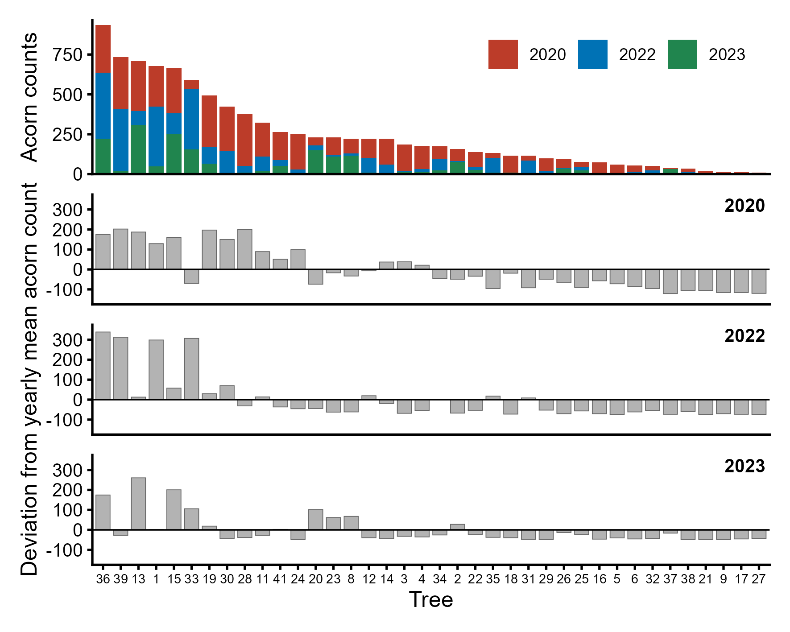
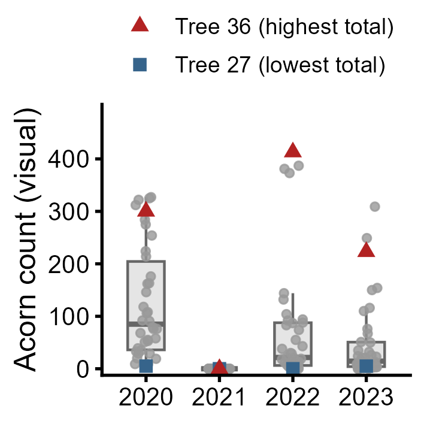
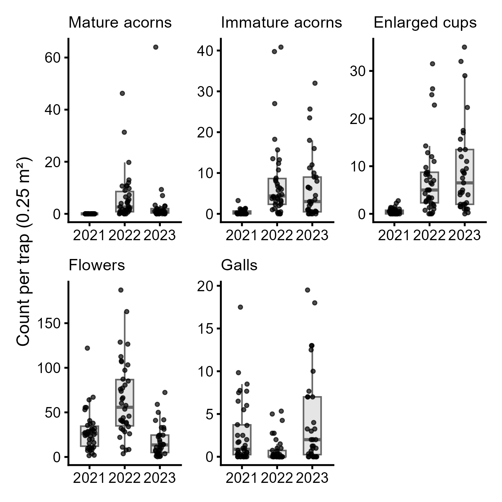
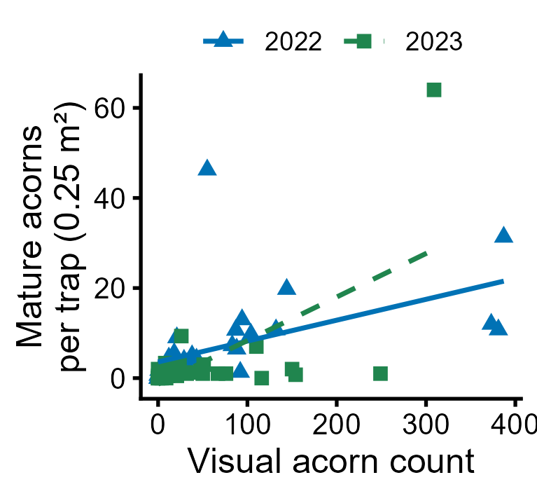
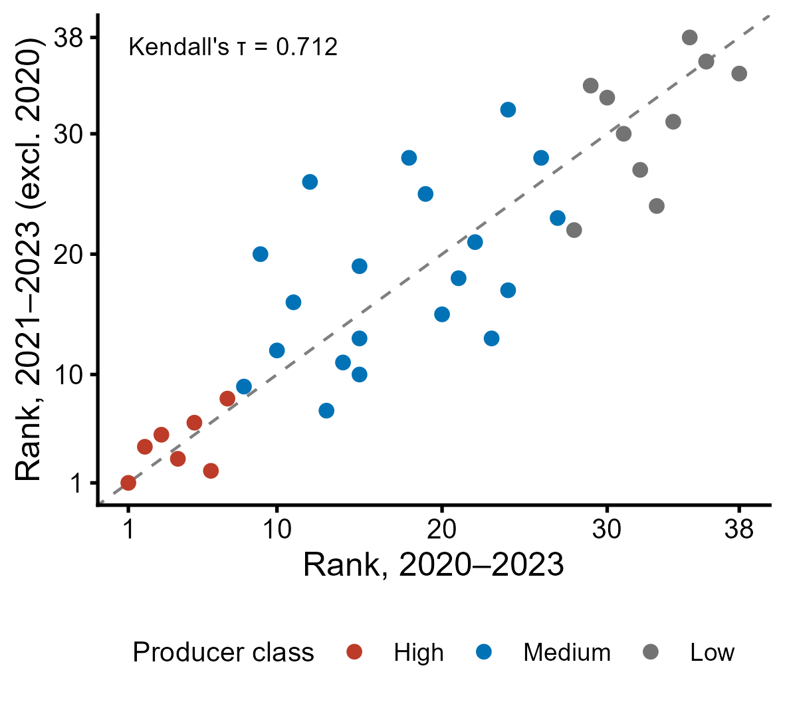
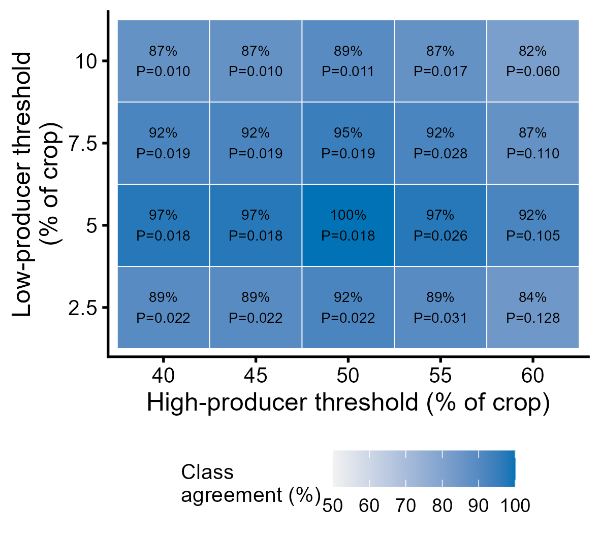

1. Inter-annual and inter-tree variability in acorn production
================

- [Data](#data)
- [Mature acorn production (visual
  survey)](#mature-acorn-production-visual-survey)
  - [Supplementary Table 1 and producer
    classes](#supplementary-table-1-and-producer-classes)
  - [Variability, synchrony and rank
    consistency](#variability-synchrony-and-rank-consistency)
  - [Producer classes: CV and crop
    share](#producer-classes-cv-and-crop-share)
  - [Figure 2](#figure-2)
- [Shed reproductive structures (litter
  traps)](#shed-reproductive-structures-litter-traps)
  - [Supplementary Tables 2–5](#supplementary-tables-25)
  - [Concentration of production among
    trees](#concentration-of-production-among-trees)
  - [Figure 1](#figure-1)
  - [Figure 3: visual counts vs. litter-trap mature
    acorns](#figure-3-visual-counts-vs-litter-trap-mature-acorns)
- [Robustness of producer classes (Supplementary Figure
  11)](#robustness-of-producer-classes-supplementary-figure-11)
- [Key results](#key-results)
- [Derived data for downstream
  analyses](#derived-data-for-downstream-analyses)

This notebook contains the analyses of mature-acorn production and shed
reproductive structures of the 38 study trees (Results: *Inter-annual
variability in acorn production*).

| Output | Content |
|----|----|
| Figure 1 | Annual visual counts (a) and litter-trap contents (b–f) |
| Figure 2 | Total visual acorn count per tree and yearly deviations |
| Figure 3 | Visual counts vs. litter-trap mature acorns |
| Supplementary Table 1 | Visual acorn counts per tree and year |
| Supplementary Tables 2–5 | Litter-trap immature acorns, enlarged cups, flowers, galls |
| Supplementary Figure 11 | Robustness of producer classes (2020 exclusion; class thresholds) |
| `data/derived/` | Tree-level response table and producer classes used downstream |

``` r
source("R/setup.R")
set.seed(2020)
```

# Data

Mature acorns were counted by visual survey each September (2020–2023).
Litter-trap contents (four 0.25 m² traps per tree) are stored as the
mean count per trap per tree and year (2021–2023).

``` r
viz  <- load_visual_counts()
trap <- load_litter_traps()

viz_wide <- viz |>
  pivot_wider(names_from = Year, values_from = Count) |>
  select(Tree, all_of(as.character(STUDY_YEARS)))

stopifnot(nrow(viz_wide) == 38, !anyNA(viz_wide))
cat("Visual survey:", n_distinct(viz$Tree), "trees x", n_distinct(viz$Year), "years\n")
cat("Litter traps :", n_distinct(trap$Tree), "trees;",
    "tree-years per year:", paste(table(trap$Year), collapse = " / "), "\n")
cat("Trees without 2023 litter-trap record (traps destroyed):",
    paste(setdiff(STUDY_TREES, trap$Tree[trap$Year == 2023]), collapse = ", "), "\n")
```

    #> Visual survey: 38 trees x 4 years
    #> Litter traps : 38 trees; tree-years per year: 38 / 38 / 33 
    #> Trees without 2023 litter-trap record (traps destroyed): 3, 6, 32, 34, 36

# Mature acorn production (visual survey)

## Supplementary Table 1 and producer classes

Trees are ranked by their total count over 2020–2023. Producer classes
follow the cumulative share of the total crop: **high** producers are
the top-ranked trees that together produce ≥ 50% of the crop, **medium**
producers are the following trees up to a cumulative share of ≥ 95%, and
the remaining trees (~5% of the crop) are **low** producers. The
per-tree coefficient of variation (CV) is computed across all four study
years, including the 2021 crop failure.

``` r
classify_producers <- function(total, high = 0.50, medium = 0.95) {
  ord   <- order(total, decreasing = TRUE)
  cum   <- cumsum(total[ord]) / sum(total)
  n_hi  <- which(cum >= high)[1]
  n_med <- which(cum >= medium)[1]
  cls   <- character(length(total))
  cls[ord] <- c(rep("High", n_hi), rep("Medium", n_med - n_hi),
                rep("Low", length(total) - n_med))
  factor(cls, levels = c("High", "Medium", "Low"))
}

cv <- function(x) sd(x) / mean(x)

viz_tree <- viz_wide |>
  mutate(Total = `2020` + `2021` + `2022` + `2023`,
         CV    = apply(across(`2020`:`2023`), 1, cv),
         Class = classify_producers(Total)) |>
  arrange(desc(Total)) |>
  mutate(Rank = row_number())

table(viz_tree$Class)
```

    #> 
    #>   High Medium    Low 
    #>      7     20     11

``` r
year_tot <- colSums(viz_wide[, -1])
pct <- function(x, tot) if (tot > 0) sprintf("%.2f%%", 100 * x / tot) else rep("na", length(x))

st1 <- viz_tree |>
  transmute(Tree,
            `2020` = `2020`, `% 2020` = pct(`2020`, year_tot["2020"]),
            `2021` = `2021`, `% 2021` = pct(`2021`, year_tot["2021"]),
            `2022` = `2022`, `% 2022` = pct(`2022`, year_tot["2022"]),
            `2023` = `2023`, `% 2023` = pct(`2023`, year_tot["2023"]),
            Total, `% Total` = pct(Total, sum(Total)),
            CV = round(CV, 2), Class)

st1_total <- tibble(Tree = "Total",
                    `2020` = year_tot[["2020"]], `% 2020` = "100%",
                    `2021` = year_tot[["2021"]], `% 2021` = "na",
                    `2022` = year_tot[["2022"]], `% 2022` = "100%",
                    `2023` = year_tot[["2023"]], `% 2023` = "100%",
                    Total = sum(viz_tree$Total), `% Total` = "100%",
                    CV = round(mean(viz_tree$CV), 2), Class = NA)

st1_out <- bind_rows(st1 |> mutate(Class = as.character(Class)), st1_total)
save_tab(st1_out, "SuppTable01_visual_counts")
knitr::kable(st1_out)
```

| Tree  | 2020 | % 2020 | 2021 | % 2021 | 2022 | % 2022 | 2023 | % 2023 | Total | % Total |   CV | Class  |
|:------|-----:|:-------|-----:|:-------|-----:|:-------|-----:|:-------|------:|:--------|-----:|:-------|
| 36    |  300 | 6.32%  |    0 | na     |  413 | 14.60% |  223 | 12.12% |   936 | 9.94%   | 0.75 | High   |
| 39    |  327 | 6.89%  |    0 | na     |  387 | 13.68% |   21 | 1.14%  |   735 | 7.81%   | 1.10 | High   |
| 13    |  312 | 6.57%  |    0 | na     |   87 | 3.08%  |  309 | 16.79% |   708 | 7.52%   | 0.89 | High   |
| 1     |  254 | 5.35%  |    0 | na     |  373 | 13.19% |   50 | 2.72%  |   677 | 7.19%   | 1.03 | High   |
| 15    |  284 | 5.98%  |    0 | na     |  132 | 4.67%  |  249 | 13.53% |   665 | 7.06%   | 0.77 | High   |
| 33    |   55 | 1.16%  |    0 | na     |  381 | 13.47% |  154 | 8.37%  |   590 | 6.27%   | 1.14 | High   |
| 19    |  322 | 6.78%  |    0 | na     |  104 | 3.68%  |   67 | 3.64%  |   493 | 5.24%   | 1.13 | High   |
| 30    |  275 | 5.79%  |    0 | na     |  144 | 5.09%  |    4 | 0.22%  |   423 | 4.49%   | 1.24 | Medium |
| 28    |  325 | 6.85%  |    0 | na     |   43 | 1.52%  |   10 | 0.54%  |   378 | 4.02%   | 1.64 | Medium |
| 11    |  214 | 4.51%  |    0 | na     |   88 | 3.11%  |   21 | 1.14%  |   323 | 3.43%   | 1.19 | Medium |
| 41    |  176 | 3.71%  |    0 | na     |   38 | 1.34%  |   51 | 2.77%  |   265 | 2.81%   | 1.15 | Medium |
| 24    |  224 | 4.72%  |    0 | na     |   29 | 1.03%  |    0 | 0.00%  |   253 | 2.69%   | 1.71 | Medium |
| 20    |   51 | 1.07%  |    0 | na     |   30 | 1.06%  |  150 | 8.15%  |   231 | 2.45%   | 1.12 | Medium |
| 23    |  108 | 2.28%  |    0 | na     |   12 | 0.42%  |  110 | 5.98%  |   230 | 2.44%   | 1.04 | Medium |
| 8     |   92 | 1.94%  |    0 | na     |   13 | 0.46%  |  116 | 6.30%  |   221 | 2.35%   | 1.04 | Medium |
| 12    |  118 | 2.49%  |    0 | na     |   94 | 3.32%  |    9 | 0.49%  |   221 | 2.35%   | 1.08 | Medium |
| 14    |  162 | 3.41%  |    0 | na     |   55 | 1.94%  |    4 | 0.22%  |   221 | 2.35%   | 1.37 | Medium |
| 3     |  163 | 3.43%  |    0 | na     |    6 | 0.21%  |   16 | 0.87%  |   185 | 1.97%   | 1.69 | Medium |
| 4     |  146 | 3.08%  |    0 | na     |   19 | 0.67%  |   13 | 0.71%  |   178 | 1.89%   | 1.53 | Medium |
| 34    |   79 | 1.66%  |    0 | na     |   74 | 2.62%  |   23 | 1.25%  |   176 | 1.87%   | 0.88 | Medium |
| 2     |   76 | 1.60%  |    0 | na     |    7 | 0.25%  |   76 | 4.13%  |   159 | 1.69%   | 1.06 | Medium |
| 22    |   91 | 1.92%  |    0 | na     |   21 | 0.74%  |   26 | 1.41%  |   138 | 1.47%   | 1.14 | Medium |
| 35    |   29 | 0.61%  |    0 | na     |   92 | 3.25%  |   11 | 0.60%  |   132 | 1.40%   | 1.25 | Medium |
| 18    |  106 | 2.23%  |    0 | na     |    2 | 0.07%  |    9 | 0.49%  |   117 | 1.24%   | 1.75 | Medium |
| 31    |   33 | 0.70%  |    0 | na     |   83 | 2.93%  |    1 | 0.05%  |   117 | 1.24%   | 1.33 | Medium |
| 29    |   76 | 1.60%  |    0 | na     |   22 | 0.78%  |    0 | 0.00%  |    98 | 1.04%   | 1.46 | Medium |
| 26    |   58 | 1.22%  |    0 | na     |    4 | 0.14%  |   35 | 1.90%  |    97 | 1.03%   | 1.13 | Medium |
| 25    |   35 | 0.74%  |    0 | na     |   18 | 0.64%  |   24 | 1.30%  |    77 | 0.82%   | 0.76 | Low    |
| 16    |   68 | 1.43%  |    0 | na     |    4 | 0.14%  |    2 | 0.11%  |    74 | 0.79%   | 1.79 | Low    |
| 5     |   53 | 1.12%  |    0 | na     |    0 | 0.00%  |    8 | 0.43%  |    61 | 0.65%   | 1.67 | Low    |
| 6     |   39 | 0.82%  |    0 | na     |   13 | 0.46%  |    3 | 0.16%  |    55 | 0.58%   | 1.29 | Low    |
| 32    |   29 | 0.61%  |    0 | na     |   19 | 0.67%  |    5 | 0.27%  |    53 | 0.56%   | 1.00 | Low    |
| 37    |    4 | 0.08%  |    0 | na     |    1 | 0.04%  |   32 | 1.74%  |    37 | 0.39%   | 1.65 | Low    |
| 38    |   20 | 0.42%  |    0 | na     |   15 | 0.53%  |    0 | 0.00%  |    35 | 0.37%   | 1.18 | Low    |
| 21    |   19 | 0.40%  |    0 | na     |    0 | 0.00%  |    0 | 0.00%  |    19 | 0.20%   | 2.00 | Low    |
| 9     |    9 | 0.19%  |    0 | na     |    4 | 0.14%  |    0 | 0.00%  |    13 | 0.14%   | 1.31 | Low    |
| 17    |    9 | 0.19%  |    0 | na     |    1 | 0.04%  |    3 | 0.16%  |    13 | 0.14%   | 1.24 | Low    |
| 27    |    5 | 0.11%  |    0 | na     |    0 | 0.00%  |    5 | 0.27%  |    10 | 0.11%   | 1.15 | Low    |
| Total | 4746 | 100%   |    0 | na     | 2828 | 100%   | 1840 | 100%   |  9414 | 100%    | 1.25 | NA     |

## Variability, synchrony and rank consistency

- **Individual CV**: mean of per-tree CVs across the four years.
- **Among-tree CV**: CV across trees within each productive year.
- **Synchrony**: mean pairwise Pearson correlation of the four-year
  count series across all 703 tree pairs, with a t-based 95% CI over
  pairs.
- **Lag-1 autocorrelation**: Pearson correlation between each tree’s
  counts in consecutive years (2020→2021, 2021→2022, 2022→2023),
  averaged across trees.
- **Rank consistency**: Kendall’s τ between each pair of productive
  years (2021 excluded: no tree produced mature acorns).

``` r
m <- as.matrix(viz_wide[, -1]); rownames(m) <- viz_wide$Tree

among_cv <- sapply(c("2020", "2022", "2023"), function(y) 100 * cv(m[, y]))

r_pairs <- cor(t(m))[upper.tri(diag(nrow(m)))]
sync_ci <- t.test(r_pairs)$conf.int

# undefined for trees whose 2021–2023 counts are constant (e.g. 0, 0, 0)
lag1_tree <- apply(m, 1, function(x) suppressWarnings(cor(x[-length(x)], x[-1])))
lag1_mean <- mean(lag1_tree, na.rm = TRUE)
cat("Lag-1 autocorrelation defined for", sum(!is.na(lag1_tree)), "of", length(lag1_tree), "trees\n")

tau_pairs <- combn(c("2020", "2022", "2023"), 2, function(y) {
  kt <- cor.test(m[, y[1]], m[, y[2]], method = "kendall", exact = FALSE)
  tibble(Years = paste(y, collapse = "–"), tau = unname(kt$estimate),
         z = unname(kt$statistic), P = kt$p.value)
}, simplify = FALSE) |> bind_rows()

knitr::kable(tau_pairs, digits = 3, caption = "Kendall rank correlations between productive years")
```

    #> Lag-1 autocorrelation defined for 37 of 38 trees

| Years     |   tau |     z |     P |
|:----------|------:|------:|------:|
| 2020–2022 | 0.469 | 4.115 | 0.000 |
| 2020–2023 | 0.287 | 2.507 | 0.012 |
| 2022–2023 | 0.256 | 2.231 | 0.026 |

Kendall rank correlations between productive years

## Producer classes: CV and crop share

``` r
class_summary <- viz_tree |>
  group_by(Class) |>
  summarise(n_trees = n(),
            crop_share_pct = 100 * sum(Total) / sum(viz_tree$Total),
            CV_mean = mean(CV), CV_se = sd(CV) / sqrt(n()), .groups = "drop")
knitr::kable(class_summary, digits = 3)

cv_aov   <- aov(CV ~ Class, data = viz_tree)
cv_anova <- summary(cv_aov)[[1]]
cv_tukey <- TukeyHSD(cv_aov)$Class
cv_anova
cv_tukey
```

| Class  | n_trees | crop_share_pct | CV_mean | CV_se |
|:-------|--------:|---------------:|--------:|------:|
| High   |       7 |         51.030 |   0.973 | 0.064 |
| Medium |      20 |         44.221 |   1.290 | 0.058 |
| Low    |      11 |          4.748 |   1.367 | 0.111 |

    #>             Df  Sum Sq Mean Sq F value  Pr(>F)  
    #> Class        2 0.71864 0.35932  4.4979 0.01826 *
    #> Residuals   35 2.79599 0.07989                  
    #> ---
    #> Signif. codes:  0 '***' 0.001 '**' 0.01 '*' 0.05 '.' 0.1 ' ' 1
    #>                   diff         lwr       upr      p adj
    #> Medium-High 0.31666314  0.01290014 0.6204261 0.03952302
    #> Low-High    0.39400796  0.05957591 0.7284400 0.01791439
    #> Low-Medium  0.07734482 -0.18230409 0.3369937 0.74808475

## Figure 2

``` r
tree_levels <- viz_tree$Tree

fig2_top <- viz |>
  filter(Year != 2021) |>
  mutate(Tree = factor(Tree, levels = tree_levels), Year = factor(Year)) |>
  ggplot(aes(Tree, Count, fill = Year)) +
  geom_col(width = 0.85) +
  scale_fill_manual(values = YEAR_COLS, name = NULL) +
  scale_y_continuous(expand = expansion(mult = c(0, 0.03))) +
  labs(x = NULL, y = "Acorn counts") +
  theme(axis.text.x = element_blank(), axis.ticks.x = element_blank(),
        legend.position = "inside", legend.position.inside = c(0.98, 0.95),
        legend.justification = c(1, 1), legend.direction = "horizontal")

dev_panel <- function(yr, xlab = FALSE) {
  d <- viz |>
    filter(Year == yr) |>
    mutate(Deviation = Count - mean(Count),
           Tree = factor(Tree, levels = tree_levels))
  p <- ggplot(d, aes(Tree, Deviation)) +
    geom_col(fill = "grey70", colour = "grey40", width = 0.8, linewidth = 0.2) +
    geom_hline(yintercept = 0, linewidth = 0.4) +
    annotate("text", x = Inf, y = Inf, label = yr, hjust = 1.1, vjust = 1.3,
             fontface = "bold", size = 3.5) +
    scale_y_continuous(limits = c(-150, 350)) +
    labs(x = if (xlab) "Tree" else NULL, y = NULL)
  if (!xlab) p <- p + theme(axis.text.x = element_blank(), axis.ticks.x = element_blank())
  else       p <- p + theme(axis.text.x = element_text(size = 7))
  p
}

fig2 <- fig2_top / dev_panel(2020) / (dev_panel(2022) + labs(y = "Deviation from yearly mean acorn count")) /
  dev_panel(2023, xlab = TRUE) + plot_layout(heights = c(1.4, 1, 1, 1))
save_fig(fig2, "Figure2", width = 150, height = 120)
```



# Shed reproductive structures (litter traps)

## Supplementary Tables 2–5

Tables list the mean count per 0.25 m² trap for each year, each tree’s
share of the yearly total, and the three-year total, with trees ordered
as in Supplementary Table 1. `na`: traps destroyed in 2023.

``` r
litter_table <- function(var) {
  d <- trap |>
    select(Tree, Year, value = all_of(var)) |>
    pivot_wider(names_from = Year, values_from = value) |>
    right_join(tibble(Tree = tree_levels), by = "Tree") |>
    mutate(Tree = factor(Tree, levels = tree_levels)) |>
    arrange(Tree)
  tot_y <- colSums(d[, c("2021", "2022", "2023")], na.rm = TRUE)
  d <- d |> mutate(Total = rowSums(across(`2021`:`2023`), na.rm = TRUE))
  f2 <- function(x) ifelse(is.na(x), "na", formatC(x, format = "f", digits = 2))
  pc <- function(x, t) ifelse(is.na(x), "na", sprintf("%.2f%%", 100 * x / t))
  out <- tibble(Tree = as.character(d$Tree),
                `2021` = f2(d$`2021`), `% 2021` = pc(d$`2021`, tot_y[["2021"]]),
                `2022` = f2(d$`2022`), `% 2022` = pc(d$`2022`, tot_y[["2022"]]),
                `2023` = f2(d$`2023`), `% 2023` = pc(d$`2023`, tot_y[["2023"]]),
                Total  = f2(d$Total),  `% Total` = pc(d$Total, sum(d$Total)))
  bind_rows(out, tibble(Tree = "Total",
                        `2021` = f2(tot_y[["2021"]]), `% 2021` = "100%",
                        `2022` = f2(tot_y[["2022"]]), `% 2022` = "100%",
                        `2023` = f2(tot_y[["2023"]]), `% 2023` = "100%",
                        Total = f2(sum(d$Total)), `% Total` = "100%"))
}

supp_litter <- c(SuppTable02_immature_acorns = "IMMAT_ACORNS",
                 SuppTable03_enlarged_cups   = "ENLARGED_CUPS",
                 SuppTable04_flowers         = "FLOWERS",
                 SuppTable05_galls           = "GALLS")
for (nm in names(supp_litter)) save_tab(litter_table(supp_litter[[nm]]), nm)
knitr::kable(litter_table("IMMAT_ACORNS"), caption = "Supplementary Table 2 (immature acorns)")
```

| Tree  | 2021  | % 2021 | 2022   | % 2022 | 2023   | % 2023 | Total  | % Total |
|:------|:------|:-------|:-------|:-------|:-------|:-------|:-------|:--------|
| 36    | 0.00  | 0.00%  | 3.00   | 1.01%  | na     | na     | 3.00   | 0.56%   |
| 39    | 0.25  | 1.43%  | 40.83  | 13.75% | 4.50   | 2.07%  | 45.58  | 8.56%   |
| 13    | 0.00  | 0.00%  | 6.33   | 2.13%  | 32.00  | 14.69% | 38.33  | 7.20%   |
| 1     | 0.50  | 2.86%  | 15.67  | 5.28%  | 9.00   | 4.13%  | 25.17  | 4.73%   |
| 15    | 1.33  | 7.62%  | 18.25  | 6.15%  | 23.50  | 10.79% | 43.08  | 8.09%   |
| 33    | 0.33  | 1.90%  | 27.00  | 9.09%  | 11.25  | 5.16%  | 38.58  | 7.25%   |
| 19    | 0.00  | 0.00%  | 13.50  | 4.55%  | 3.00   | 1.38%  | 16.50  | 3.10%   |
| 30    | 1.25  | 7.14%  | 8.75   | 2.95%  | 0.00   | 0.00%  | 10.00  | 1.88%   |
| 28    | 0.00  | 0.00%  | 13.25  | 4.46%  | 6.50   | 2.98%  | 19.75  | 3.71%   |
| 11    | 0.25  | 1.43%  | 4.00   | 1.35%  | 0.50   | 0.23%  | 4.75   | 0.89%   |
| 41    | 1.00  | 5.71%  | 6.00   | 2.02%  | 10.00  | 4.59%  | 17.00  | 3.19%   |
| 24    | 0.00  | 0.00%  | 3.33   | 1.12%  | 0.00   | 0.00%  | 3.33   | 0.63%   |
| 20    | 1.00  | 5.71%  | 2.00   | 0.67%  | 1.00   | 0.46%  | 4.00   | 0.75%   |
| 23    | 0.75  | 4.29%  | 3.00   | 1.01%  | 18.00  | 8.26%  | 21.75  | 4.09%   |
| 8     | 0.50  | 2.86%  | 0.50   | 0.17%  | 6.50   | 2.98%  | 7.50   | 1.41%   |
| 12    | 0.00  | 0.00%  | 5.75   | 1.94%  | 0.50   | 0.23%  | 6.25   | 1.17%   |
| 14    | 0.00  | 0.00%  | 39.75  | 13.39% | 2.00   | 0.92%  | 41.75  | 7.84%   |
| 3     | 0.25  | 1.43%  | 4.00   | 1.35%  | na     | na     | 4.25   | 0.80%   |
| 4     | 0.50  | 2.86%  | 12.33  | 4.15%  | 16.00  | 7.35%  | 28.83  | 5.42%   |
| 34    | 0.00  | 0.00%  | 7.33   | 2.47%  | na     | na     | 7.33   | 1.38%   |
| 2     | 0.25  | 1.43%  | 1.25   | 0.42%  | 2.50   | 1.15%  | 4.00   | 0.75%   |
| 22    | 3.25  | 18.57% | 8.00   | 2.69%  | 25.67  | 11.78% | 36.92  | 6.94%   |
| 35    | 1.08  | 6.19%  | 2.33   | 0.79%  | 0.00   | 0.00%  | 3.42   | 0.64%   |
| 18    | 1.00  | 5.71%  | 0.33   | 0.11%  | 1.00   | 0.46%  | 2.33   | 0.44%   |
| 31    | 0.50  | 2.86%  | 10.75  | 3.62%  | 3.50   | 1.61%  | 14.75  | 2.77%   |
| 29    | 0.25  | 1.43%  | 4.50   | 1.52%  | 0.50   | 0.23%  | 5.25   | 0.99%   |
| 26    | 0.25  | 1.43%  | 4.25   | 1.43%  | 6.25   | 2.87%  | 10.75  | 2.02%   |
| 25    | 0.75  | 4.29%  | 6.75   | 2.27%  | 8.00   | 3.67%  | 15.50  | 2.91%   |
| 16    | 0.00  | 0.00%  | 4.75   | 1.60%  | 0.00   | 0.00%  | 4.75   | 0.89%   |
| 5     | 0.00  | 0.00%  | 2.33   | 0.79%  | 3.00   | 1.38%  | 5.33   | 1.00%   |
| 6     | 0.00  | 0.00%  | 0.00   | 0.00%  | na     | na     | 0.00   | 0.00%   |
| 32    | 0.00  | 0.00%  | 0.00   | 0.00%  | na     | na     | 0.00   | 0.00%   |
| 37    | 0.00  | 0.00%  | 0.00   | 0.00%  | 9.00   | 4.13%  | 9.00   | 1.69%   |
| 38    | 0.00  | 0.00%  | 8.33   | 2.81%  | 0.50   | 0.23%  | 8.83   | 1.66%   |
| 21    | 0.50  | 2.86%  | 3.67   | 1.23%  | 12.00  | 5.51%  | 16.17  | 3.04%   |
| 9     | 0.00  | 0.00%  | 1.00   | 0.34%  | 0.00   | 0.00%  | 1.00   | 0.19%   |
| 17    | 1.25  | 7.14%  | 3.75   | 1.26%  | 1.00   | 0.46%  | 6.00   | 1.13%   |
| 27    | 0.50  | 2.86%  | 0.33   | 0.11%  | 0.67   | 0.31%  | 1.50   | 0.28%   |
| Total | 17.50 | 100%   | 296.92 | 100%   | 217.83 | 100%   | 532.25 | 100%    |

Supplementary Table 2 (immature acorns)

## Concentration of production among trees

For each litter-trap category, the number of top-ranked trees needed to
reach 50% of the three-year total, the share of the seven top trees, and
how many of those trees are high (mature-acorn) producers.

``` r
high_trees <- viz_tree$Tree[viz_tree$Class == "High"]

concentration <- map_dfr(LITTER_VARS, function(v) {
  tot <- trap |> group_by(Tree) |> summarise(x = sum(.data[[v]], na.rm = TRUE)) |>
    arrange(desc(x))
  cum <- cumsum(tot$x) / sum(tot$x)
  n50 <- which(cum >= 0.5)[1]
  tibble(Variable = v,
         n_trees_for_50pct = n50,
         top7_share_pct = 100 * cum[7],
         high_producers_in_top_n50 = sum(tot$Tree[1:n50] %in% high_trees))
})
knitr::kable(concentration, digits = 1)
```

| Variable      | n_trees_for_50pct | top7_share_pct | high_producers_in_top_n50 |
|:--------------|------------------:|---------------:|--------------------------:|
| MATURE_ACORNS |                 4 |           63.9 |                         2 |
| IMMAT_ACORNS  |                 7 |           51.3 |                         4 |
| ENLARGED_CUPS |                 9 |           43.4 |                         2 |
| FLOWERS       |                12 |           33.6 |                         4 |
| GALLS         |                 6 |           57.4 |                         2 |

## Figure 1

``` r
focal <- c("36" = "Tree 36 (highest total)", "27" = "Tree 27 (lowest total)")

viz_plot <- viz |> mutate(Year = factor(Year),
                          Focal = factor(focal[Tree], levels = focal))

fig1a <- ggplot(viz_plot, aes(Year, Count)) +
  geom_boxplot(outlier.shape = NA, fill = "grey90", colour = "grey40", width = 0.5) +
  geom_jitter(data = filter(viz_plot, is.na(Focal)), colour = "grey60",
              size = 1.3, alpha = 0.8, width = 0.15, height = 0) +
  geom_point(data = filter(viz_plot, !is.na(Focal)),
             aes(shape = Focal, colour = Focal), size = 2.2) +
  scale_shape_manual(values = c(17, 15), name = NULL) +
  scale_colour_manual(values = c("firebrick", "steelblue4"), name = NULL) +
  scale_y_continuous(breaks = seq(0, 400, 100), expand = expansion(mult = c(0.03, 0.22))) +
  labs(x = NULL, y = "Acorn count (visual)") +
  guides(shape = guide_legend(nrow = 2), colour = guide_legend(nrow = 2)) +
  theme(legend.position = "top", legend.margin = margin(0, 0, 0, 0),
        legend.spacing.y = unit(0, "pt"), legend.key.height = unit(10, "pt"))

trap_long <- trap |>
  pivot_longer(all_of(LITTER_VARS), names_to = "Category", values_to = "Count") |>
  mutate(Year = factor(Year))

litter_panel <- function(v) {
  ggplot(filter(trap_long, Category == v), aes(Year, Count)) +
    geom_boxplot(outlier.shape = NA, fill = "grey90", colour = "grey40", width = 0.5) +
    geom_jitter(size = 1, alpha = 0.7, width = 0.15, height = 0) +
    labs(x = NULL, y = "Count per trap (0.25 m²)", subtitle = VAR_LABELS[[v]])
}
lp <- map(LITTER_VARS, litter_panel)
lp[[1]] <- lp[[1]] + labs(subtitle = "Mature acorns")

fig1b_f <- wrap_plots(lp, ncol = 3) + plot_layout(axis_titles = "collect")

save_fig(fig1a, "Figure1a", width = 60, height = 60)
```



``` r
save_fig(fig1b_f, "Figure1b-f", width = 120, height = 120)
```



## Figure 3: visual counts vs. litter-trap mature acorns

Trees whose traps were destroyed in 2023 (3, 6, 32, 34, 36) are
excluded. No mature acorns were recorded by either method in 2021.

``` r
DAMAGED <- c("3", "6", "32", "34", "36")

method_cmp <- inner_join(viz, trap |> select(Tree, Year, MATURE_ACORNS),
                         by = c("Tree", "Year")) |>
  filter(!Tree %in% DAMAGED)

ktest <- function(d) {
  kt <- cor.test(d$Count, d$MATURE_ACORNS, method = "kendall", exact = FALSE)
  tibble(n = nrow(d), tau = unname(kt$estimate), z = unname(kt$statistic), P = kt$p.value)
}
method_tau <- bind_rows(
  ktest(filter(method_cmp, Year == 2022)) |> mutate(Data = "2022"),
  ktest(filter(method_cmp, Year == 2023)) |> mutate(Data = "2023"),
  ktest(filter(method_cmp, Year %in% 2022:2023)) |> mutate(Data = "2022–2023 pooled")
) |> relocate(Data)
knitr::kable(method_tau, digits = 3)
```

| Data             |   n |   tau |     z |     P |
|:-----------------|----:|------:|------:|------:|
| 2022             |  33 | 0.688 | 5.559 | 0.000 |
| 2023             |  33 | 0.405 | 3.123 | 0.002 |
| 2022–2023 pooled |  66 | 0.530 | 6.090 | 0.000 |

``` r
fig3 <- method_cmp |>
  filter(Year != 2021) |>
  mutate(Year = factor(Year)) |>
  ggplot(aes(Count, MATURE_ACORNS, colour = Year, shape = Year, linetype = Year)) +
  geom_point(size = 2) +
  geom_smooth(method = "lm", formula = y ~ x, se = FALSE, linewidth = 0.8) +
  scale_colour_manual(values = YEAR_COLS[c("2022", "2023")], name = NULL) +
  scale_shape_manual(values = c("2022" = 17, "2023" = 15), name = NULL) +
  scale_linetype_manual(values = c("2022" = "solid", "2023" = "dashed"), name = NULL) +
  labs(x = "Visual acorn count", y = "Mature acorns\nper trap (0.25 m²)") +
  theme(legend.position = "top", legend.margin = margin(0, 0, -8, 0))
save_fig(fig3, "Figure3", width = 65, height = 60)
```



# Robustness of producer classes (Supplementary Figure 11)

**(a) Exclusion of the 2020 mast year.** Trees are re-ranked on their
2021–2023 totals and compared with the 2020–2023 ranking.

**(b) Class thresholds.** The cumulative-share thresholds defining high
(40–60%) and low (2.5–10% of the crop) producers are varied. For each
combination we record the proportion of trees keeping their class and
the one-way ANOVA of per-tree CV among classes.

``` r
rank_cmp <- viz_tree |>
  mutate(Total_no2020 = `2021` + `2022` + `2023`,
         Rank_all    = rank(-Total, ties.method = "min"),
         Rank_no2020 = rank(-Total_no2020, ties.method = "min"))
tau_no2020 <- cor.test(rank_cmp$Rank_all, rank_cmp$Rank_no2020,
                       method = "kendall", exact = FALSE)

grid <- expand_grid(high = c(0.40, 0.45, 0.50, 0.55, 0.60),
                    low  = c(0.025, 0.05, 0.075, 0.10))
threshold_sens <- pmap_dfr(grid, function(high, low) {
  cls <- classify_producers(viz_tree$Total, high = high, medium = 1 - low)
  a   <- summary(aov(viz_tree$CV ~ cls))[[1]]
  mcv <- tapply(viz_tree$CV, cls, mean)
  tibble(high_pct = 100 * high, low_pct = 100 * low,
         n_high = sum(cls == "High"), n_medium = sum(cls == "Medium"), n_low = sum(cls == "Low"),
         agreement_pct = 100 * mean(cls == viz_tree$Class),
         F = a$`F value`[1], df1 = a$Df[1], df2 = a$Df[2], P = a$`Pr(>F)`[1],
         high_lowest_CV = mcv[["High"]] == min(mcv))
})
save_tab(threshold_sens |> mutate(across(c(F, P), ~ signif(.x, 4))),
         "SuppFig11_threshold_sensitivity")
knitr::kable(threshold_sens, digits = 3)
```

| high_pct | low_pct | n_high | n_medium | n_low | agreement_pct | F | df1 | df2 | P | high_lowest_CV |
|---:|---:|---:|---:|---:|---:|---:|---:|---:|---:|:---|
| 40 | 2.5 | 6 | 24 | 8 | 89.474 | 4.271 | 2 | 35 | 0.022 | TRUE |
| 40 | 5.0 | 6 | 21 | 11 | 97.368 | 4.534 | 2 | 35 | 0.018 | TRUE |
| 40 | 7.5 | 6 | 19 | 13 | 92.105 | 4.472 | 2 | 35 | 0.019 | TRUE |
| 40 | 10.0 | 6 | 17 | 15 | 86.842 | 5.231 | 2 | 35 | 0.010 | TRUE |
| 45 | 2.5 | 6 | 24 | 8 | 89.474 | 4.271 | 2 | 35 | 0.022 | TRUE |
| 45 | 5.0 | 6 | 21 | 11 | 97.368 | 4.534 | 2 | 35 | 0.018 | TRUE |
| 45 | 7.5 | 6 | 19 | 13 | 92.105 | 4.472 | 2 | 35 | 0.019 | TRUE |
| 45 | 10.0 | 6 | 17 | 15 | 86.842 | 5.231 | 2 | 35 | 0.010 | TRUE |
| 50 | 2.5 | 7 | 23 | 8 | 92.105 | 4.275 | 2 | 35 | 0.022 | TRUE |
| 50 | 5.0 | 7 | 20 | 11 | 100.000 | 4.498 | 2 | 35 | 0.018 | TRUE |
| 50 | 7.5 | 7 | 18 | 13 | 94.737 | 4.433 | 2 | 35 | 0.019 | TRUE |
| 50 | 10.0 | 7 | 16 | 15 | 89.474 | 5.118 | 2 | 35 | 0.011 | TRUE |
| 55 | 2.5 | 8 | 22 | 8 | 89.474 | 3.834 | 2 | 35 | 0.031 | TRUE |
| 55 | 5.0 | 8 | 19 | 11 | 97.368 | 4.035 | 2 | 35 | 0.026 | TRUE |
| 55 | 7.5 | 8 | 17 | 13 | 92.105 | 3.973 | 2 | 35 | 0.028 | TRUE |
| 55 | 10.0 | 8 | 15 | 15 | 86.842 | 4.611 | 2 | 35 | 0.017 | TRUE |
| 60 | 2.5 | 10 | 20 | 8 | 84.211 | 2.180 | 2 | 35 | 0.128 | TRUE |
| 60 | 5.0 | 10 | 17 | 11 | 92.105 | 2.405 | 2 | 35 | 0.105 | TRUE |
| 60 | 7.5 | 10 | 15 | 13 | 86.842 | 2.357 | 2 | 35 | 0.110 | TRUE |
| 60 | 10.0 | 10 | 13 | 15 | 81.579 | 3.054 | 2 | 35 | 0.060 | TRUE |

``` r
sf11a <- ggplot(rank_cmp, aes(Rank_all, Rank_no2020, colour = Class)) +
  geom_abline(slope = 1, intercept = 0, linetype = "dashed", colour = "grey50") +
  geom_point(size = 2) +
  annotate("text", x = 1, y = 38, hjust = 0, vjust = 1, size = 3.2,
           label = sprintf("Kendall's τ = %.3f", tau_no2020$estimate)) +
  scale_colour_manual(values = CLASS_COLS, name = "Producer class") +
  scale_x_continuous(breaks = c(1, 10, 20, 30, 38)) +
  scale_y_continuous(breaks = c(1, 10, 20, 30, 38)) +
  labs(x = "Rank, 2020–2023", y = "Rank, 2021–2023 (excl. 2020)") +
  theme(legend.position = "bottom")

sf11b <- threshold_sens |>
  mutate(label = sprintf("%.0f%%\nP=%.3f", agreement_pct, P)) |>
  ggplot(aes(factor(high_pct), factor(low_pct), fill = agreement_pct)) +
  geom_tile(colour = "white") +
  geom_text(aes(label = label), size = 2.4) +
  scale_fill_gradient(low = "grey95", high = "#0072B5", limits = c(50, 100),
                      name = "Class\nagreement (%)") +
  labs(x = "High-producer threshold (% of crop)",
       y = "Low-producer threshold\n(% of crop)") +
  theme(legend.position = "bottom")

save_fig(sf11a, "SuppFig11a_producer_rank_comparison", width = 100, height = 90)
```



``` r
save_fig(sf11b, "SuppFig11b_producer_threshold_grid", width = 100, height = 90)
```



# Key results

``` r
hi <- class_summary |> filter(Class == "High")
md <- class_summary |> filter(Class == "Medium")
lo <- class_summary |> filter(Class == "Low")

key01 <- tribble(
  ~Statistic, ~Value,
  "Trees in study panel", as.character(nrow(viz_tree)),
  "2020 visual count range", sprintf("%d–%d", min(m[, "2020"]), max(m[, "2020"])),
  "Highest total (Tree 36) / margin over 2nd", sprintf("%d / %d", viz_tree$Total[1], viz_tree$Total[1] - viz_tree$Total[2]),
  "Lowest total", sprintf("Tree %s (%d)", viz_tree$Tree[38], viz_tree$Total[38]),
  "Mean individual CV (%)", sprintf("%.1f", 100 * mean(viz_tree$CV)),
  "Among-tree CV 2020 / 2022 / 2023 (%)", paste(sprintf("%.1f", among_cv), collapse = " / "),
  "Synchrony, mean pairwise r (95% CI)", sprintf("%.2f (%.2f–%.2f)", mean(r_pairs), sync_ci[1], sync_ci[2]),
  "Lag-1 autocorrelation (mean of per-tree correlations)",
    sprintf("%.2f (n = %d trees)", lag1_mean, sum(!is.na(lag1_tree))),
  "Kendall tau 2020–22 / 2020–23 / 2022–23", paste(sprintf("%.2f", tau_pairs$tau), collapse = " / "),
  "High producers: n, crop share", sprintf("%d, %.1f%%", hi$n_trees, hi$crop_share_pct),
  "Medium producers: n, crop share", sprintf("%d, %.1f%%", md$n_trees, md$crop_share_pct),
  "Low producers: n, crop share", sprintf("%d, %.1f%%", lo$n_trees, lo$crop_share_pct),
  "CV (mean ± SE) high / medium / low", sprintf("%.2f ± %.2f / %.2f ± %.2f / %.2f ± %.2f",
     hi$CV_mean, hi$CV_se, md$CV_mean, md$CV_se, lo$CV_mean, lo$CV_se),
  "ANOVA CV ~ class", sprintf("F(%d,%d) = %.2f, P = %.3f", cv_anova$Df[1], cv_anova$Df[2],
                              cv_anova$`F value`[1], cv_anova$`Pr(>F)`[1]),
  "Tukey High vs Medium / High vs Low (P)", sprintf("%.3f / %.3f",
     cv_tukey["Medium-High", "p adj"], cv_tukey["Low-High", "p adj"]),
  "Visual vs trap, 2022 (tau, z)", sprintf("%.2f, %.2f", method_tau$tau[1], method_tau$z[1]),
  "Visual vs trap, 2023 (tau, z)", sprintf("%.2f, %.2f", method_tau$tau[2], method_tau$z[2]),
  "Visual vs trap, 2022–2023 pooled (tau, z)", sprintf("%.2f, %.2f", method_tau$tau[3], method_tau$z[3]),
  "Rank tau, all years vs excl. 2020", sprintf("%.3f", tau_no2020$estimate),
  "Threshold combinations with P < 0.05 for CV ~ class", sprintf("%d of %d", sum(threshold_sens$P < 0.05), nrow(threshold_sens))
) |> mutate(Value = as.character(Value))
save_tab(key01, "key_results_01_acorn_production")
knitr::kable(key01)
```

| Statistic | Value |
|:---|:---|
| Trees in study panel | 38 |
| 2020 visual count range | 4–327 |
| Highest total (Tree 36) / margin over 2nd | 936 / 201 |
| Lowest total | Tree 27 (10) |
| Mean individual CV (%) | 125.4 |
| Among-tree CV 2020 / 2022 / 2023 (%) | 86.0 / 156.0 / 156.0 |
| Synchrony, mean pairwise r (95% CI) | 0.57 (0.54–0.60) |
| Lag-1 autocorrelation (mean of per-tree correlations) | -0.72 (n = 37 trees) |
| Kendall tau 2020–22 / 2020–23 / 2022–23 | 0.47 / 0.29 / 0.26 |
| High producers: n, crop share | 7, 51.0% |
| Medium producers: n, crop share | 20, 44.2% |
| Low producers: n, crop share | 11, 4.7% |
| CV (mean ± SE) high / medium / low | 0.97 ± 0.06 / 1.29 ± 0.06 / 1.37 ± 0.11 |
| ANOVA CV ~ class | F(2,35) = 4.50, P = 0.018 |
| Tukey High vs Medium / High vs Low (P) | 0.040 / 0.018 |
| Visual vs trap, 2022 (tau, z) | 0.69, 5.56 |
| Visual vs trap, 2023 (tau, z) | 0.40, 3.12 |
| Visual vs trap, 2022–2023 pooled (tau, z) | 0.53, 6.09 |
| Rank tau, all years vs excl. 2020 | 0.712 |
| Threshold combinations with P \< 0.05 for CV ~ class | 16 of 20 |

# Derived data for downstream analyses

`tree_reproduction.csv` holds one row per tree with the response
variables used in the association analyses:

- `VIZ_COUNT` – mean visual count over 2020–2022 (response in the VSURF,
  GLM and descriptive statistics of Table 1);
- `VIZ_COUNT_2020_2023` – mean visual count over all four years (GWAS
  phenotype);
- litter-trap variables – mean count per 0.25 m² trap over the available
  years 2021–2023.

``` r
tree_repro <- viz_wide |>
  transmute(Tree,
            VIZ_COUNT           = (`2020` + `2021` + `2022`) / 3,
            VIZ_COUNT_2020_2023 = (`2020` + `2021` + `2022` + `2023`) / 4) |>
  left_join(trap |> group_by(Tree) |>
              summarise(across(all_of(LITTER_VARS), mean), .groups = "drop"),
            by = "Tree") |>
  left_join(viz_tree |> select(Tree, Total_visual = Total, CV_visual = CV, Class),
            by = "Tree")

write_csv(tree_repro, file.path(DIR_DERIVED, "tree_reproduction.csv"))
write_csv(viz_tree |> select(Tree, Rank, Total, Class),
          file.path(DIR_DERIVED, "producer_classes.csv"))
glimpse(tree_repro)
```

    #> Rows: 38
    #> Columns: 11
    #> $ Tree                <chr> "1", "2", "3", "4", "5", "6", "8", "9", "11", "12"…
    #> $ VIZ_COUNT           <dbl> 209.000000, 27.666667, 56.333333, 55.000000, 17.66…
    #> $ VIZ_COUNT_2020_2023 <dbl> 169.25, 39.75, 46.25, 44.50, 15.25, 13.75, 55.25, …
    #> $ MATURE_ACORNS       <dbl> 4.33333333, 0.75000000, 0.75000000, 1.16666667, 1.…
    #> $ IMMAT_ACORNS        <dbl> 8.3888889, 1.3333333, 2.1250000, 9.6111111, 1.7777…
    #> $ ENLARGED_CUPS       <dbl> 17.5277778, 2.4166667, 1.8750000, 5.6944444, 1.444…
    #> $ FLOWERS             <dbl> 94.722222, 28.000000, 37.125000, 57.055556, 25.888…
    #> $ GALLS               <dbl> 8.69444444, 4.58333333, 0.87500000, 3.16666667, 0.…
    #> $ Total_visual        <dbl> 677, 159, 185, 178, 61, 55, 221, 13, 323, 221, 708…
    #> $ CV_visual           <dbl> 1.0322149, 1.0554801, 1.6889218, 1.5310062, 1.6686…
    #> $ Class               <fct> High, Medium, Medium, Medium, Low, Low, Medium, Lo…

``` r
sessionInfo()
```

    #> R version 4.5.2 (2025-10-31 ucrt)
    #> Platform: x86_64-w64-mingw32/x64
    #> Running under: Windows 11 x64 (build 26200)
    #> 
    #> Matrix products: default
    #>   LAPACK version 3.12.1
    #> 
    #> locale:
    #> [1] LC_COLLATE=English_United Kingdom.utf8 
    #> [2] LC_CTYPE=English_United Kingdom.utf8   
    #> [3] LC_MONETARY=English_United Kingdom.utf8
    #> [4] LC_NUMERIC=C                           
    #> [5] LC_TIME=English_United Kingdom.utf8    
    #> 
    #> time zone: Europe/London
    #> tzcode source: internal
    #> 
    #> attached base packages:
    #> [1] stats     graphics  grDevices utils     datasets  methods   base     
    #> 
    #> other attached packages:
    #>  [1] patchwork_1.3.2 readxl_1.4.5    lubridate_1.9.4 forcats_1.0.1  
    #>  [5] stringr_1.6.0   dplyr_1.1.4     purrr_1.2.2     readr_2.1.6    
    #>  [9] tidyr_1.3.1     tibble_3.3.0    ggplot2_4.0.1   tidyverse_2.0.0
    #> 
    #> loaded via a namespace (and not attached):
    #>  [1] generics_0.1.4     lattice_0.22-7     stringi_1.8.7      hms_1.1.4         
    #>  [5] digest_0.6.39      magrittr_2.0.4     evaluate_1.0.5     grid_4.5.2        
    #>  [9] timechange_0.3.0   RColorBrewer_1.1-3 fastmap_1.2.0      Matrix_1.7-4      
    #> [13] cellranger_1.1.0   mgcv_1.9-3         scales_1.4.0       textshaping_1.0.5 
    #> [17] cli_3.6.5          rlang_1.2.0        crayon_1.5.3       splines_4.5.2     
    #> [21] bit64_4.6.0-1      withr_3.0.2        yaml_2.3.12        otel_0.2.0        
    #> [25] tools_4.5.2        parallel_4.5.2     tzdb_0.5.0         vctrs_0.7.3       
    #> [29] R6_2.6.1           lifecycle_1.0.5    bit_4.6.0          vroom_1.7.0       
    #> [33] ragg_1.5.1         pkgconfig_2.0.3    pillar_1.11.1      gtable_0.3.6      
    #> [37] glue_1.8.0         systemfonts_1.3.2  xfun_0.57          tidyselect_1.2.1  
    #> [41] knitr_1.51         farver_2.1.2       nlme_3.1-168       htmltools_0.5.9   
    #> [45] rmarkdown_2.30     labeling_0.4.3     compiler_4.5.2     S7_0.2.1
