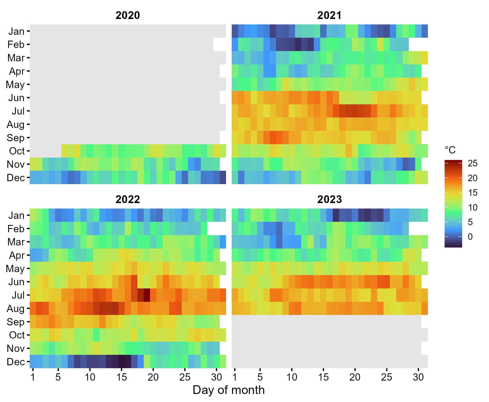
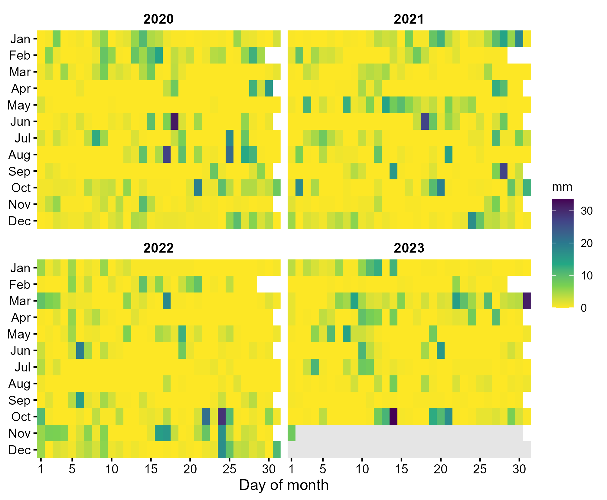
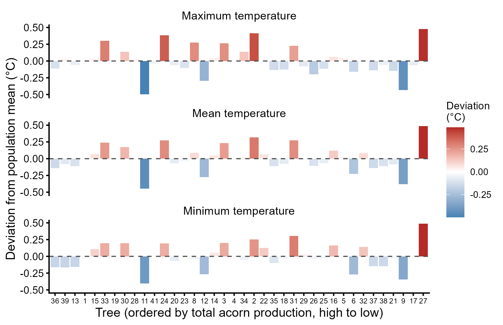
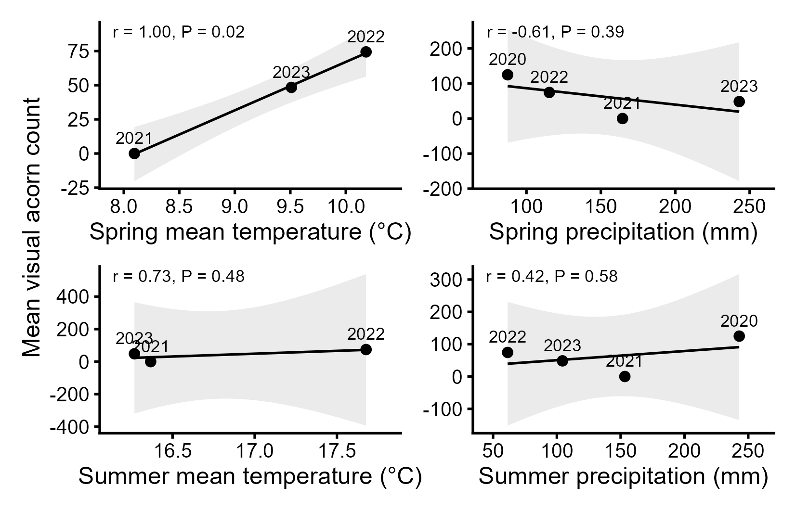

2. Inter-annual variability in weather and tree microclimate
================

- [Data](#data)
- [Supplementary Figures 1 and 2: daily temperature and
  rainfall](#supplementary-figures-1-and-2-daily-temperature-and-rainfall)
- [Supplementary Figure 3: individual-tree
  microclimate](#supplementary-figure-3-individual-tree-microclimate)
- [Supplementary Figure 4: population-mean acorn count vs. seasonal
  climate](#supplementary-figure-4-population-mean-acorn-count-vs-seasonal-climate)
- [Supplementary Table 10: microclimate by producer
  class](#supplementary-table-10-microclimate-by-producer-class)
- [Key results](#key-results)

This notebook characterises weather and tree-level microclimate over the
study period (Results: *Inter-annual variability in weather*).

| Output | Content |
|----|----|
| Supplementary Figure 1 | Daily mean temperature, tree-mounted loggers |
| Supplementary Figure 2 | Daily precipitation, ECN Wytham station |
| Supplementary Figure 3 | Deviation of each tree’s temperature from the population mean |
| Supplementary Figure 4 | Population-mean visual acorn count vs. seasonal climate |
| Supplementary Table 10 | ANOVAs of microclimate by producer class, phenological period and year |

``` r
source("R/setup.R")
library(lubridate)
```

# Data

Tinytag loggers on the northern side of each trunk (~1.3 m) recorded
hourly temperature from 6 October 2020. The hourly readings
(temperature, and the maximum and minimum within each hour) were
averaged to daily values, so `Tmax` and `Tmin` below are daily means of
hourly maxima and minima. Daily rainfall is from the UK Environmental
Change Network (ECN) station at Wytham.

``` r
mc <- readRDS(file.path(DIR_RAW, "climate", "tree_microclimate_daily_2020_2023.rds")) |>
  transmute(Tree = as.character(Tree), Date = as.Date(Date),
            Tmean = Temperature, Tmax = Maximum.Temperature, Tmin = Minimum.Temperature) |>
  filter(Tree %in% STUDY_TREES) |>
  mutate(Year = year(Date), Month = month(Date), Day = day(Date))

precip <- read_csv(file.path(DIR_RAW, "climate", "wytham_daily_precipitation_2020_2023.csv"),
                   skip = 1, col_names = c("Date", "Rain_mm"), show_col_types = FALSE) |>
  mutate(Date = dmy(Date), Rain_mm = as.numeric(Rain_mm),
         Year = year(Date), Month = month(Date), Day = day(Date)) |>
  filter(Year %in% STUDY_YEARS)

classes <- read_csv(file.path(DIR_DERIVED, "producer_classes.csv"), col_types = "cidc") |>
  mutate(Class = factor(Class, levels = c("High", "Medium", "Low")))

cat("Logger records:", format(min(mc$Date)), "to", format(max(mc$Date)), "|",
    n_distinct(mc$Tree), "trees with loggers; no logger for tree(s):",
    paste(setdiff(STUDY_TREES, mc$Tree), collapse = ", "), "\n")
cat("Rainfall records:", format(min(precip$Date)), "to", format(max(precip$Date)), "\n")
```

    #> Logger records: 2020-10-06 to 2023-08-31 | 37 trees with loggers; no logger for tree(s): 4 
    #> Rainfall records: 2020-01-01 to 2023-11-01

# Supplementary Figures 1 and 2: daily temperature and rainfall

``` r
all_days <- tibble(Date = seq(as.Date("2020-01-01"), as.Date("2023-12-31"), by = "day")) |>
  mutate(Year = year(Date), Month = month(Date), Day = day(Date))

daily_temp <- mc |> group_by(Date) |> summarise(Tmean = mean(Tmean), .groups = "drop")

calendar_heatmap <- function(d, fill, limits, palette, legend_name, direction = 1) {
  ggplot(d, aes(Day, Month, fill = .data[[fill]])) +
    geom_tile() +
    facet_wrap(~ Year, ncol = 2) +
    scale_fill_viridis_c(option = palette, direction = direction, limits = limits,
                         na.value = "grey90", name = legend_name) +
    scale_x_continuous(breaks = c(1, 5, 10, 15, 20, 25, 30), expand = c(0, 0)) +
    scale_y_reverse(breaks = 1:12, labels = month.abb, expand = c(0, 0)) +
    labs(x = "Day of month", y = NULL) +
    theme(axis.line = element_blank(), strip.text = element_text(face = "bold"))
}

sf1 <- calendar_heatmap(left_join(all_days, daily_temp, by = "Date"), "Tmean",
                        range(daily_temp$Tmean), "H", "°C")
save_fig(sf1, "SuppFig01_temperature_heatmap", width = 170, height = 140)
```



``` r
sf2 <- calendar_heatmap(left_join(all_days, select(precip, Date, Rain_mm), by = "Date"),
                        "Rain_mm", c(0, max(precip$Rain_mm, na.rm = TRUE)), "D", "mm",
                        direction = -1)
save_fig(sf2, "SuppFig02_precipitation_heatmap", width = 170, height = 140)
```



``` r
cat("Range of daily mean temperature (population mean): ",
    sprintf("%.1f to %.1f °C", min(daily_temp$Tmean), max(daily_temp$Tmean)), "\n")
```

Range of daily mean temperature (population mean): -3.7 to 26.0 °C

# Supplementary Figure 3: individual-tree microclimate

Each tree’s mean daily Tmax, Tmean and Tmin over all logger days,
expressed as the deviation from the mean of all trees. Trees are ordered
by total visual acorn count (2020–2023).

``` r
tree_temp <- mc |>
  group_by(Tree) |>
  summarise(across(c(Tmax, Tmean, Tmin), mean), .groups = "drop") |>
  mutate(across(c(Tmax, Tmean, Tmin), ~ .x - mean(.x), .names = "dev_{.col}"))

knitr::kable(tree_temp |> arrange(dev_Tmean) |> slice(c(1:3, (n() - 2):n())),
             digits = 2, caption = "Coolest and warmest trees")
```

| Tree |  Tmax | Tmean |  Tmin | dev_Tmax | dev_Tmean | dev_Tmin |
|:-----|------:|------:|------:|---------:|----------:|---------:|
| 11   | 10.37 | 10.04 |  9.73 |    -0.50 |     -0.45 |    -0.40 |
| 9    | 10.43 | 10.10 |  9.79 |    -0.43 |     -0.38 |    -0.34 |
| 12   | 10.57 | 10.21 |  9.87 |    -0.29 |     -0.28 |    -0.26 |
| 24   | 11.25 | 10.76 | 10.32 |     0.38 |      0.28 |     0.19 |
| 2    | 11.28 | 10.80 | 10.39 |     0.41 |      0.32 |     0.25 |
| 27   | 11.34 | 10.97 | 10.62 |     0.48 |      0.49 |     0.49 |

Coolest and warmest trees

``` r
sf3 <- tree_temp |>
  pivot_longer(starts_with("dev_"), names_to = "Metric", values_to = "Deviation") |>
  mutate(Metric = factor(Metric, levels = c("dev_Tmax", "dev_Tmean", "dev_Tmin"),
                         labels = c("Maximum temperature", "Mean temperature",
                                    "Minimum temperature")),
         Tree = factor(Tree, levels = classes$Tree)) |>
  ggplot(aes(Tree, Deviation, fill = Deviation)) +
  geom_col() +
  geom_hline(yintercept = 0, linetype = "dashed", colour = "grey30") +
  scale_fill_gradient2(low = "steelblue", mid = "white", high = "firebrick",
                       name = "Deviation\n(°C)") +
  scale_x_discrete(drop = FALSE) +
  facet_wrap(~ Metric, ncol = 1) +
  labs(x = "Tree (ordered by total acorn production, high to low)",
       y = "Deviation from population mean (°C)") +
  theme(axis.text.x = element_text(size = 7))
save_fig(sf3, "SuppFig03_tree_temperature_deviation", width = 170, height = 110)
```



# Supplementary Figure 4: population-mean acorn count vs. seasonal climate

Spring = March–May, summer = June–August. Logger temperatures are
available from spring 2021 only (n = 3 years); rainfall covers all four
years. With n = 3–4, these relationships are descriptive only.

``` r
season_of <- function(m) case_when(m %in% 3:5 ~ "Spring", m %in% 6:8 ~ "Summer")

seasonal <- full_join(
  mc |> mutate(Season = season_of(Month)) |> filter(!is.na(Season)) |>
    group_by(Year, Season) |> summarise(Temp = mean(Tmean), .groups = "drop"),
  precip |> mutate(Season = season_of(Month)) |> filter(!is.na(Season)) |>
    group_by(Year, Season) |> summarise(Rain = sum(Rain_mm, na.rm = TRUE), .groups = "drop"),
  by = c("Year", "Season")) |>
  pivot_wider(names_from = Season, values_from = c(Temp, Rain))

annual <- load_visual_counts() |>
  group_by(Year) |> summarise(Mean_count = mean(Count), .groups = "drop") |>
  left_join(seasonal, by = "Year")
knitr::kable(annual, digits = 2)
```

| Year | Mean_count | Temp_Spring | Temp_Summer | Rain_Spring | Rain_Summer |
|-----:|-----------:|------------:|------------:|------------:|------------:|
| 2020 |     124.89 |          NA |          NA |       87.36 |      242.96 |
| 2021 |       0.00 |        8.10 |       16.37 |      164.57 |      153.28 |
| 2022 |      74.42 |       10.18 |       17.68 |      115.40 |       61.40 |
| 2023 |      48.42 |        9.51 |       16.27 |      243.00 |      104.40 |

``` r
clim_vars <- c(Temp_Spring = "Spring mean temperature (°C)",
               Rain_Spring = "Spring precipitation (mm)",
               Temp_Summer = "Summer mean temperature (°C)",
               Rain_Summer = "Summer precipitation (mm)")

clim_cor <- imap_dfr(clim_vars, function(lab, v) {
  d <- annual |> filter(!is.na(.data[[v]]))
  ct <- cor.test(d[[v]], d$Mean_count)
  tibble(Climate = lab, n = nrow(d), r = unname(ct$estimate), P = ct$p.value)
})
knitr::kable(clim_cor, digits = 3)
```

| Climate                      |   n |      r |     P |
|:-----------------------------|----:|-------:|------:|
| Spring mean temperature (°C) |   3 |  1.000 | 0.019 |
| Spring precipitation (mm)    |   4 | -0.613 | 0.387 |
| Summer mean temperature (°C) |   3 |  0.726 | 0.483 |
| Summer precipitation (mm)    |   4 |  0.424 | 0.576 |

``` r
sf4 <- imap(clim_vars, function(lab, v) {
  st <- clim_cor |> filter(Climate == lab)
  ggplot(filter(annual, !is.na(.data[[v]])), aes(.data[[v]], Mean_count, label = Year)) +
    geom_smooth(method = "lm", formula = y ~ x, colour = "black", fill = "grey80",
                linewidth = 0.6) +
    geom_point(size = 2) +
    geom_text(vjust = -0.8, size = 3) +
    annotate("text", x = -Inf, y = Inf, hjust = -0.1, vjust = 1.3, size = 3,
             label = sprintf("r = %.2f, P = %.2f", st$r, st$P)) +
    scale_x_continuous(expand = expansion(mult = 0.15)) +
    labs(x = lab, y = "Mean visual acorn count")
}) |> wrap_plots(ncol = 2) + plot_layout(axis_titles = "collect")
save_fig(sf4, "SuppFig04_acorns_vs_seasonal_climate", width = 140, height = 90)
```



# Supplementary Table 10: microclimate by producer class

Daily temperatures were assigned to three phenological periods: budburst
(1 March–15 May), acorn development (16 May–15 September) and
post-acorn-drop leaf senescence (6 October–31 December). Accumulated
temperature is the sum of daily mean temperatures per tree, year and
period. Each temperature measure was modelled with `aov` as producer
class × period + producer class × year (Year as a factor; sequential
sums of squares).

``` r
period_of <- function(d) {
  md <- month(d) * 100 + day(d)
  case_when(md >= 301  & md <= 515  ~ "Budburst",
            md >= 516  & md <= 915  ~ "Acorn development",
            md >= 1006 & md <= 1231 ~ "Post-acorn-drop senescence")
}

mc_period <- mc |>
  mutate(Period = factor(period_of(Date),
                         levels = c("Budburst", "Acorn development",
                                    "Post-acorn-drop senescence"))) |>
  filter(!is.na(Period)) |>
  left_join(select(classes, Tree, Class), by = "Tree") |>
  mutate(Year = factor(Year))

knitr::kable(count(mc_period, Year, Period), caption = "Tree-days per year and period")

accum <- mc_period |>
  group_by(Tree, Class, Year, Period) |>
  summarise(Taccum = sum(Tmean), .groups = "drop")

term_labels <- c("Class" = "Producer", "Period" = "Period", "Year" = "Year",
                 "Class:Period" = "Producer × Period", "Class:Year" = "Producer × Year",
                 "Residuals" = "Residuals")

aov_table <- function(resp, data, label) {
  f <- as.formula(paste(resp, "~ Class * Period + Class * Year"))
  a <- summary(aov(f, data = data))[[1]]
  tibble(Response = label, Term = term_labels[trimws(rownames(a))],
         df = a$Df, `Sum Sq` = a$`Sum Sq`, `Mean Sq` = a$`Mean Sq`,
         F = a$`F value`, P = a$`Pr(>F)`)
}

st10 <- bind_rows(
  aov_table("Tmax",   mc_period, "Maximum temperature"),
  aov_table("Tmin",   mc_period, "Minimum temperature"),
  aov_table("Tmean",  mc_period, "Mean temperature"),
  aov_table("Taccum", accum,     "Accumulated mean temperature")
)
st10_out <- st10 |>
  mutate(across(c(`Sum Sq`, `Mean Sq`), ~ round(.x, 1)), F = round(F, 3), P = fmt_p(P))
save_tab(st10_out, "SuppTable10_microclimate_ANOVA")
knitr::kable(st10_out)
```

| Year | Period                     |    n |
|:-----|:---------------------------|-----:|
| 2020 | Post-acorn-drop senescence | 3219 |
| 2021 | Budburst                   | 2812 |
| 2021 | Acorn development          | 4545 |
| 2021 | Post-acorn-drop senescence | 3132 |
| 2022 | Budburst                   | 2736 |
| 2022 | Acorn development          | 4448 |
| 2022 | Post-acorn-drop senescence | 3219 |
| 2023 | Budburst                   | 2812 |
| 2023 | Acorn development          | 3996 |

Tree-days per year and period

| Response | Term | df | Sum Sq | Mean Sq | F | P |
|:---|:---|---:|---:|---:|---:|:---|
| Maximum temperature | Producer | 2 | 45.5 | 22.8 | 2.128 | 0.1191 |
| Maximum temperature | Period | 2 | 489003.9 | 244501.9 | 22854.251 | \<0.001 |
| Maximum temperature | Year | 3 | 5937.5 | 1979.2 | 184.998 | \<0.001 |
| Maximum temperature | Producer × Period | 4 | 33.4 | 8.4 | 0.781 | 0.5371 |
| Maximum temperature | Producer × Year | 6 | 16.1 | 2.7 | 0.251 | 0.9592 |
| Maximum temperature | Residuals | 30901 | 330588.6 | 10.7 | NA | NA |
| Minimum temperature | Producer | 2 | 9.2 | 4.6 | 0.438 | 0.6456 |
| Minimum temperature | Period | 2 | 471910.4 | 235955.2 | 22482.396 | \<0.001 |
| Minimum temperature | Year | 3 | 5464.8 | 1821.6 | 173.567 | \<0.001 |
| Minimum temperature | Producer × Period | 4 | 22.7 | 5.7 | 0.541 | 0.7060 |
| Minimum temperature | Producer × Year | 6 | 6.6 | 1.1 | 0.104 | 0.9959 |
| Minimum temperature | Residuals | 30901 | 324309.3 | 10.5 | NA | NA |
| Mean temperature | Producer | 2 | 15.7 | 7.8 | 0.742 | 0.4763 |
| Mean temperature | Period | 2 | 478690.0 | 239345.0 | 22648.306 | \<0.001 |
| Mean temperature | Year | 3 | 5715.9 | 1905.3 | 180.292 | \<0.001 |
| Mean temperature | Producer × Period | 4 | 26.2 | 6.5 | 0.620 | 0.6485 |
| Mean temperature | Producer × Year | 6 | 8.8 | 1.5 | 0.139 | 0.9911 |
| Mean temperature | Residuals | 30901 | 326558.6 | 10.6 | NA | NA |
| Accumulated mean temperature | Producer | 2 | 2418.2 | 1209.1 | 0.217 | 0.8050 |
| Accumulated mean temperature | Period | 2 | 110461877\.1 | 55230938.6 | 9913.594 | \<0.001 |
| Accumulated mean temperature | Year | 3 | 1201011.6 | 400337.2 | 71.858 | \<0.001 |
| Accumulated mean temperature | Producer × Period | 4 | 9225.0 | 2306.2 | 0.414 | 0.7986 |
| Accumulated mean temperature | Producer × Year | 6 | 4586.3 | 764.4 | 0.137 | 0.9913 |
| Accumulated mean temperature | Residuals | 313 | 1743795.8 | 5571.2 | NA | NA |

# Key results

``` r
coolest <- tree_temp |> slice_min(dev_Tmean, n = 1)
warmest <- tree_temp |> slice_max(dev_Tmean, n = 1)
producer_p <- st10 |> filter(grepl("Producer", Term)) |> pull(P)

key02 <- tribble(
  ~Statistic, ~Value,
  "Trees with loggers", as.character(n_distinct(mc$Tree)),
  "Range of tree deviations, mean temperature (°C)",
    sprintf("%.2f to %.2f", min(tree_temp$dev_Tmean), max(tree_temp$dev_Tmean)),
  "Coolest tree (dTmax / dTmean / dTmin)",
    sprintf("Tree %s (%.2f / %.2f / %.2f)", coolest$Tree, coolest$dev_Tmax, coolest$dev_Tmean, coolest$dev_Tmin),
  "Warmest tree (dTmax / dTmean / dTmin)",
    sprintf("Tree %s (%.2f / %.2f / %.2f)", warmest$Tree, warmest$dev_Tmax, warmest$dev_Tmean, warmest$dev_Tmin),
  "Spring mean temperature vs mean count (r, P, n)",
    with(filter(clim_cor, grepl("Spring mean", Climate)), sprintf("%.2f, %.3f, %d", r, P, n)),
  "Smallest P among producer terms (ST10)", sprintf("%.3f", min(producer_p))
)
save_tab(key02, "key_results_02_weather_microclimate")
knitr::kable(key02)
```

| Statistic | Value |
|:---|:---|
| Trees with loggers | 37 |
| Range of tree deviations, mean temperature (°C) | -0.45 to 0.49 |
| Coolest tree (dTmax / dTmean / dTmin) | Tree 11 (-0.50 / -0.45 / -0.40) |
| Warmest tree (dTmax / dTmean / dTmin) | Tree 27 (0.48 / 0.49 / 0.49) |
| Spring mean temperature vs mean count (r, P, n) | 1.00, 0.019, 3 |
| Smallest P among producer terms (ST10) | 0.119 |

``` r
sessionInfo()
```

    #> R version 4.5.2 (2025-10-31 ucrt)
    #> Platform: x86_64-w64-mingw32/x64
    #> Running under: Windows 11 x64 (build 26200)
    #> 
    #> Matrix products: default
    #>   LAPACK version 3.12.1
    #> 
    #> locale:
    #> [1] LC_COLLATE=English_United Kingdom.utf8 
    #> [2] LC_CTYPE=English_United Kingdom.utf8   
    #> [3] LC_MONETARY=English_United Kingdom.utf8
    #> [4] LC_NUMERIC=C                           
    #> [5] LC_TIME=English_United Kingdom.utf8    
    #> 
    #> time zone: Europe/London
    #> tzcode source: internal
    #> 
    #> attached base packages:
    #> [1] stats     graphics  grDevices utils     datasets  methods   base     
    #> 
    #> other attached packages:
    #>  [1] patchwork_1.3.2 readxl_1.4.5    lubridate_1.9.4 forcats_1.0.1  
    #>  [5] stringr_1.6.0   dplyr_1.1.4     purrr_1.2.2     readr_2.1.6    
    #>  [9] tidyr_1.3.1     tibble_3.3.0    ggplot2_4.0.1   tidyverse_2.0.0
    #> 
    #> loaded via a namespace (and not attached):
    #>  [1] generics_0.1.4     lattice_0.22-7     stringi_1.8.7      hms_1.1.4         
    #>  [5] digest_0.6.39      magrittr_2.0.4     evaluate_1.0.5     grid_4.5.2        
    #>  [9] timechange_0.3.0   RColorBrewer_1.1-3 fastmap_1.2.0      Matrix_1.7-4      
    #> [13] cellranger_1.1.0   mgcv_1.9-3         viridisLite_0.4.2  scales_1.4.0      
    #> [17] textshaping_1.0.5  cli_3.6.5          rlang_1.2.0        crayon_1.5.3      
    #> [21] splines_4.5.2      bit64_4.6.0-1      withr_3.0.2        yaml_2.3.12       
    #> [25] otel_0.2.0         tools_4.5.2        parallel_4.5.2     tzdb_0.5.0        
    #> [29] vctrs_0.7.3        R6_2.6.1           lifecycle_1.0.5    bit_4.6.0         
    #> [33] vroom_1.7.0        ragg_1.5.1         pkgconfig_2.0.3    pillar_1.11.1     
    #> [37] gtable_0.3.6       glue_1.8.0         systemfonts_1.3.2  xfun_0.57         
    #> [41] tidyselect_1.2.1   knitr_1.51         farver_2.1.2       nlme_3.1-168      
    #> [45] htmltools_0.5.9    rmarkdown_2.30     labeling_0.4.3     compiler_4.5.2    
    #> [49] S7_0.2.1
