3. Environmental and tree-level associates of acorn production
================

- [Tree-level data](#tree-level-data)
- [Table 1: descriptive statistics](#table-1-descriptive-statistics)
- [Supplementary Figure 5: correlations among candidate
  predictors](#supplementary-figure-5-correlations-among-candidate-predictors)
- [Stage 1: VSURF variable selection](#stage-1-vsurf-variable-selection)
  - [Supplementary Table 6](#supplementary-table-6)
  - [Supplementary Figure 6: observed vs. random-forest fitted
    values](#supplementary-figure-6-observed-vs-random-forest-fitted-values)
  - [Supplementary Figures 7–8: Shapley
    values](#supplementary-figures-78-shapley-values)
- [Stage 2: generalised linear (mixed)
  models](#stage-2-generalised-linear-mixed-models)
  - [Model specification](#model-specification)
  - [GLMMs](#glmms)
  - [Table 2](#table-2)
  - [Supplementary Table 7: soil-class contrasts (enlarged
    cups)](#supplementary-table-7-soil-class-contrasts-enlarged-cups)
  - [Figure 4: significant GLM
    relationships](#figure-4-significant-glm-relationships)
  - [Residual diagnostics (Supplementary Figures 9–10, Tables
    8–9)](#residual-diagnostics-supplementary-figures-910-tables-89)
- [Producer class and relatedness](#producer-class-and-relatedness)
- [Powdery mildew (Supplementary Table 11, Figure
  12)](#powdery-mildew-supplementary-table-11-figure-12)
- [Key results](#key-results)

This notebook relates reproductive output to tree, soil, phenology and
disease variables (Results: *Environmental and tree-level associates of
acorn production*). The two-stage approach uses (1) random-forest
variable selection with VSURF and (2) Gamma GLMs and GLMMs on the
selected variables.

| Output | Content |
|----|----|
| Table 1 | Response and explanatory variables: descriptive statistics |
| Table 2 | GLM and GLMM results for VSURF-selected variables |
| Figure 4 | GLM-fitted relationships for significant predictors |
| Supplementary Figure 5 | Correlation matrix of candidate predictors |
| Supplementary Table 6 | VSURF-selected variables and OOB errors |
| Supplementary Figure 6 | Observed vs. random-forest fitted values |
| Supplementary Figures 7–8 | Shapley values |
| Supplementary Table 7 | Tukey comparisons of soil classes (enlarged cups) |
| Supplementary Figure 9, Table 8 | DHARMa residual diagnostics |
| Supplementary Figure 10, Table 9 | Error-distribution comparison for visual counts |
| Supplementary Table 11, Figure 12 | Powdery mildew models |

``` r
source("R/setup.R")
suppressPackageStartupMessages({
  library(VSURF); library(ranger); library(iml)
  library(car); library(lme4); library(broom.mixed)
  library(multcomp); library(emmeans); library(DHARMa)
  library(ggcorrplot)
})
select <- dplyr::select   # MASS (loaded by car/VSURF dependencies) masks select()
filter <- dplyr::filter
```

# Tree-level data

Explanatory variables come from the tree attribute table (one row per
tree). Responses are the tree-level means derived in notebook 1: the
visual count is the 2020–2022 mean, and litter-trap variables are
2021–2023 means per 0.25 m² trap.

``` r
attrs <- read_excel(file.path(DIR_RAW, "trees", "tree_attributes.xlsx")) |>
  transmute(Tree = as.character(TREE_ID),
            ELEVATION, ASPECT, HEIGHT, DBH = as.numeric(DBH), CROWN_SPREAD, CROWN_CROSS,
            CANOPY_CLOSURE, STEM_DENSITY = STALK_DENSITY,
            PH = as.numeric(PH), P_MGL = as.numeric(P_MGL), K_MGL = as.numeric(K_MGL),
            Mg_MGL = as.numeric(Mg_MGL), SAND = as.numeric(SAND), SILT = as.numeric(SILT),
            CLAY = as.numeric(CLAY), SOIL_CLASS,
            SPRING_PHENO, MIDAPRIL_LAI, AUTUMN_PHENO, MIDNOV_LAI, MIDDEC_LAI, AUPPC,
            KING = suppressWarnings(as.numeric(KING))) |>
  filter(Tree %in% STUDY_TREES)

repro <- read_csv(file.path(DIR_DERIVED, "tree_reproduction.csv"),
                  col_types = cols(Tree = "c", Class = "c"))

RESPONSES <- c("VIZ_COUNT", LITTER_VARS)
PREDICTORS <- c("ELEVATION", "ASPECT", "HEIGHT", "DBH", "CROWN_SPREAD", "CROWN_CROSS",
                "CANOPY_CLOSURE", "STEM_DENSITY", "PH", "P_MGL", "K_MGL", "Mg_MGL",
                "SAND", "SILT", "CLAY", "SPRING_PHENO", "MIDAPRIL_LAI",
                "AUTUMN_PHENO", "MIDNOV_LAI", "MIDDEC_LAI", "AUPPC")

soil_levels <- c("Clay", "Clay_Loam", "Sandy_Clay_Loam", "Sandy_Loam", "Loamy_Sand", "Sand")
trees <- inner_join(repro, attrs, by = "Tree") |>
  mutate(SOIL_CLASS = factor(SOIL_CLASS, levels = soil_levels),
         Class = factor(Class, levels = c("High", "Medium", "Low")))

stopifnot(nrow(trees) == 38, !anyNA(trees[, c(RESPONSES, PREDICTORS, "SOIL_CLASS")]))
cat(nrow(trees), "trees;", length(PREDICTORS), "numeric candidate predictors\n")
table(trees$SOIL_CLASS)
```

    #> 38 trees; 21 numeric candidate predictors
    #> 
    #>            Clay       Clay_Loam Sandy_Clay_Loam      Sandy_Loam      Loamy_Sand 
    #>              10              13               4               9               1 
    #>            Sand 
    #>               1

# Table 1: descriptive statistics

Tree-level statistics (n = 38). Temperatures are summarised over all
tree-days of logger data (daily means of hourly readings, see notebook
2).

``` r
mc <- readRDS(file.path(DIR_RAW, "climate", "tree_microclimate_daily_2020_2023.rds")) |>
  filter(as.character(Tree) %in% STUDY_TREES)

describe <- function(x) tibble(Mean = mean(x), SD = sd(x), Max = max(x), Min = min(x))

table1 <- bind_rows(
  map_dfr(c(RESPONSES, PREDICTORS), ~ describe(trees[[.x]]) |> mutate(Symbol = .x)),
  describe(mc$Maximum.Temperature) |> mutate(Symbol = "Maximum temperature"),
  describe(mc$Minimum.Temperature) |> mutate(Symbol = "Minimum temperature"),
  describe(mc$Temperature)         |> mutate(Symbol = "Mean temperature")
) |>
  mutate(Variable = coalesce(VAR_LABELS[Symbol], Symbol)) |>
  relocate(Variable, Symbol) |>
  mutate(across(Mean:Min, ~ round(.x, 2)))
save_tab(table1, "Table1_descriptive_statistics")
knitr::kable(table1)
```

| Variable                     | Symbol              |   Mean |     SD |    Max |    Min |
|:-----------------------------|:--------------------|-------:|-------:|-------:|-------:|
| Mature acorns (visual count) | VIZ_COUNT           |  66.44 |  65.10 | 238.00 |   1.67 |
| Mature acorns (litter trap)  | MATURE_ACORNS       |   3.03 |   4.80 |  24.89 |   0.00 |
| Immature acorns              | IMMAT_ACORNS        |   4.73 |   4.52 |  15.19 |   0.00 |
| Enlarged cups                | ENLARGED_CUPS       |   5.41 |   4.28 |  17.53 |   0.00 |
| Flowers                      | FLOWERS             |  38.28 |  20.40 |  94.72 |   4.72 |
| Galls                        | GALLS               |   2.45 |   2.78 |   8.92 |   0.00 |
| Site Elevation               | ELEVATION           | 101.85 |  31.60 | 162.62 |  59.93 |
| Slope Aspect                 | ASPECT              | 186.64 | 124.77 | 359.52 |   1.00 |
| Tree Height                  | HEIGHT              |  21.43 |   5.34 |  33.76 |  12.74 |
| DBH                          | DBH                 |  77.78 |  27.71 | 185.26 |  41.06 |
| Crown Spread                 | CROWN_SPREAD        |  14.98 |   3.57 |  24.00 |   5.50 |
| Crown Cross                  | CROWN_CROSS         |  11.83 |   3.41 |  19.80 |   5.50 |
| Canopy Closure               | CANOPY_CLOSURE      |   5.21 |   2.57 |  10.00 |   1.00 |
| Stem Density                 | STEM_DENSITY        |   3.32 |   1.92 |   7.00 |   1.00 |
| pH                           | PH                  |   6.49 |   0.83 |   7.80 |   4.60 |
| Phosphorus                   | P_MGL               |   9.59 |   7.53 |  32.20 |   4.00 |
| Potassium                    | K_MGL               | 269.24 |  98.98 | 549.00 | 103.00 |
| Magnesium                    | Mg_MGL              | 181.76 |  69.07 | 371.00 |  90.00 |
| Sand                         | SAND                |  47.45 |  18.54 |  88.00 |  14.00 |
| Silt                         | SILT                |  25.45 |   7.85 |  41.00 |   8.00 |
| Clay                         | CLAY                |  27.11 |  11.29 |  51.00 |   4.00 |
| Spring Phenology             | SPRING_PHENO        |  45.69 |   4.82 |  55.92 |  34.48 |
| Mid-April LAI                | MIDAPRIL_LAI        |  29.06 |  14.08 |  58.65 |   1.34 |
| Autumn Phenology             | AUTUMN_PHENO        |  13.73 |   3.66 |  22.42 |   8.46 |
| Mid-November LAI             | MIDNOV_LAI          |  59.95 |  11.69 |  92.12 |  41.25 |
| Mid-December LAI             | MIDDEC_LAI          |   7.04 |   8.55 |  29.10 |   0.00 |
| AUPPC                        | AUPPC               | 186.33 |  10.37 | 203.03 | 164.58 |
| Maximum temperature          | Maximum temperature |  10.86 |   5.50 |  28.75 |  -5.19 |
| Minimum temperature          | Minimum temperature |  10.13 |   5.41 |  27.06 |  -5.80 |
| Mean temperature             | Mean temperature    |  10.48 |   5.45 |  27.73 |  -5.48 |

# Supplementary Figure 5: correlations among candidate predictors

``` r
X <- trees |> select(all_of(PREDICTORS)) |> as.data.frame()
colnames_lab <- VAR_LABELS[PREDICTORS]

cor_mat <- cor(X); p_mat <- ggcorrplot::cor_pmat(X)
dimnames(cor_mat) <- dimnames(p_mat) <- list(colnames_lab, colnames_lab)
save_tab(as_tibble(round(cor_mat, 3), rownames = "Variable"), "SuppFig05_predictor_correlations")

sf5 <- ggcorrplot(cor_mat, type = "lower", p.mat = p_mat, sig.level = 0.05,
                  insig = "blank", lab = TRUE, lab_size = 2.5,
                  colors = c("firebrick3", "white", "steelblue4"),
                  outline.color = "grey85", tl.cex = 9)
save_fig(sf5, "SuppFig05_predictor_correlations", width = 140, height = 130)
```

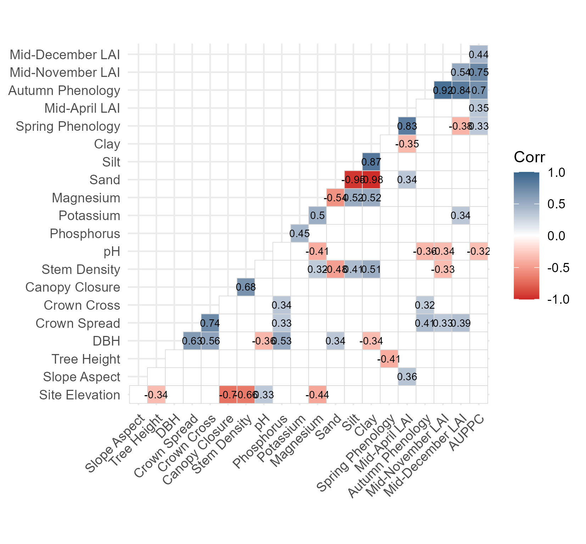

# Stage 1: VSURF variable selection

VSURF (thresholding, interpretation and prediction steps; Genuer et
al. 2015) was run on the 21 numeric candidate predictors with the
`ranger` random-forest implementation. The variables retained at the
interpretation step are used downstream.

The fitted VSURF objects are provided in `cache/vsurf/` and are read
here. Random-forest variable selection depends on the random number
stream, which differs between versions of `ranger` and `VSURF`, so
re-running the call below with other package versions can retain a
slightly different set of variables. The call is evaluated only when a
stored object is absent.

``` r
VSURF_SEEDS <- c(VIZ_COUNT = 5, MATURE_ACORNS = 2, IMMAT_ACORNS = 36,
                 ENLARGED_CUPS = 10, FLOWERS = 2, GALLS = 42)
# column order of the predictor matrix used by VSURF (indices in the VSURF objects)
VSURF_PREDICTORS <- c("ELEVATION", "ASPECT", "HEIGHT", "DBH", "CROWN_SPREAD", "CROWN_CROSS",
                      "CANOPY_CLOSURE", "STEM_DENSITY", "SPRING_PHENO", "MIDAPRIL_LAI",
                      "AUTUMN_PHENO", "MIDNOV_LAI", "MIDDEC_LAI", "AUPPC",
                      "PH", "P_MGL", "K_MGL", "Mg_MGL", "SAND", "SILT", "CLAY")
X_vsurf <- X[, VSURF_PREDICTORS]

run_vsurf <- function(resp) {
  cache <- file.path(DIR_CACHE, "vsurf", paste0("vsurf_", resp, ".rds"))
  if (file.exists(cache)) return(readRDS(cache))
  y <- trees[[resp]] + if (resp %in% c("ENLARGED_CUPS", "GALLS")) 1 else 0
  set.seed(VSURF_SEEDS[[resp]])
  v <- VSURF(X_vsurf, y, ntree = 1000, mtry = 9, nfor.thres = 10, nfor.interp = 5,
             nfor.pred = 5, RFimplem = "ranger", parallel = FALSE)
  saveRDS(v, cache)
  v
}
vsurf_fits <- set_names(RESPONSES) |> map(run_vsurf)

selected <- map(vsurf_fits, function(v) {
  idx <- if (length(v$varselect.interp)) v$varselect.interp else v$varselect.thres
  VSURF_PREDICTORS[idx]
})
str(selected)
```

    #> List of 6
    #>  $ VIZ_COUNT    : chr [1:5] "CROWN_SPREAD" "HEIGHT" "SPRING_PHENO" "PH" ...
    #>  $ MATURE_ACORNS: chr [1:2] "SPRING_PHENO" "HEIGHT"
    #>  $ IMMAT_ACORNS : chr [1:7] "SPRING_PHENO" "K_MGL" "MIDAPRIL_LAI" "CROWN_SPREAD" ...
    #>  $ ENLARGED_CUPS: chr [1:5] "CLAY" "SAND" "MIDNOV_LAI" "AUTUMN_PHENO" ...
    #>  $ FLOWERS      : chr [1:6] "AUTUMN_PHENO" "MIDNOV_LAI" "AUPPC" "STEM_DENSITY" ...
    #>  $ GALLS        : chr "HEIGHT"

## Supplementary Table 6

``` r
st6 <- imap_dfr(vsurf_fits, function(v, resp) {
  tibble(Response = resp,
         `Number selected` = length(selected[[resp]]),
         `Variables selected` = paste(VAR_LABELS[selected[[resp]]], collapse = ", "),
         `OOB MSE at thresholding` = v$mean.perf,
         `OOB MSE at interpretation` = min(v$err.interp))
}) |>
  mutate(`Error reduction (%)` = 100 * (1 - `OOB MSE at interpretation` / `OOB MSE at thresholding`),
         across(where(is.double), ~ round(.x, 2)))
save_tab(st6, "SuppTable06_VSURF_selection")
knitr::kable(st6)
```

| Response | Number selected | Variables selected | OOB MSE at thresholding | OOB MSE at interpretation | Error reduction (%) |
|:---|---:|:---|---:|---:|---:|
| VIZ_COUNT | 5 | Crown Spread, Tree Height, Spring Phenology, pH, Canopy Closure | 4288.23 | 3442.79 | 19.72 |
| MATURE_ACORNS | 2 | Spring Phenology, Tree Height | 21.68 | 16.97 | 21.73 |
| IMMAT_ACORNS | 7 | Spring Phenology, Potassium, Mid-April LAI, Crown Spread, Phosphorus, Tree Height, Stem Density | 17.31 | 14.50 | 16.24 |
| ENLARGED_CUPS | 5 | Clay, Sand, Mid-November LAI, Autumn Phenology, pH | 11.78 | 9.76 | 17.14 |
| FLOWERS | 6 | Autumn Phenology, Mid-November LAI, AUPPC, Stem Density, Mid-December LAI, Mid-April LAI | 509.12 | 377.01 | 25.95 |
| GALLS | 1 | Tree Height | 11.37 | 8.43 | 25.88 |

## Supplementary Figure 6: observed vs. random-forest fitted values

Random forests (`ranger`, 500 trees) refitted on the VSURF-selected
variables. R² is the squared correlation between observed and fitted
values.

``` r
rf_fits <- imap(selected, function(vars, resp) {
  ranger(x = X[, vars, drop = FALSE], y = trees[[resp]], num.trees = 500, seed = 42)
})

rf_df <- imap_dfr(rf_fits, function(rf, resp) {
  tibble(Response = resp, Observed = trees[[resp]],
         Fitted = predict(rf, X[, selected[[resp]], drop = FALSE])$predictions)
})
rf_r2 <- rf_df |> group_by(Response) |>
  summarise(R2_fitted = cor(Observed, Fitted)^2)
knitr::kable(rf_r2, digits = 2)
```

| Response      | R2_fitted |
|:--------------|----------:|
| ENLARGED_CUPS |      0.92 |
| FLOWERS       |      0.87 |
| GALLS         |      0.73 |
| IMMAT_ACORNS  |      0.91 |
| MATURE_ACORNS |      0.90 |
| VIZ_COUNT     |      0.87 |

``` r
sf6 <- rf_df |>
  left_join(rf_r2, by = "Response") |>
  mutate(Panel = factor(VAR_LABELS[Response], levels = VAR_LABELS[RESPONSES])) |>
  ggplot(aes(Fitted, Observed)) +
  geom_abline(linetype = "dashed", colour = "grey50") +
  geom_point(size = 1.5, alpha = 0.8) +
  geom_text(data = \(d) distinct(d, Panel, R2_fitted),
            aes(label = sprintf("R² = %.2f", R2_fitted)),
            x = -Inf, y = Inf, hjust = -0.15, vjust = 1.5, size = 3) +
  facet_wrap(~ Panel, scales = "free", ncol = 3) +
  labs(x = "Random-forest fitted value", y = "Observed mean per tree per annum")
save_fig(sf6, "SuppFig06_observed_vs_fitted", width = 200, height = 100)
```

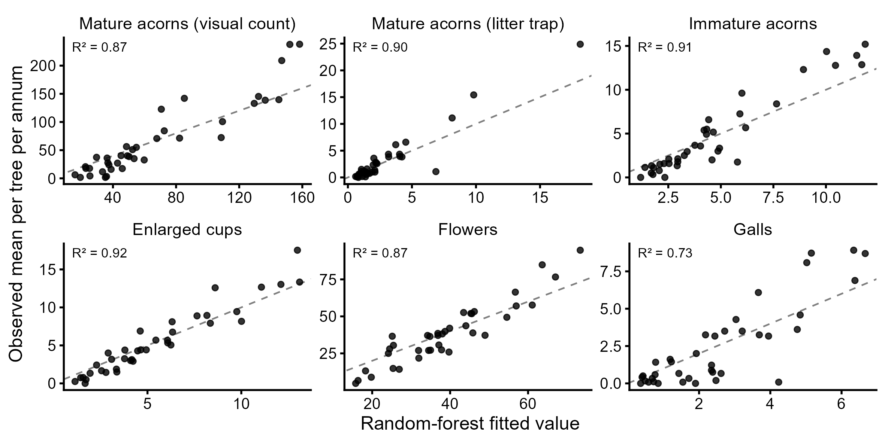

## Supplementary Figures 7–8: Shapley values

Shapley values (`iml`) quantify the contribution of each selected
variable’s value to the random-forest prediction. For each model they
are computed for 50 trees drawn at random (with replacement) from the
38; for single-variable models the Shapley value is the prediction minus
the mean prediction. Values are stored in `cache/shapley/` and
recomputed only when absent.

``` r
shapley_for <- function(resp, n = 50, seed = 42) {
  vars <- selected[[resp]]
  Xs <- X[, vars, drop = FALSE]
  y  <- trees[[resp]] + if (resp %in% PLUS1_RF) 1 else 0
  rf <- ranger(x = Xs, y = y, num.trees = 500, seed = seed)
  if (length(vars) < 2) {   # single predictor: prediction minus mean prediction
    p <- predict(rf, Xs)$predictions
    return(tibble(feature.value = paste0(vars, "=", Xs[[1]]), phi = p - mean(p)))
  }
  pred <- Predictor$new(rf, data = Xs, y = y,
                        predict.function = \(model, newdata) predict(model, newdata)$predictions)
  set.seed(seed)
  map_dfr(seq_len(n), function(i) {
    Shapley$new(pred, x.interest = Xs[sample(nrow(Xs), 1), , drop = FALSE])$results
  }) |> filter(phi != 0)
}
PLUS1_RF <- c("MATURE_ACORNS", "IMMAT_ACORNS", "ENLARGED_CUPS", "GALLS")

shap <- map_dfr(RESPONSES, function(resp) {
  cache <- file.path(DIR_CACHE, "shapley", paste0("shapley_", resp, ".rds"))
  if (!file.exists(cache)) saveRDS(shapley_for(resp), cache)
  readRDS(cache) |>
    transmute(Response = resp,
              feature = sub("=.*", "", feature.value),
              value = as.numeric(sub(".*=", "", feature.value)), phi) |>
    mutate(feature = sub("^STALK_DENSITY$", "STEM_DENSITY", feature))
})
```

``` r
SHAP_TITLES <- c(VIZ_COUNT = "Mature acorns\n(visual count)", MATURE_ACORNS = "Mature acorns\n(litter trap)",
                 IMMAT_ACORNS = "Immature acorns", ENLARGED_CUPS = "Enlarged cups",
                 FLOWERS = "Flowers", GALLS = "Galls")

shapley_panel <- function(resp) {
  shap |>
    filter(Response == resp) |>
    mutate(feature = factor(VAR_LABELS[feature], levels = VAR_LABELS[selected[[resp]]])) |>
    ggplot(aes(phi, value)) +
    geom_vline(xintercept = 0, colour = "grey75") +
    geom_smooth(method = "loess", formula = y ~ x, se = FALSE, colour = "black",
                linewidth = 0.8, span = 0.75) +
    facet_wrap(~ feature, scales = "free_y", ncol = 1) +
    labs(title = SHAP_TITLES[[resp]], x = "Shapley value (effect on model prediction)",
         y = "Variable value")
}

sf7 <- wrap_plots(map(c("VIZ_COUNT", "IMMAT_ACORNS", "ENLARGED_CUPS", "FLOWERS"),
                      shapley_panel), nrow = 1) +
  plot_layout(axis_titles = "collect") & theme(plot.title = element_text(size = 10))
save_fig(sf7, "SuppFig07_shapley_visual_immature_cups_flowers", width = 180, height = 300)
```

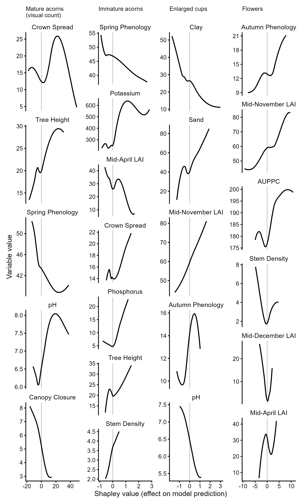

``` r
sf8 <- wrap_plots(map(c("MATURE_ACORNS", "GALLS"), shapley_panel), nrow = 1) +
  plot_layout(axis_titles = "collect") & theme(plot.title = element_text(size = 10))
save_fig(sf8, "SuppFig08_shapley_mature_galls", width = 180, height = 110)
```

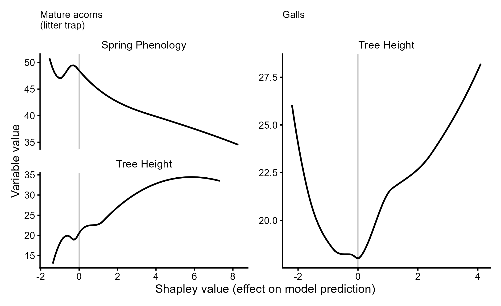

# Stage 2: generalised linear (mixed) models

## Model specification

For each response, the GLM contains the VSURF-selected variables with
two adjustments: the highly collinear soil texture fractions (Clay,
Sand) are represented jointly by the categorical Soil Class, and
Mid-December LAI is removed because of its high collinearity with Autumn
Phenology. Responses containing zeros are modelled as count + 1. All
models use a Gamma distribution with log link.

``` r
PLUS1 <- c("MATURE_ACORNS", "IMMAT_ACORNS", "ENLARGED_CUPS", "GALLS")
resp_term <- function(resp) if (resp %in% PLUS1) paste0("I(", resp, " + 1)") else resp

glm_vars <- imap(selected, function(vars, resp) {
  dropped <- character()
  if (any(vars %in% c("SAND", "SILT", "CLAY"))) {
    dropped <- intersect(vars, c("SAND", "SILT", "CLAY"))
    vars <- c(setdiff(vars, dropped), "SOIL_CLASS")
  }
  if (all(c("MIDDEC_LAI", "AUTUMN_PHENO") %in% vars)) {
    dropped <- c(dropped, "MIDDEC_LAI")
    vars <- setdiff(vars, "MIDDEC_LAI")
  }
  list(vars = vars, dropped = dropped)
})
tibble(Response = names(glm_vars),
       Predictors = map_chr(glm_vars, ~ paste(.x$vars, collapse = ", ")),
       Removed = map_chr(glm_vars, ~ paste(.x$dropped, collapse = ", "))) |>
  knitr::kable()

glms <- imap(glm_vars, ~ glm(reformulate(.x$vars, resp_term(.y)),
                             data = trees, family = Gamma("log")))
```

| Response | Predictors | Removed |
|:---|:---|:---|
| VIZ_COUNT | CROWN_SPREAD, HEIGHT, SPRING_PHENO, PH, CANOPY_CLOSURE |  |
| MATURE_ACORNS | SPRING_PHENO, HEIGHT |  |
| IMMAT_ACORNS | SPRING_PHENO, K_MGL, MIDAPRIL_LAI, CROWN_SPREAD, P_MGL, HEIGHT, STEM_DENSITY |  |
| ENLARGED_CUPS | MIDNOV_LAI, AUTUMN_PHENO, PH, SOIL_CLASS | CLAY, SAND |
| FLOWERS | AUTUMN_PHENO, MIDNOV_LAI, AUPPC, STEM_DENSITY, MIDAPRIL_LAI | MIDDEC_LAI |
| GALLS | HEIGHT |  |

## GLMMs

Year-level panel: annual visual counts (2020–2023) and annual
litter-trap means (2021–2023) per tree, with the tree-level predictors
of the GLM and Year as a random intercept. All GLMM responses are
modelled as count + 1.

``` r
panel <- bind_rows(
  load_visual_counts() |> transmute(Tree, Year, Response = "VIZ_COUNT", y = Count),
  load_litter_traps() |> pivot_longer(all_of(LITTER_VARS), names_to = "Response", values_to = "y")
) |>
  left_join(select(trees, Tree, all_of(PREDICTORS), SOIL_CLASS), by = "Tree") |>
  mutate(y1 = y + 1, Year = factor(Year))

glmms <- imap(glm_vars, function(g, resp) {
  d <- filter(panel, Response == resp)
  glmer(reformulate(c(g$vars, "(1 | Year)"), "y1"), data = d, family = Gamma("log"),
        control = glmerControl(optimizer = "bobyqa", optCtrl = list(maxfun = 2e5)))
})
map_chr(glmms, ~ if (isSingular(.x)) "singular" else "ok")
```

    #>     VIZ_COUNT MATURE_ACORNS  IMMAT_ACORNS ENLARGED_CUPS       FLOWERS 
    #>          "ok"          "ok"          "ok"          "ok"          "ok" 
    #>         GALLS 
    #>          "ok"

## Table 2

GLM: Type II likelihood-ratio χ² (`car::Anova`) and VIF. GLMM:
fixed-effect estimate β (log scale), Wald z and P; for Soil Class, the
Type II Wald χ².

``` r
glm_part <- imap_dfr(glms, function(m, resp) {
  a <- Anova(m, type = "II")
  v <- if (length(glm_vars[[resp]]$vars) > 1) {
    vv <- vif(m); if (is.matrix(vv)) vv[, "GVIF^(1/(2*Df))"]^2 else vv
  } else setNames(NA_real_, glm_vars[[resp]]$vars)
  tibble(Response = resp, Variable = rownames(a), VIF = unname(v[rownames(a)]),
         df = a$Df, Chisq = a$`LR Chisq`, P_GLM = a$`Pr(>Chisq)`)
})

glmm_part <- imap_dfr(glmms, function(m, resp) {
  fx <- tidy(m, effects = "fixed") |> filter(term != "(Intercept)", !grepl("SOIL_CLASS", term)) |>
    transmute(Variable = term, beta = estimate, z = statistic, P_GLMM = p.value)
  if ("SOIL_CLASS" %in% glm_vars[[resp]]$vars) {
    a <- Anova(m, type = "II")
    fx <- bind_rows(fx, tibble(Variable = "SOIL_CLASS", beta = NA, z = NA,
                               Wald_chisq = a["SOIL_CLASS", "Chisq"],
                               P_GLMM = a["SOIL_CLASS", "Pr(>Chisq)"]))
  }
  mutate(fx, Response = resp)
})

table2 <- left_join(glm_part, glmm_part, by = c("Response", "Variable")) |>
  mutate(Variable = VAR_LABELS[Variable],
         Response = VAR_LABELS[Response]) |>
  select(Response, Variable, VIF, df, Chisq, P_GLM, beta, z, any_of("Wald_chisq"), P_GLMM)

table2_out <- table2 |>
  mutate(across(c(VIF, Chisq, z, any_of("Wald_chisq")), ~ round(.x, 3)),
         beta = round(beta, 4),
         P_GLM = paste0(fmt_p(P_GLM), sig_stars(P_GLM)),
         P_GLMM = paste0(fmt_p(P_GLMM), sig_stars(P_GLMM)))
save_tab(table2_out, "Table2_GLM_GLMM")
knitr::kable(table2_out)
```

| Response | Variable | VIF | df | Chisq | P_GLM | beta | z | Wald_chisq | P_GLMM |
|:---|:---|---:|---:|---:|:---|---:|---:|---:|:---|
| Mature acorns (visual count) | Crown Spread | 1.191 | 1 | 1.783 | 0.1818 | -0.0634 | -2.745 | NA | 0.0061\*\* |
| Mature acorns (visual count) | Tree Height | 1.263 | 1 | 1.587 | 0.2078 | 0.0328 | 1.798 | NA | 0.0721 |
| Mature acorns (visual count) | Spring Phenology | 1.250 | 1 | 2.096 | 0.1476 | -0.0367 | -1.916 | NA | 0.0554 |
| Mature acorns (visual count) | pH | 1.177 | 1 | 0.669 | 0.4135 | 0.0862 | 0.822 | NA | 0.4109 |
| Mature acorns (visual count) | Canopy Closure | 1.070 | 1 | 8.152 | 0.0043\*\* | -0.1694 | -4.873 | NA | \<0.001\*\*\* |
| Mature acorns (litter trap) | Spring Phenology | 1.198 | 1 | 8.047 | 0.0046\*\* | -0.0551 | -3.562 | NA | \<0.001\*\*\* |
| Mature acorns (litter trap) | Tree Height | 1.198 | 1 | 1.286 | 0.2567 | 0.0255 | 1.665 | NA | 0.0960 |
| Immature acorns | Spring Phenology | 4.891 | 1 | 1.498 | 0.2210 | -0.0451 | -1.343 | NA | 0.1792 |
| Immature acorns | Potassium | 1.259 | 1 | 0.180 | 0.6716 | 0.0006 | 0.801 | NA | 0.4233 |
| Immature acorns | Mid-April LAI | 4.241 | 1 | 0.073 | 0.7874 | 0.0025 | 0.228 | NA | 0.8200 |
| Immature acorns | Crown Spread | 1.270 | 1 | 0.095 | 0.7582 | -0.0173 | -0.789 | NA | 0.4303 |
| Immature acorns | Phosphorus | 1.426 | 1 | 1.117 | 0.2905 | 0.0176 | 1.361 | NA | 0.1735 |
| Immature acorns | Tree Height | 1.408 | 1 | 0.001 | 0.9714 | -0.0030 | -0.180 | NA | 0.8575 |
| Immature acorns | Stem Density | 1.054 | 1 | 0.153 | 0.6957 | -0.0325 | -0.741 | NA | 0.4585 |
| Enlarged cups | Mid-November LAI | 7.531 | 1 | 6.308 | 0.0120\* | 0.0348 | 2.250 | NA | 0.0244\* |
| Enlarged cups | Autumn Phenology | 6.962 | 1 | 1.882 | 0.1701 | -0.0647 | -1.405 | NA | 0.1601 |
| Enlarged cups | pH | 1.651 | 1 | 0.915 | 0.3388 | -0.1518 | -1.610 | NA | 0.1073 |
| Enlarged cups | Soil Class | 1.125 | 5 | 22.312 | \<0.001\*\*\* | NA | NA | 16.289 | 0.0061\*\* |
| Flowers | Autumn Phenology | 7.531 | 1 | 0.042 | 0.8372 | -0.0067 | -0.116 | NA | 0.9075 |
| Flowers | Mid-November LAI | 7.966 | 1 | 2.295 | 0.1298 | 0.0276 | 1.331 | NA | 0.1831 |
| Flowers | AUPPC | 4.115 | 1 | 0.230 | 0.6318 | -0.0013 | -0.087 | NA | 0.9310 |
| Flowers | Stem Density | 1.232 | 1 | 0.003 | 0.9545 | -0.0214 | -0.447 | NA | 0.6550 |
| Flowers | Mid-April LAI | 2.026 | 1 | 0.101 | 0.7504 | 0.0016 | 0.210 | NA | 0.8334 |
| Galls | Tree Height | NA | 1 | 0.221 | 0.6383 | 0.0050 | 0.356 | NA | 0.7217 |

## Supplementary Table 7: soil-class contrasts (enlarged cups)

``` r
st7 <- NULL
if ("SOIL_CLASS" %in% glm_vars$ENLARGED_CUPS$vars) {
  set.seed(1)   # adjusted P-values use randomised multivariate-t integration
  tk <- summary(glht(glms$ENLARGED_CUPS, linfct = mcp(SOIL_CLASS = "Tukey")))
  st7 <- tibble(Comparison = gsub("_", " ", names(tk$test$coefficients)),
                Estimate = tk$test$coefficients, SE = tk$test$sigma,
                z = tk$test$tstat, P = tk$test$pvalues)
  save_tab(st7 |> mutate(across(Estimate:z, ~ round(.x, 4)), P = fmt_p(P)),
           "SuppTable07_soil_class_Tukey")
  knitr::kable(st7, digits = 4)
}
```

| Comparison                   | Estimate |     SE |       z |      P |
|:-----------------------------|---------:|-------:|--------:|-------:|
| Clay Loam - Clay             |   0.4119 | 0.2110 |  1.9522 | 0.3348 |
| Sandy Clay Loam - Clay       |  -0.5612 | 0.3093 | -1.8142 | 0.4189 |
| Sandy Loam - Clay            |   0.6318 | 0.2374 |  2.6616 | 0.0705 |
| Loamy Sand - Clay            |   0.8891 | 0.5233 |  1.6991 | 0.4944 |
| Sand - Clay                  |   0.8671 | 0.5210 |  1.6643 | 0.5180 |
| Sandy Clay Loam - Clay Loam  |  -0.9732 | 0.2732 | -3.5619 | 0.0042 |
| Sandy Loam - Clay Loam       |   0.2199 | 0.2061 |  1.0667 | 0.8785 |
| Loamy Sand - Clay Loam       |   0.4772 | 0.4960 |  0.9620 | 0.9183 |
| Sand - Clay Loam             |   0.4552 | 0.5336 |  0.8530 | 0.9498 |
| Sandy Loam - Sandy Clay Loam |   1.1930 | 0.2859 |  4.1734 | 0.0004 |
| Loamy Sand - Sandy Clay Loam |   1.4503 | 0.5257 |  2.7587 | 0.0544 |
| Sand - Sandy Clay Loam       |   1.4284 | 0.5925 |  2.4108 | 0.1316 |
| Loamy Sand - Sandy Loam      |   0.2573 | 0.4986 |  0.5160 | 0.9947 |
| Sand - Sandy Loam            |   0.2353 | 0.5412 |  0.4348 | 0.9976 |
| Sand - Loamy Sand            |  -0.0220 | 0.7150 | -0.0308 | 1.0000 |

## Figure 4: significant GLM relationships

Lines are predictions of the fitted Gamma GLM (log link) for the focal
predictor, with other continuous predictors held at their means and
averaged over soil classes (`emmeans`), with 95% confidence bands.
Responses fitted as count + 1 are back-transformed by subtracting 1. The
box plot shows enlarged cups by soil class with Tukey compact letters
and sample sizes.

``` r
AXIS_LABELS <- c(CANOPY_CLOSURE = "Canopy Closure\n(1 = open, 10 = closed)",
                 SPRING_PHENO   = "Spring Phenology\n(% peak LAI)",
                 MIDNOV_LAI     = "Mid-November LAI\n(% peak LAI)",
                 AUTUMN_PHENO   = "Autumn Phenology (% peak LAI)",
                 MIDAPRIL_LAI   = "Mid-April LAI (% peak LAI)",
                 CROWN_SPREAD   = "Crown Spread (m)", HEIGHT = "Tree Height (m)",
                 PH = "pH", P_MGL = "Phosphorus (mg/l)", K_MGL = "Potassium (mg/l)",
                 STEM_DENSITY = "Stem Density (1 = open, 10 = closed)",
                 AUPPC = "AUPPC (cumulative % LAI)")
Y_LABELS <- c(VIZ_COUNT = "Visual acorn count\n(per tree per annum)",
              MATURE_ACORNS = "Mature acorns\n(per 0.25 m² per annum)",
              IMMAT_ACORNS = "Immature acorns\n(per 0.25 m² per annum)",
              ENLARGED_CUPS = "Enlarged cups\n(per 0.25 m² per annum)",
              FLOWERS = "Flowers\n(per 0.25 m² per annum)",
              GALLS = "Galls\n(per 0.25 m² per annum)")

sig_terms <- glm_part |> filter(P_GLM < 0.05, Variable != "SOIL_CLASS")

effect_panel <- function(resp, var) {
  grid <- seq(min(trees[[var]]), max(trees[[var]]), length.out = 100)
  em <- emmeans(glms[[resp]], as.formula(paste("~", var)),
                at = setNames(list(grid), var), type = "response") |>
    as.data.frame() |> as_tibble()
  names(em)[names(em) %in% c("response", "emmean", "rate")] <- "fit"
  names(em)[names(em) %in% c("asymp.LCL", "lower.CL")] <- "lwr"
  names(em)[names(em) %in% c("asymp.UCL", "upper.CL")] <- "upr"
  off <- if (resp %in% PLUS1) 1 else 0
  em <- em |> mutate(across(c(fit, lwr, upr), ~ pmax(.x - off, 0)))
  ggplot() +
    geom_ribbon(data = em, aes(.data[[var]], ymin = lwr, ymax = upr), fill = "grey85") +
    geom_line(data = em, aes(.data[[var]], fit), linewidth = 0.7) +
    geom_point(data = trees, aes(.data[[var]], .data[[resp]]), colour = "grey35",
               size = 1.6, alpha = 0.8) +
    coord_cartesian(ylim = c(0, max(trees[[resp]]) * 1.08)) +
    labs(x = AXIS_LABELS[[var]], y = Y_LABELS[[resp]])
}
fig4_panels <- map2(sig_terms$Response, sig_terms$Variable, effect_panel)

if (!is.null(st7)) {
  set.seed(1)
  letters_cld <- cld(glht(glms$ENLARGED_CUPS, linfct = mcp(SOIL_CLASS = "Tukey")))$mcletters$Letters
  soil_lab <- distinct(trees, SOIL_CLASS) |>
    mutate(letter = letters_cld[as.character(SOIL_CLASS)],
           tick = gsub("_", " ", SOIL_CLASS))
  fig4_panels <- c(fig4_panels, list(
    ggplot(trees, aes(SOIL_CLASS, ENLARGED_CUPS)) +
      geom_boxplot(fill = "grey90", colour = "grey30", outlier.shape = NA, width = 0.6) +
      geom_jitter(width = 0.12, height = 0, size = 1.2, colour = "grey35") +
      geom_text(data = soil_lab, aes(SOIL_CLASS, max(trees$ENLARGED_CUPS) * 1.1, label = letter),
                size = 3.2) +
      scale_x_discrete(labels = setNames(soil_lab$tick, soil_lab$SOIL_CLASS)) +
      scale_y_continuous(expand = expansion(mult = c(0.03, 0.12))) +
      labs(x = "Soil class", y = Y_LABELS[["ENLARGED_CUPS"]]) +
      theme(axis.text.x = element_text(angle = 30, hjust = 1))))
}

fig4 <- wrap_plots(fig4_panels, ncol = 2) + plot_annotation(tag_levels = "a") &
  theme(plot.tag = element_text(face = "bold", size = 14))
save_fig(fig4, "Figure4", width = 120, height = 120)
```

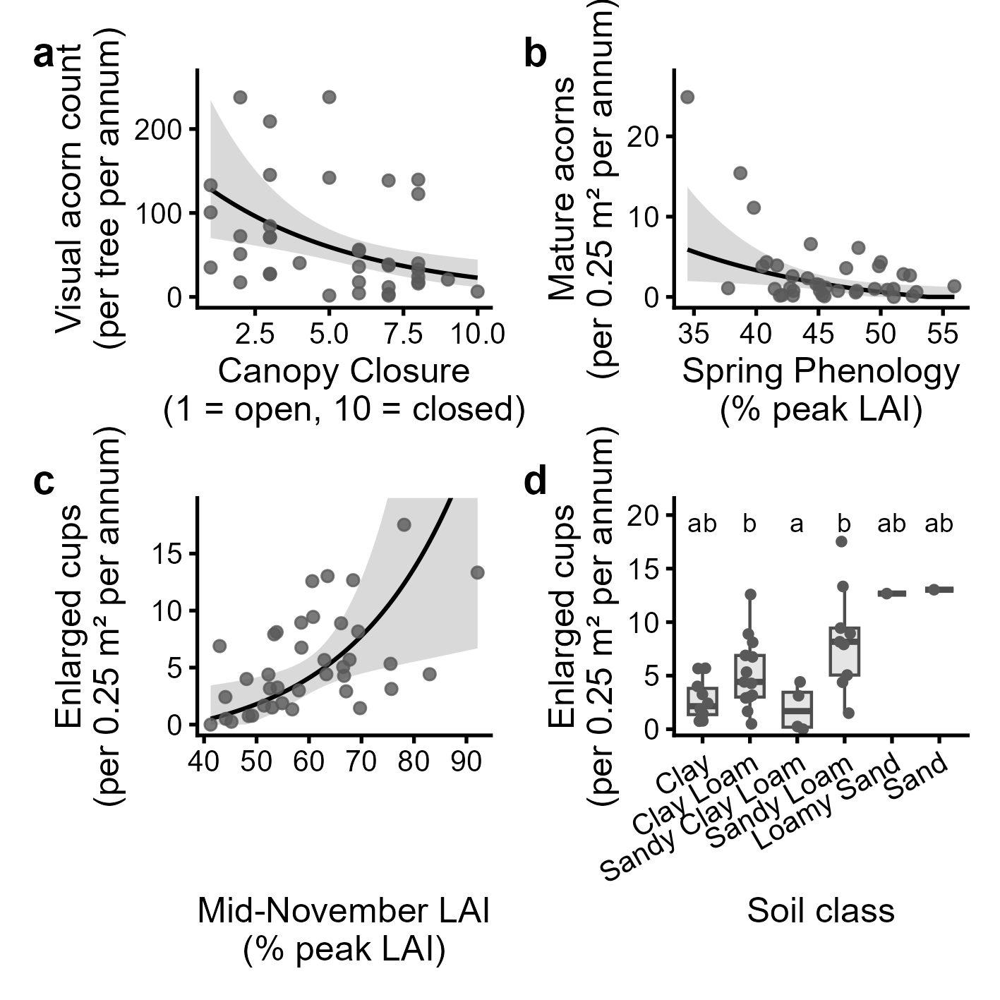

## Residual diagnostics (Supplementary Figures 9–10, Tables 8–9)

``` r
dharma_test <- function(m, label) {
  set.seed(42)
  sim <- simulateResiduals(m, n = 1000)
  png(file.path(DIR_FIG, paste0("SuppFig09_DHARMa_", label, ".png")),
      width = 170, height = 85, units = "mm", res = 300)
  plot(sim, title = paste("DHARMa residuals:", label)); dev.off()
  tibble(Model = label,
         `KS P` = testUniformity(sim, plot = FALSE)$p.value,
         `Dispersion ratio` = unname(testDispersion(sim, plot = FALSE)$statistic),
         `Dispersion P` = testDispersion(sim, plot = FALSE)$p.value,
         `Outlier P` = testOutliers(sim, plot = FALSE)$p.value)
}
st8 <- imap_dfr(glms, dharma_test)
save_tab(st8 |> mutate(across(where(is.double), ~ round(.x, 4))), "SuppTable08_DHARMa_tests")
for (r in names(glms)) show_fig(paste0("SuppFig09_DHARMa_", r))
```

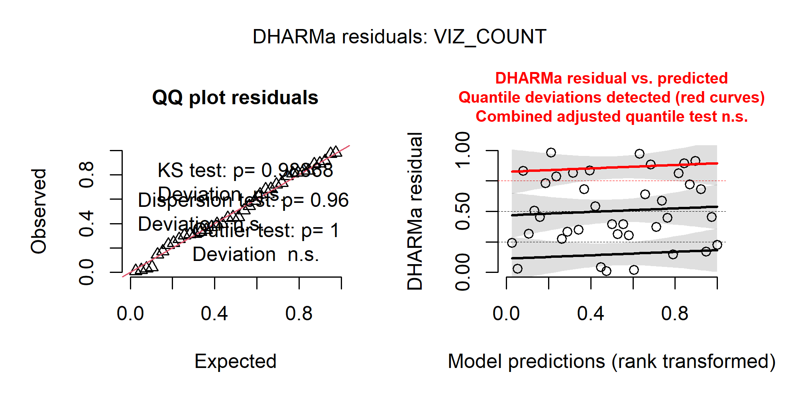

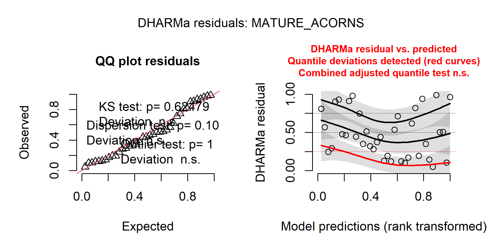

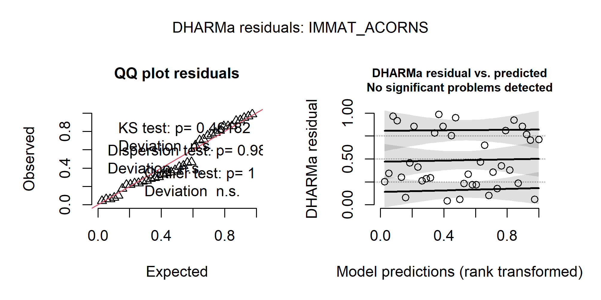

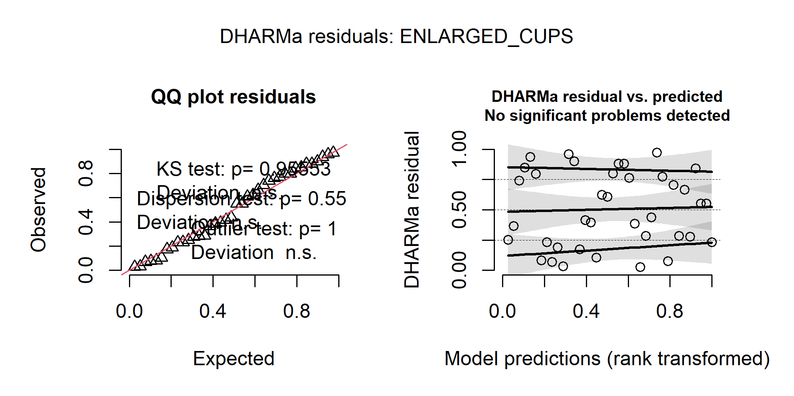

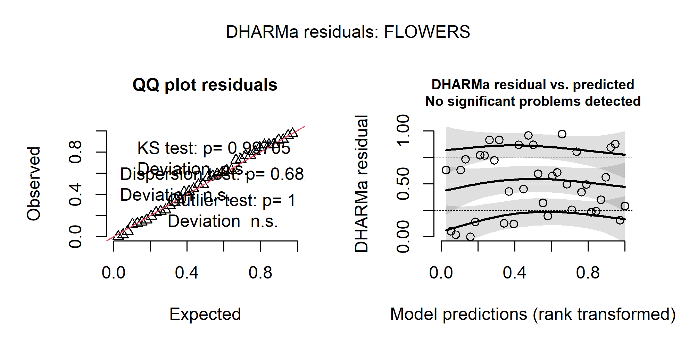

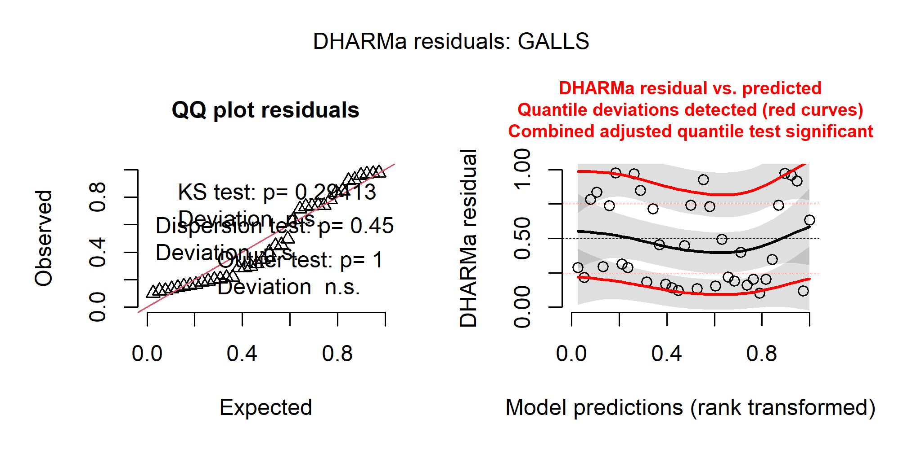

``` r
knitr::kable(st8, digits = 4)
```

| Model         |   KS P | Dispersion ratio | Dispersion P | Outlier P |
|:--------------|-------:|-----------------:|-------------:|----------:|
| VIZ_COUNT     | 0.9887 |           0.7127 |        0.968 |         1 |
| MATURE_ACORNS | 0.6248 |           1.8035 |        0.102 |         1 |
| IMMAT_ACORNS  | 0.4618 |           0.9218 |        0.980 |         1 |
| ENLARGED_CUPS | 0.9555 |           0.7125 |        0.558 |         1 |
| FLOWERS       | 0.9971 |           0.8111 |        0.682 |         1 |
| GALLS         | 0.2941 |           1.2212 |        0.458 |         1 |

``` r
f_viz <- formula(glms$VIZ_COUNT)
viz_models <- list(`Gamma (log)` = glms$VIZ_COUNT,
                   `Negative binomial (log)` = MASS::glm.nb(f_viz, data = mutate(trees, VIZ_COUNT = round(VIZ_COUNT))),
                   `Poisson (log)` = glm(f_viz, data = mutate(trees, VIZ_COUNT = round(VIZ_COUNT)),
                                         family = poisson("log")))
st9 <- imap_dfr(viz_models, function(m, lab) {
  set.seed(42)
  sim <- simulateResiduals(m, n = 1000)
  slug <- gsub("[^A-Za-z]", "", lab)
  png(file.path(DIR_FIG, paste0("SuppFig10_DHARMa_VIZ_COUNT_", slug, ".png")),
      width = 170, height = 85, units = "mm", res = 300)
  plot(sim, title = paste("Visual acorn count:", lab)); dev.off()
  show_fig(paste0("SuppFig10_DHARMa_VIZ_COUNT_", slug))
  tibble(Distribution = lab, AIC = AIC(m),
         `KS P` = testUniformity(sim, plot = FALSE)$p.value,
         `Dispersion ratio` = unname(testDispersion(sim, plot = FALSE)$statistic),
         `Dispersion P` = testDispersion(sim, plot = FALSE)$p.value)
})
```


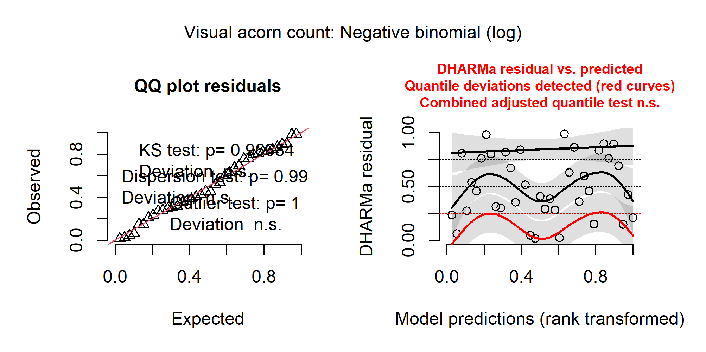

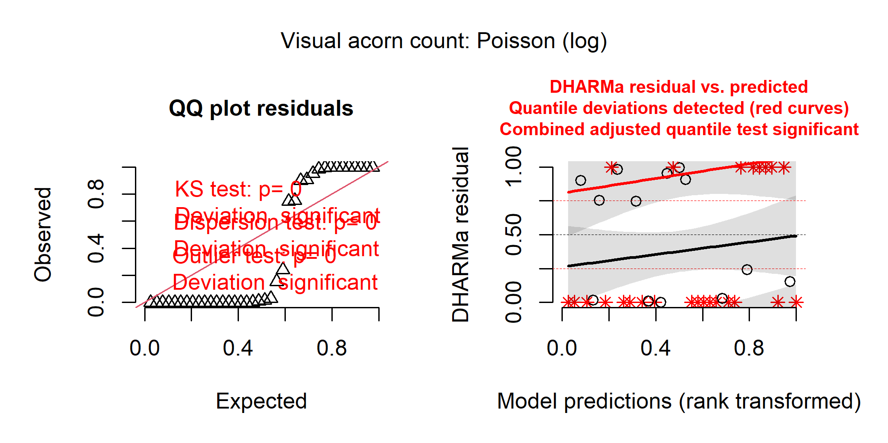

``` r
save_tab(st9 |> mutate(across(where(is.double), ~ round(.x, 4))), "SuppTable09_distribution_comparison")
knitr::kable(st9, digits = 4)
```

| Distribution            |       AIC |   KS P | Dispersion ratio | Dispersion P |
|:------------------------|----------:|-------:|-----------------:|-------------:|
| Gamma (log)             |  396.5335 | 0.9887 |           0.7127 |        0.968 |
| Negative binomial (log) |  396.5424 | 0.9668 |           0.7434 |        0.994 |
| Poisson (log)           | 1779.0910 | 0.0000 |          50.8580 |        0.000 |

The Poisson and negative-binomial models use visual counts rounded to
integers (the response is a three-year mean).

# Producer class and relatedness

Summed pairwise KING kinship per tree (tree attribute table) compared
among producer classes. Tree 33 failed sequencing, and Tree 25 is
excluded because its sample showed elevated kinship with all other
samples, consistent with contamination.

``` r
kin <- trees |> filter(!is.na(KING), Tree != "25")
kin_aov <- summary(aov(KING ~ Class, data = kin))[[1]]
kin_summary <- kin |> group_by(Class) |>
  summarise(n = n(), mean = mean(KING), se = sd(KING) / sqrt(n()), .groups = "drop")
kin_aov
knitr::kable(kin_summary, digits = 3)
```

    #>             Df  Sum Sq  Mean Sq F value Pr(>F)
    #> Class        2 0.04956 0.024781   0.538 0.5889
    #> Residuals   33 1.51998 0.046060

| Class  |   n |  mean |    se |
|:-------|----:|------:|------:|
| High   |   6 | 4.190 | 0.038 |
| Medium |  20 | 4.290 | 0.060 |
| Low    |  10 | 4.244 | 0.037 |

# Powdery mildew (Supplementary Table 11, Figure 12)

Dry weight of prematurely abscised, mildew-infected leaves per 0.25 m²
trap in August 2021 related to 2021 litter-trap counts (Gamma GLMs, log
link, count + 1). No mature acorns were produced in 2021.

``` r
pm <- read_excel(file.path(DIR_RAW, "reproduction", "powdery_mildew_2021.xlsx")) |>
  transmute(Tree = as.character(TREE_ID), PM_leaves) |>
  filter(Tree %in% STUDY_TREES) |>
  inner_join(load_litter_traps() |> filter(Year == 2021), by = "Tree")

pm_models <- map(set_names(c("IMMAT_ACORNS", "ENLARGED_CUPS", "FLOWERS", "GALLS")),
                 ~ glm(reformulate("PM_leaves", paste0("I(", .x, " + 1)")),
                       data = pm, family = Gamma("log")))
st11 <- imap_dfr(pm_models, ~ tidy(.x) |> filter(term == "PM_leaves") |>
                   transmute(Variable = VAR_LABELS[.y], Estimate = estimate,
                             SE = std.error, t = statistic, P = p.value))
save_tab(st11 |> mutate(across(Estimate:t, ~ signif(.x, 4)), P = fmt_p(P)),
         "SuppTable11_powdery_mildew")
cat("n trees:", nrow(pm), "\n")
knitr::kable(st11, digits = 4)
```

    #> n trees: 38

| Variable        | Estimate |     SE |       t |      P |
|:----------------|---------:|-------:|--------:|-------:|
| Immature acorns |  -0.0077 | 0.0111 | -0.6945 | 0.4918 |
| Enlarged cups   |  -0.0048 | 0.0110 | -0.4313 | 0.6688 |
| Flowers         |  -0.0300 | 0.0186 | -1.6143 | 0.1152 |
| Galls           |  -0.0622 | 0.0230 | -2.7042 | 0.0104 |

``` r
g_pm <- pm_models$GALLS
grid <- tibble(PM_leaves = seq(min(pm$PM_leaves), max(pm$PM_leaves), length.out = 100))
pr <- predict(g_pm, grid, type = "link", se.fit = TRUE)
grid <- grid |> mutate(fit = exp(pr$fit) - 1,
                       lwr = pmax(exp(pr$fit - 1.96 * pr$se.fit) - 1, 0),
                       upr = exp(pr$fit + 1.96 * pr$se.fit) - 1)
dev_r2 <- 1 - g_pm$deviance / g_pm$null.deviance

sf12 <- ggplot(pm, aes(PM_leaves, GALLS)) +
  geom_ribbon(data = grid, aes(PM_leaves, ymin = lwr, ymax = upr), inherit.aes = FALSE,
              fill = "grey85") +
  geom_line(data = grid, aes(PM_leaves, fit), linewidth = 0.7) +
  geom_point(size = 1.8, colour = "grey30") +
  annotate("text", x = Inf, y = Inf, hjust = 1.05, vjust = 1.3, size = 3.2,
           label = sprintf("Deviance R² = %.2f", dev_r2)) +
  labs(x = "Dry weight of abscised leaves\n(g per 0.25 m² trap)",
       y = "Galls per 0.25 m² trap (2021)")
save_fig(sf12, "SuppFig12_galls_vs_powdery_mildew", width = 90, height = 90)
```

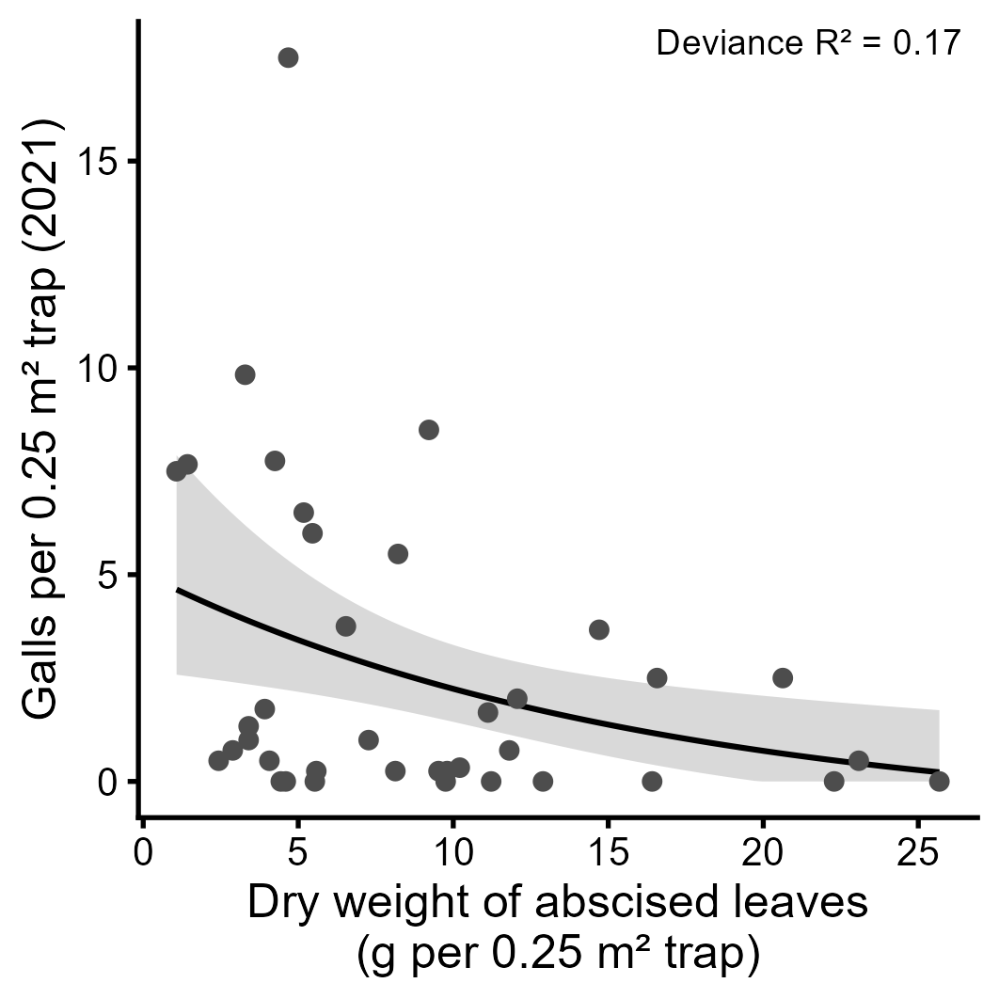

# Key results

``` r
fmt_row <- function(resp, var) {
  r <- table2 |> filter(Response == VAR_LABELS[[resp]], Variable == VAR_LABELS[[var]])
  if (nrow(r) == 0) return("not in model")
  sprintf("GLM chi2 = %.2f, P = %.4f; GLMM beta = %.3f, z = %.2f, P = %.4f",
          r$Chisq, r$P_GLM, r$beta, r$z, r$P_GLMM)
}
key03 <- tribble(
  ~Statistic, ~Value,
  "VSURF variables (union over responses)", as.character(length(unique(unlist(selected)))),
  "VSURF variables per response", paste(lengths(selected), collapse = " / "),
  "OOB error reduction range (%)", sprintf("%.1f–%.1f", min(st6$`Error reduction (%)`), max(st6$`Error reduction (%)`)),
  "RF R² fitted (range)", sprintf("%.2f–%.2f", min(rf_r2$R2_fitted), max(rf_r2$R2_fitted)),
  "Visual count ~ Canopy Closure", fmt_row("VIZ_COUNT", "CANOPY_CLOSURE"),
  "Visual count ~ Crown Spread", fmt_row("VIZ_COUNT", "CROWN_SPREAD"),
  "Visual count ~ Spring Phenology", fmt_row("VIZ_COUNT", "SPRING_PHENO"),
  "Trap mature acorns ~ Spring Phenology", fmt_row("MATURE_ACORNS", "SPRING_PHENO"),
  "Enlarged cups ~ Mid-November LAI", fmt_row("ENLARGED_CUPS", "MIDNOV_LAI"),
  "Enlarged cups ~ Soil Class (GLM chi2, df, P)", with(filter(glm_part, Response == "ENLARGED_CUPS", Variable == "SOIL_CLASS"),
      if (length(Chisq)) sprintf("%.2f, %d, %.4f", Chisq, df, P_GLM) else "not in model"),
  "Galls ~ Tree Height", fmt_row("GALLS", "HEIGHT"),
  "Smallest GLM P, flowers", sprintf("%.4f", min(filter(glm_part, Response == "FLOWERS")$P_GLM)),
  "Smallest GLM P, immature acorns", sprintf("%.4f", min(filter(glm_part, Response == "IMMAT_ACORNS")$P_GLM)),
  "DHARMa KS P (min)", sprintf("%.3f", min(st8$`KS P`)),
  "Kinship ~ producer class", sprintf("F(%d,%d) = %.3f, P = %.2f", kin_aov$Df[1], kin_aov$Df[2],
                                       kin_aov$`F value`[1], kin_aov$`Pr(>F)`[1]),
  "Kinship high / medium / low (mean ± SE)", paste(sprintf("%.2f ± %.2f", kin_summary$mean, kin_summary$se), collapse = " / "),
  "Galls ~ powdery mildew (estimate, P)", sprintf("%.4f, %.4f", st11$Estimate[4], st11$P[4]),
  "Flowers ~ powdery mildew (estimate, P)", sprintf("%.4f, %.4f", st11$Estimate[3], st11$P[3])
)
save_tab(key03, "key_results_03_environmental_associations")
knitr::kable(key03)
```

| Statistic | Value |
|:---|:---|
| VSURF variables (union over responses) | 15 |
| VSURF variables per response | 5 / 2 / 7 / 5 / 6 / 1 |
| OOB error reduction range (%) | 16.2–25.9 |
| RF R² fitted (range) | 0.73–0.92 |
| Visual count ~ Canopy Closure | GLM chi2 = 8.15, P = 0.0043; GLMM beta = -0.169, z = -4.87, P = 0.0000 |
| Visual count ~ Crown Spread | GLM chi2 = 1.78, P = 0.1818; GLMM beta = -0.063, z = -2.74, P = 0.0061 |
| Visual count ~ Spring Phenology | GLM chi2 = 2.10, P = 0.1476; GLMM beta = -0.037, z = -1.92, P = 0.0554 |
| Trap mature acorns ~ Spring Phenology | GLM chi2 = 8.05, P = 0.0046; GLMM beta = -0.055, z = -3.56, P = 0.0004 |
| Enlarged cups ~ Mid-November LAI | GLM chi2 = 6.31, P = 0.0120; GLMM beta = 0.035, z = 2.25, P = 0.0244 |
| Enlarged cups ~ Soil Class (GLM chi2, df, P) | 22.31, 5, 0.0005 |
| Galls ~ Tree Height | GLM chi2 = 0.22, P = 0.6383; GLMM beta = 0.005, z = 0.36, P = 0.7217 |
| Smallest GLM P, flowers | 0.1298 |
| Smallest GLM P, immature acorns | 0.2210 |
| DHARMa KS P (min) | 0.294 |
| Kinship ~ producer class | F(2,33) = 0.538, P = 0.59 |
| Kinship high / medium / low (mean ± SE) | 4.19 ± 0.04 / 4.29 ± 0.06 / 4.24 ± 0.04 |
| Galls ~ powdery mildew (estimate, P) | -0.0622, 0.0104 |
| Flowers ~ powdery mildew (estimate, P) | -0.0300, 0.1152 |

``` r
sessionInfo()
```

    #> R version 4.5.2 (2025-10-31 ucrt)
    #> Platform: x86_64-w64-mingw32/x64
    #> Running under: Windows 11 x64 (build 26200)
    #> 
    #> Matrix products: default
    #>   LAPACK version 3.12.1
    #> 
    #> locale:
    #> [1] LC_COLLATE=English_United Kingdom.utf8 
    #> [2] LC_CTYPE=English_United Kingdom.utf8   
    #> [3] LC_MONETARY=English_United Kingdom.utf8
    #> [4] LC_NUMERIC=C                           
    #> [5] LC_TIME=English_United Kingdom.utf8    
    #> 
    #> time zone: Europe/London
    #> tzcode source: internal
    #> 
    #> attached base packages:
    #> [1] stats     graphics  grDevices utils     datasets  methods   base     
    #> 
    #> other attached packages:
    #>  [1] ggcorrplot_0.1.4.1  DHARMa_0.5.0        emmeans_2.0.3      
    #>  [4] multcomp_1.4-30     TH.data_1.1-5       MASS_7.3-65        
    #>  [7] survival_3.8-3      mvtnorm_1.4-0       broom.mixed_0.2.9.7
    #> [10] lme4_2.0-1          Matrix_1.7-4        car_3.1-5          
    #> [13] carData_3.0-6       iml_0.11.4          ranger_0.18.0      
    #> [16] VSURF_1.2.1         patchwork_1.3.2     readxl_1.4.5       
    #> [19] lubridate_1.9.4     forcats_1.0.1       stringr_1.6.0      
    #> [22] dplyr_1.1.4         purrr_1.2.2         readr_2.1.6        
    #> [25] tidyr_1.3.1         tibble_3.3.0        ggplot2_4.0.1      
    #> [28] tidyverse_2.0.0    
    #> 
    #> loaded via a namespace (and not attached):
    #>  [1] Rdpack_2.6.6         sandwich_3.1-1       rlang_1.2.0         
    #>  [4] magrittr_2.0.4       furrr_0.4.0          otel_0.2.0          
    #>  [7] compiler_4.5.2       mgcv_1.9-3           reshape2_1.4.5      
    #> [10] systemfonts_1.3.2    vctrs_0.7.3          pkgconfig_2.0.3     
    #> [13] crayon_1.5.3         fastmap_1.2.0        backports_1.5.0     
    #> [16] labeling_0.4.3       promises_1.5.0       rmarkdown_2.30      
    #> [19] tzdb_0.5.0           nloptr_2.2.1         ragg_1.5.1          
    #> [22] bit_4.6.0            xfun_0.57            randomForest_4.7-1.2
    #> [25] later_1.4.8          broom_1.0.12         parallel_4.5.2      
    #> [28] gap.datasets_0.0.6   R6_2.6.1             qgam_2.0.0          
    #> [31] stringi_1.8.7        RColorBrewer_1.1-3   parallelly_1.47.0   
    #> [34] boot_1.3-32          rpart_4.1.24         estimability_1.5.1  
    #> [37] cellranger_1.1.0     Rcpp_1.1.1           iterators_1.0.14    
    #> [40] knitr_1.51           zoo_1.8-15           Metrics_0.1.4       
    #> [43] httpuv_1.6.17        splines_4.5.2        timechange_0.3.0    
    #> [46] tidyselect_1.2.1     abind_1.4-8          yaml_2.3.12         
    #> [49] doParallel_1.0.17    codetools_0.2-20     listenv_0.10.1      
    #> [52] plyr_1.8.9           lattice_0.22-7       shiny_1.13.0        
    #> [55] withr_3.0.2          S7_0.2.1             coda_0.19-4.1       
    #> [58] evaluate_1.0.5       future_1.70.0        pillar_1.11.1       
    #> [61] gap_1.15.2           checkmate_2.3.4      foreach_1.5.2       
    #> [64] reformulas_0.4.4     generics_0.1.4       vroom_1.7.0         
    #> [67] hms_1.1.4            scales_1.4.0         minqa_1.2.8         
    #> [70] xtable_1.8-8         globals_0.19.1       glue_1.8.0          
    #> [73] tools_4.5.2          data.table_1.18.2.1  grid_4.5.2          
    #> [76] rbibutils_2.4.1      nlme_3.1-168         Formula_1.2-5       
    #> [79] cli_3.6.5            textshaping_1.0.5    viridisLite_0.4.2   
    #> [82] gtable_0.3.6         digest_0.6.39        farver_2.1.2        
    #> [85] htmltools_0.5.9      lifecycle_1.0.5      mime_0.13           
    #> [88] bit64_4.6.0-1
