4. Genomic associates of acorn production
================

- [Sequencing (Supplementary Table
  12)](#sequencing-supplementary-table-12)
- [Population structure (Supplementary Figure
  13)](#population-structure-supplementary-figure-13)
- [Kinship (Supplementary Table 13)](#kinship-supplementary-table-13)
- [GWAS variables](#gwas-variables)
- [LFMM2 association results](#lfmm2-association-results)
  - [Annotation](#annotation)
  - [Top associations and shared
    SNPs](#top-associations-and-shared-snps)
  - [Supplementary Figure 16](#supplementary-figure-16)
  - [Figure 5 and Supplementary Figure 17: Manhattan
    plots](#figure-5-and-supplementary-figure-17-manhattan-plots)
- [Gene-set enrichment (Supplementary Table
  16)](#gene-set-enrichment-supplementary-table-16)
- [Key results](#key-results)

This notebook covers population structure, relatedness and the
genome-wide association study (GWAS) of the 37 sequenced trees (Results:
*Genomic associates of acorn production*).

Read processing, variant calling, filtering, LD pruning, PCA, kinship
estimation, sNMF and genotype imputation were run on a computing cluster
(see `genomics/README.md`); their outputs are the inputs in
`data/raw/genomics/` and `cache/gwas/`. The LFMM2 association tests are
run by `genomics/gwas_lfmm.R`, whose Z-scores are stored in
`cache/gwas/`.

| Output | Content |
|----|----|
| Figure 5 | Manhattan plots, reproductive traits |
| Supplementary Table 12 | Sequencing statistics |
| Supplementary Figure 13 | Population structure (PCA, sNMF) |
| Supplementary Table 13 | Pairwise kinship |
| Supplementary Figures 14–15 | GWAS variable distributions; soil texture PCA |
| Supplementary Table 14 | Significant SNPs (a) and genomic inflation factors (b) |
| Supplementary Figure 16 | P- and Q-value distributions |
| Supplementary Figure 17 | Manhattan plots, environmental variables |
| Supplementary Table 15 | Significant SNPs in coding sequences |
| Supplementary Table 16 | Gene-set enrichment (GO) for visual acorn count |

``` r
source("R/setup.R")
suppressPackageStartupMessages({
  library(data.table); library(ggrepel); library(vegan)
  library(GenomicRanges); library(rtracklayer)
  library(clusterProfiler); library(org.At.tair.db)
})
select <- dplyr::select
filter <- dplyr::filter
DIR_GEN <- file.path(DIR_RAW, "genomics")
```

# Sequencing (Supplementary Table 12)

``` r
seq_stats <- read_csv(file.path(DIR_GEN, "sequencing_statistics.csv"),
                      col_types = cols(Tree = "c", Sequencing_ID = "c"))
save_tab(seq_stats, "SuppTable12_sequencing_statistics")
geno_ids <- readLines(file.path(DIR_GEN, "genotypes", "WWO_37WGS_pruned.012.indv"))
n_snps <- length(readLines(file.path(DIR_GEN, "genotypes", "WWO_37WGS_pruned_imputed.012.pos")))

stopifnot(setequal(geno_ids, seq_stats$Sequencing_ID))
cat("Sequenced trees:", nrow(seq_stats), "\n")
cat("Raw bases (Gb): mean", round(mean(seq_stats$Raw_bases_Gb), 2),
    "SD", round(sd(seq_stats$Raw_bases_Gb), 2), "\n")
cat("SNPs after filtering and LD pruning:", format(n_snps, big.mark = ","), "\n")
cat("Study trees not sequenced:", paste(setdiff(STUDY_TREES, seq_stats$Tree), collapse = ", "), "\n")
```

    #> Sequenced trees: 37 
    #> Raw bases (Gb): mean 51.16 SD 6.35 
    #> SNPs after filtering and LD pruning: 1,013,644 
    #> Study trees not sequenced: 33

# Population structure (Supplementary Figure 13)

PCA (PLINK) of the LD-pruned SNPs, with the broken-stick criterion, and
sNMF cross-entropy for K = 1–6 (three repetitions each;
`genomics/run_snmf.R`). PLINK reports the first 20 eigenvalues of the
genomic relationship matrix; the total variance is its trace, which for
standardised genotypes equals the number of samples. The broken-stick
expectation is computed for the n − 1 = 36 non-trivial components.

``` r
eigval <- scan(file.path(DIR_GEN, "population_structure", "pca.eigenval"), quiet = TRUE)
pca <- read.table(file.path(DIR_GEN, "population_structure", "pca.eigenvec"))[, -1]
names(pca) <- c("Sample", paste0("PC", seq_len(ncol(pca) - 1)))
n_ind <- nrow(pca)
pve <- tibble(PC = seq_along(eigval), pve = 100 * eigval / n_ind,
              broken_stick = 100 * bstick(n_ind - 1)[seq_along(eigval)])
# number of leading PCs that exceed the broken-stick expectation
n_sig_pc <- which(c(pve$pve <= pve$broken_stick, TRUE))[1] - 1
cat("Leading PCs exceeding the broken-stick expectation:", n_sig_pc,
    "| variance explained by PC1–PC3:", paste(sprintf("%.1f%%", pve$pve[1:3]), collapse = ", "), "\n")
```

Leading PCs exceeding the broken-stick expectation: 0 \| variance
explained by PC1–PC3: 3.0%, 2.9%, 2.7%

``` r
ce <- readRDS(file.path(DIR_CACHE, "gwas", "snmf_crossentropy.rds"))
ce_mean <- tapply(ce$ce, ce$K, mean)
cat("Cross-entropy by K:", paste(round(ce_mean, 4), collapse = "  "),
    "| minimum at K =", names(which.min(ce_mean)), "\n")
```

Cross-entropy by K: 0.6368 0.6724 0.7105 0.7453 0.7931 0.839 \| minimum
at K = 1

``` r
p_scree <- ggplot(pve, aes(PC, pve)) + geom_col(fill = "steelblue") +
  geom_line(aes(y = broken_stick)) + geom_point(aes(y = broken_stick), size = 0.8) +
  labs(x = "Principal component", y = "Variance explained (%)")
p_ce <- ggplot(ce, aes(factor(K), ce)) +
  geom_jitter(width = 0.1, colour = "steelblue", alpha = 0.6) +
  stat_summary(fun = mean, geom = "point", shape = 18, size = 3, colour = "firebrick") +
  labs(x = "Ancestral\npopulations (K)", y = "Cross-entropy")
pc_plot <- function(a, b) ggplot(pca, aes(.data[[a]], .data[[b]])) +
  geom_point(colour = "grey30", size = 1.5) +
  labs(x = sprintf("%s (%.1f%%)", a, pve$pve[as.integer(sub("PC", "", a))]),
       y = sprintf("%s (%.1f%%)", b, pve$pve[as.integer(sub("PC", "", b))]))

save_fig(p_scree, "SuppFig13a_pca_scree", width = 60, height = 60)
```

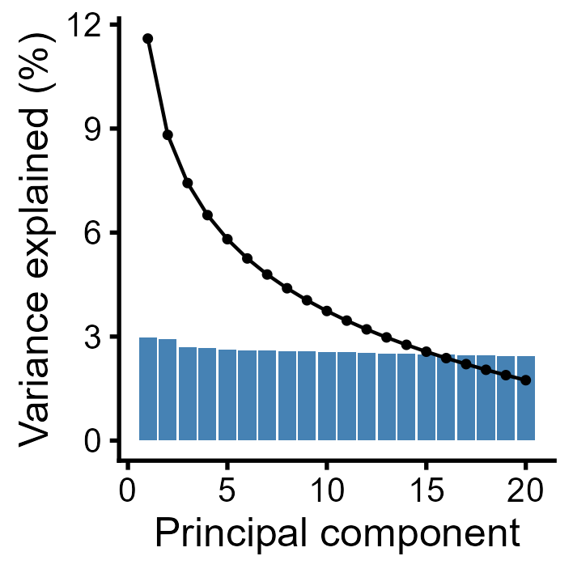

``` r
save_fig(p_ce, "SuppFig13b_snmf_crossentropy", width = 60, height = 60)
```

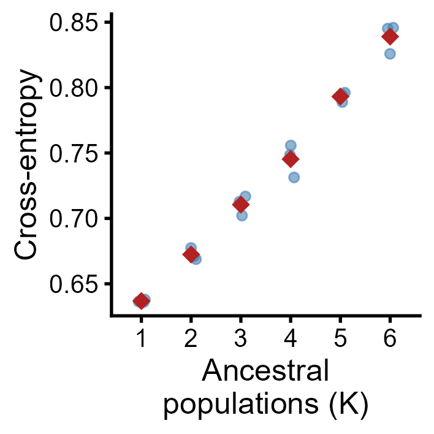

``` r
save_fig(pc_plot("PC1", "PC2"), "SuppFig13c_pca_pc1_pc2", width = 60, height = 60)
```

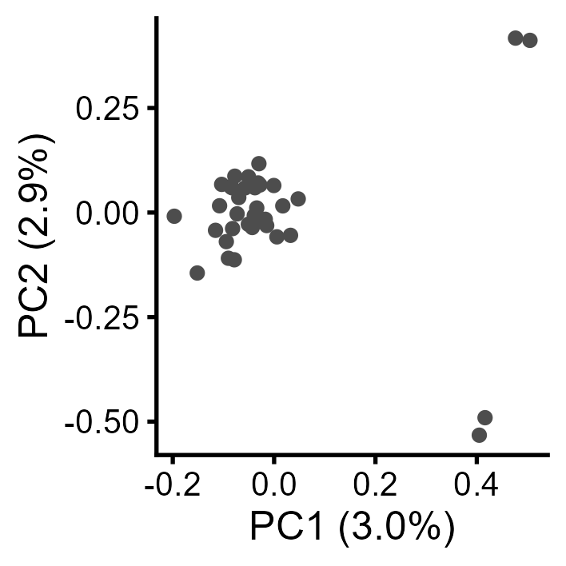

``` r
save_fig(pc_plot("PC2", "PC3"), "SuppFig13d_pca_pc2_pc3", width = 60, height = 60)
```

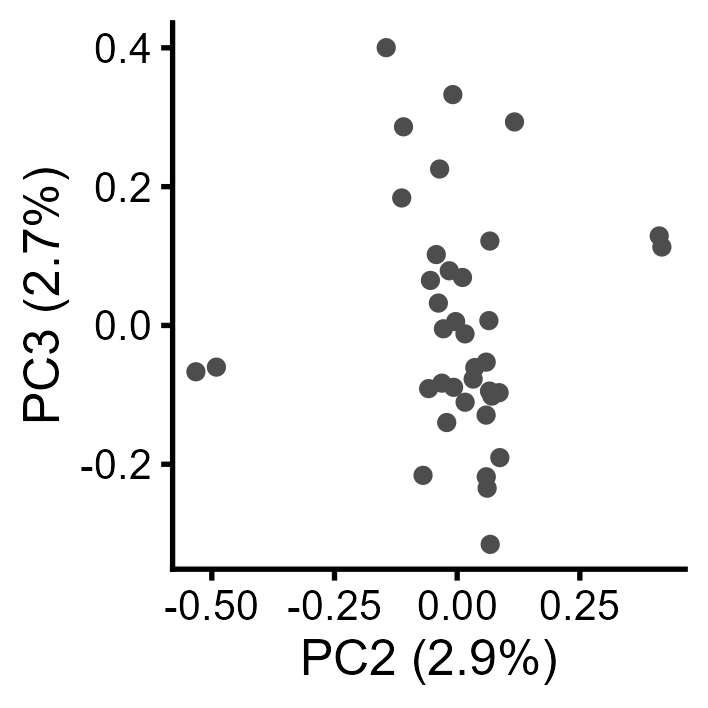

# Kinship (Supplementary Table 13)

Pairwise KING-robust kinship coefficients (φ) from
`vcftools --relatedness2` on the filtered (not LD-pruned) SNP set,
classified after Manichaikul et al. (2010).

``` r
kin <- read_tsv(file.path(DIR_GEN, "population_structure", "kinship_full_snpset.relatedness2"),
                show_col_types = FALSE) |>
  mutate(Class = cut(RELATEDNESS_PHI, c(-Inf, 0.0442, 0.0884, 0.177, 0.354, Inf),
                     labels = c(">3°", "3°", "2°", "1°", "0°")))
save_tab(kin, "SuppTable13_kinship")

kin_pairs <- kin |> filter(INDV1 < INDV2)
kin_pairs |> count(Class) |> mutate(pct = round(100 * n / sum(n), 2)) |> knitr::kable()
cat("Pairs:", nrow(kin_pairs), "| phi mean", round(mean(kin_pairs$RELATEDNESS_PHI), 3),
    "SD", round(sd(kin_pairs$RELATEDNESS_PHI), 3), "range",
    paste(round(range(kin_pairs$RELATEDNESS_PHI), 3), collapse = "–"), "\n")
```

| Class |   n |   pct |
|:------|----:|------:|
| \>3°  | 452 | 67.87 |
| 3°    | 175 | 26.28 |
| 2°    |  37 |  5.56 |
| 1°    |   2 |  0.30 |

    #> Pairs: 666 | phi mean 0.048 SD 0.032 range 0.016–0.193

# GWAS variables

Phenotypes: visual count (2020–2023 mean), litter-trap mature and
immature acorns, enlarged cups and flowers. Environmental variables: the
predictors significant in the GLMs (Canopy Closure, Spring Phenology,
Mid-November LAI) and soil texture summarised as the first principal
component of scaled sand, silt and clay (SOIL_PC1). Mature and immature
acorns were log(x + 1)-transformed.

``` r
GWAS_VARS <- c("VIZ_COUNT", "MATURE_ACORNS", "IMMAT_ACORNS", "ENLARGED_CUPS", "FLOWERS",
               "CANOPY_CLOSURE", "SPRING_PHENO", "SOIL_PC1", "MIDNOV_LAI")
PHENOTYPES <- GWAS_VARS[1:5]; ENVIRONMENT <- GWAS_VARS[6:9]

attrs <- read_excel(file.path(DIR_RAW, "trees", "tree_attributes.xlsx")) |>
  transmute(Tree = as.character(TREE_ID), Sequencing_ID = SPECIMEN_ID,
            CANOPY_CLOSURE, SPRING_PHENO, MIDNOV_LAI,
            SAND = as.numeric(SAND), SILT = as.numeric(SILT), CLAY = as.numeric(CLAY), SOIL_CLASS)
repro <- read_csv(file.path(DIR_DERIVED, "tree_reproduction.csv"), col_types = cols(Tree = "c"))

gw <- tibble(Sequencing_ID = geno_ids) |>
  left_join(attrs, by = "Sequencing_ID") |>
  left_join(repro, by = "Tree") |>
  mutate(VIZ_COUNT = VIZ_COUNT_2020_2023)

soil_pca <- prcomp(gw[, c("SAND", "SILT", "CLAY")], center = TRUE, scale. = TRUE)
soil_pve <- 100 * soil_pca$sdev^2 / sum(soil_pca$sdev^2)
gw$SOIL_PC1 <- soil_pca$x[, 1]
cat("Soil PC1 explains", round(soil_pve[1], 1), "% of texture variance\n")

gw_raw <- gw
gw <- gw |> mutate(across(c(MATURE_ACORNS, IMMAT_ACORNS), log1p))

# Input to LFMM2 (rows in genotype-matrix order)
stopifnot(identical(gw$Sequencing_ID, geno_ids), !anyNA(gw[, GWAS_VARS]))
f_vars <- file.path(DIR_DERIVED, "gwas_variables.csv")
write_csv(select(gw, Sequencing_ID, Tree, all_of(GWAS_VARS)), f_vars)
knitr::kable(select(gw, Tree, all_of(GWAS_VARS)) |> head(), digits = 2)
```

    #> Soil PC1 explains 95.4 % of texture variance

| Tree | VIZ_COUNT | MATURE_ACORNS | IMMAT_ACORNS | ENLARGED_CUPS | FLOWERS | CANOPY_CLOSURE | SPRING_PHENO | SOIL_PC1 | MIDNOV_LAI |
|:---|---:|---:|---:|---:|---:|---:|---:|---:|---:|
| 1 | 169.25 | 1.67 | 2.24 | 17.53 | 94.72 | 3 | 40.83 | -1.47 | 78.13 |
| 2 | 39.75 | 0.56 | 0.85 | 2.42 | 28.00 | 3 | 48.08 | 1.80 | 44.06 |
| 3 | 46.25 | 0.56 | 1.14 | 1.88 | 37.12 | 6 | 46.57 | 1.01 | 54.89 |
| 4 | 44.50 | 0.77 | 2.36 | 5.69 | 57.06 | 6 | 45.57 | 1.71 | 67.73 |
| 5 | 15.25 | 0.75 | 1.02 | 1.44 | 25.89 | 8 | 42.72 | 1.91 | 69.72 |
| 6 | 13.75 | 0.00 | 0.00 | 0.00 | 25.00 | 2 | 51.05 | -1.37 | 41.25 |

``` r
GWAS_LABELS <- c(VIZ_COUNT = "Visual count", MATURE_ACORNS = "Mature acorns",
                 IMMAT_ACORNS = "Immature acorns", ENLARGED_CUPS = "Enlarged cups",
                 FLOWERS = "Flowers", CANOPY_CLOSURE = "Canopy Closure",
                 SPRING_PHENO = "Spring Phenology", SOIL_PC1 = "Soil PC1",
                 MIDNOV_LAI = "Mid-November LAI")

qq_panel <- function(d, title) {
  d |> select(all_of(PHENOTYPES)) |>
    pivot_longer(everything(), names_to = "Variable") |>
    mutate(Variable = factor(GWAS_LABELS[Variable], levels = GWAS_LABELS[PHENOTYPES])) |>
    ggplot(aes(sample = value)) + stat_qq(size = 0.8) + stat_qq_line(colour = "firebrick") +
    facet_wrap(~ Variable, scales = "free_y", ncol = 3) +
    labs(subtitle = title, x = "Theoretical quantiles", y = "Sample quantiles")
}
save_fig(qq_panel(gw_raw, "Before transformation"),
         "SuppFig14a_QQ_before_transformation", width = 170, height = 120)
```

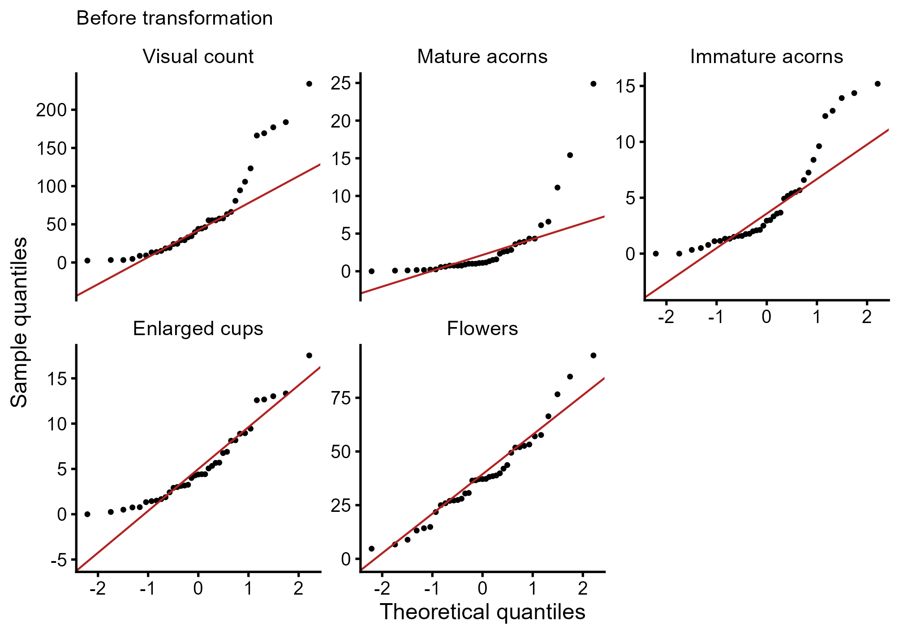

``` r
save_fig(qq_panel(gw, "After log(x + 1) of mature and immature acorns"),
         "SuppFig14b_QQ_after_transformation", width = 170, height = 120)
```

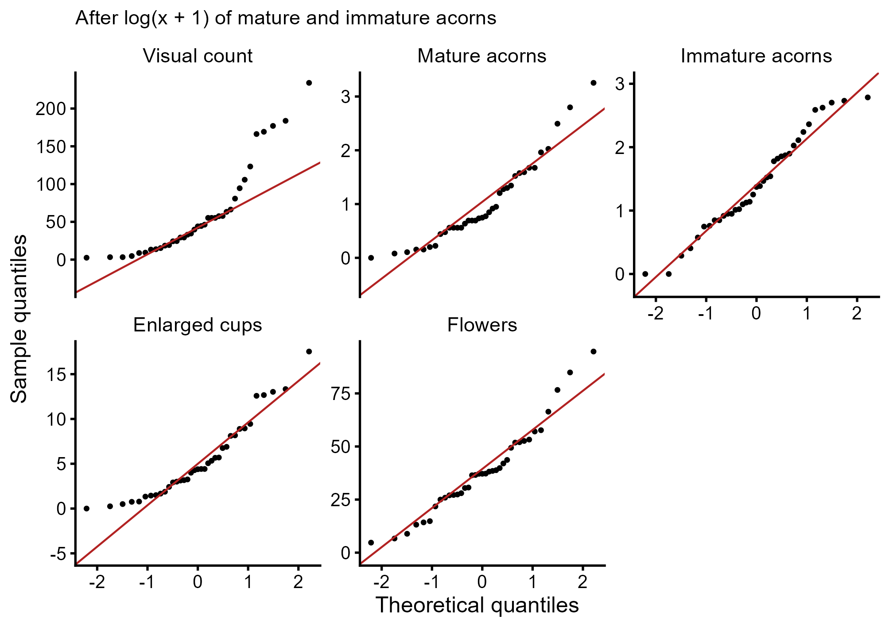

``` r
sf15 <- ggplot(gw, aes(soil_pca$x[, 1], soil_pca$x[, 2], colour = gsub("_", " ", SOIL_CLASS))) +
  geom_point(size = 2) + ggsci::scale_colour_npg(name = "Soil class") +
  labs(x = sprintf("PC1 (%.1f%%)", soil_pve[1]), y = sprintf("PC2 (%.1f%%)", soil_pve[2]))
save_fig(sf15, "SuppFig15_soil_texture_PCA", width = 100, height = 90)
```

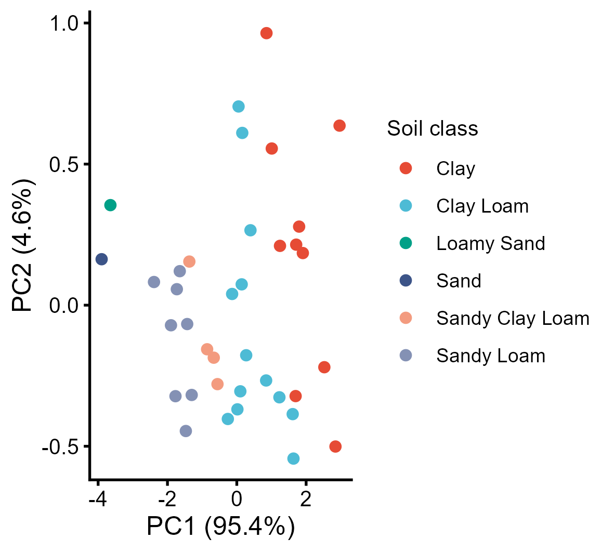

# LFMM2 association results

LFMM2 with K = 1 latent factor on the imputed, LD-pruned genotypes;
P-values recalibrated by genomic control and converted to Q-values
(Benjamini–Hochberg). Significance: Q \< 0.05.

The test is run by `genomics/gwas_lfmm.R` (a few minutes on a desktop
computer); the result is cached together with a copy of the variables it
was run on, and recomputed whenever the variables change.

``` r
f_res  <- file.path(DIR_CACHE, "gwas", "lfmm2_results.rds")
f_used <- file.path(DIR_CACHE, "gwas", "lfmm2_results_variables.csv")
if (!file.exists(f_res) || !file.exists(f_used) ||
    !identical(read_lines(f_used), read_lines(f_vars))) {
  rscript <- file.path(R.home("bin"), "Rscript")
  status <- system2(rscript, c("genomics/gwas_lfmm.R",
                               file.path(DIR_GEN, "genotypes", "WWO_37WGS_pruned_imputed.lfmm"),
                               file.path(DIR_GEN, "genotypes", "WWO_37WGS_pruned_imputed.012.pos"),
                               f_vars, f_res))
  stopifnot(status == 0)
  file.copy(f_vars, f_used, overwrite = TRUE)
}
# P- and Q-values from the stored Z-scores: genome-wide genomic control, then qvalue
lfmm_pq <- function(res) {
  chi2 <- res$z^2
  lambda <- apply(chi2, 2, median) / qchisq(0.5, df = 1, lower.tail = FALSE)
  res$p <- pchisq(sweep(chi2, 2, lambda, "/"), df = 1, lower.tail = FALSE)
  res$q <- apply(res$p, 2, function(x) qvalue::qvalue(x)$qvalues)
  res
}
res <- lfmm_pq(readRDS(f_res))
loci <- as_tibble(res$loci)
colnames(res$p) <- colnames(res$q) <- colnames(res$z) <- GWAS_VARS
stopifnot(nrow(loci) == n_snps)

st14b <- res$gif |> rename(Variable = Trait, lambda = GIF)
save_tab(st14b, "SuppTable14b_genomic_inflation")
knitr::kable(st14b)

sig_idx <- which(res$q < 0.05, arr.ind = TRUE)
sig <- tibble(CHROM = loci$CHROM[sig_idx[, 1]], POS = loci$POS[sig_idx[, 1]],
              trait = GWAS_VARS[sig_idx[, 2]],
              z = res$z[sig_idx], p = res$p[sig_idx], q = res$q[sig_idx])
cat("Trait–SNP associations:", nrow(sig), "| unique SNPs:",
    nrow(distinct(sig, CHROM, POS)), "\n")
```

|                | Variable       | lambda |
|:---------------|:---------------|-------:|
| VIZ_COUNT      | VIZ_COUNT      | 1.0089 |
| MATURE_ACORNS  | MATURE_ACORNS  | 1.0234 |
| IMMAT_ACORNS   | IMMAT_ACORNS   | 1.0107 |
| ENLARGED_CUPS  | ENLARGED_CUPS  | 1.0169 |
| FLOWERS        | FLOWERS        | 1.0435 |
| CANOPY_CLOSURE | CANOPY_CLOSURE | 1.0353 |
| SPRING_PHENO   | SPRING_PHENO   | 1.0170 |
| SOIL_PC1       | SOIL_PC1       | 1.0616 |
| MIDNOV_LAI     | MIDNOV_LAI     | 1.0068 |

    #> Trait–SNP associations: 2366 | unique SNPs: 2306

## Annotation

SNPs are overlapped with coding sequences (CDS) of the *Q. robur* PM1N
annotation. Each *Q. robur* protein is assigned its best *Arabidopsis
thaliana* Araport11 blastp hit (E \< 1 × 10⁻¹⁰).

``` r
ann_cache <- file.path(DIR_CACHE, "gwas", "snp_cds_annotation.rds")
if (file.exists(ann_cache)) {
  snp_cds <- readRDS(ann_cache)
} else {
  cds <- import(file.path(DIR_GEN, "reference", "Qrob_cds.gff"))
  cds <- cds[cds$type == "CDS"]
  cds$gene <- vapply(cds$Parent, `[`, character(1), 1)
  hits <- findOverlaps(GRanges(loci$CHROM, IRanges(loci$POS, width = 1)), cds)
  snp_cds <- tibble(idx = queryHits(hits), gene = cds$gene[subjectHits(hits)]) |>
    distinct(idx, .keep_all = TRUE)
  blast <- read_tsv(file.path(DIR_GEN, "reference", "Qrob_araport_pep_annotation.tsv"),
                    col_names = FALSE, show_col_types = FALSE) |>
    filter(X11 < 1e-10) |> arrange(X11) |> distinct(X1, .keep_all = TRUE) |>
    transmute(gene = sub("^Qrob_P", "Qrob_T", X1), tair = X2,
              tair_locus = sub("\\.\\d+$", "", X2))
  syms <- AnnotationDbi::select(org.At.tair.db, unique(blast$tair_locus), c("SYMBOL", "GENENAME"),
                                keytype = "TAIR") |>
    distinct(TAIR, .keep_all = TRUE)
  snp_cds <- snp_cds |> left_join(blast, by = "gene") |>
    left_join(syms, by = c(tair_locus = "TAIR")) |>
    rename(symbol = SYMBOL, description = GENENAME)
  saveRDS(snp_cds, ann_cache)
}

st14a <- sig |>
  mutate(idx = match(paste(CHROM, POS), paste(loci$CHROM, loci$POS))) |>
  left_join(snp_cds, by = "idx") |>
  select(CHROM, POS, trait, z, p, q, gene, tair, symbol, description) |>
  arrange(trait, CHROM, POS)
save_tab(st14a, "SuppTable14a_significant_SNPs")

st15 <- st14a |> group_by(trait) |>
  summarise(`Significant SNPs` = n(), `SNPs in CDS` = sum(!is.na(gene)),
            `Unique genes` = n_distinct(gene, na.rm = TRUE)) |>
  arrange(match(trait, GWAS_VARS))
save_tab(st15, "SuppTable15_SNPs_in_CDS")
knitr::kable(st15)
```

| trait          | Significant SNPs | SNPs in CDS | Unique genes |
|:---------------|-----------------:|------------:|-------------:|
| VIZ_COUNT      |             1322 |          62 |           59 |
| MATURE_ACORNS  |              102 |           5 |            5 |
| IMMAT_ACORNS   |               61 |           2 |            2 |
| ENLARGED_CUPS  |              399 |          16 |           16 |
| FLOWERS        |              178 |           3 |            3 |
| CANOPY_CLOSURE |               83 |           3 |            3 |
| SPRING_PHENO   |              100 |           3 |            3 |
| SOIL_PC1       |               11 |           1 |            1 |
| MIDNOV_LAI     |              110 |           8 |            8 |

## Top associations and shared SNPs

``` r
top_genes <- st14a |> filter(!is.na(symbol)) |> group_by(trait) |> slice_min(q, n = 3) |>
  ungroup() |> arrange(q)
knitr::kable(head(top_genes, 12), digits = 5)

named <- tribble(~CHROM, ~POS, ~trait,
                  "Qrob_Chr05",          21543255, "VIZ_COUNT",
                  "Qrob_Chr01",          33760705, "ENLARGED_CUPS",
                  "Qrob_H2.3_Sc0000026",   494412, "MIDNOV_LAI") |>
  left_join(st14a, by = c("CHROM", "POS", "trait")) |>
  select(CHROM, POS, trait, z, q, symbol)
knitr::kable(named, digits = 5, caption = "Candidate genes named in the Results (PDI4, PRA1B4, WTF1)")

pairs <- list(c("VIZ_COUNT", "CANOPY_CLOSURE"), c("MATURE_ACORNS", "SPRING_PHENO"),
              c("ENLARGED_CUPS", "MIDNOV_LAI"), c("ENLARGED_CUPS", "SOIL_PC1"))
shared <- map_dfr(pairs, function(pr) {
  both <- which(res$q[, pr[1]] < 0.05 & res$q[, pr[2]] < 0.05)
  tibble(Pair = paste(pr, collapse = " × "), CHROM = loci$CHROM[both], POS = loci$POS[both],
         in_CDS = both %in% snp_cds$idx)
})
knitr::kable(shared, caption = "SNPs significant for both members of an environment–phenotype pair")
```

| CHROM | POS | trait | z | p | q | gene | tair | symbol | description |
|:---|---:|:---|---:|---:|---:|:---|:---|:---|:---|
| Qrob_Chr02 | 39883453 | VIZ_COUNT | -5.04324 | 0 | 0.00097 | Qrob_T0418650.2 | AT2G29420.1 | ATGSTU7 | Encodes glutathione transferase belonging to the tau class of GSTs. Naming convention according to Wagner et al. (2002). Induced by Salicylic acid. Independent of NPR1 for their induction by salicylic acid. |
| Qrob_Chr03 | 12646926 | VIZ_COUNT | -5.04324 | 0 | 0.00097 | Qrob_T0359970.2 | AT2G48060.3 | PZO1 | NA |
| Qrob_Chr03 | 54021905 | VIZ_COUNT | -5.04324 | 0 | 0.00097 | Qrob_T0452550.2 | AT1G11330.1 | RDA2 | NA |
| Qrob_Chr04 | 37749768 | VIZ_COUNT | -5.04324 | 0 | 0.00097 | Qrob_T0229540.2 | AT5G12080.3 | ATMSL10 | NA |
| Qrob_Chr07 | 6336198 | VIZ_COUNT | -5.04324 | 0 | 0.00097 | Qrob_T0266350.2 | AT1G22360.1 | AtUGT85A2 | NA |
| Qrob_Chr08 | 2771767 | VIZ_COUNT | 5.27527 | 0 | 0.00097 | Qrob_T0137780.2 | AT3G07040.1 | RPM1 | Contains an N-terminal tripartite nucleotide binding site and a C-terminal tandem array of leucine-rich repeats. Confers resistance to Pseudomonas syringae strains that carry the avirulence genes avrB and avrRpm1. |
| Qrob_Chr08 | 5607501 | VIZ_COUNT | -5.04324 | 0 | 0.00097 | Qrob_T0510980.2 | AT5G42180.1 | PER64 | NA |
| Qrob_Chr12 | 4011716 | VIZ_COUNT | -5.04324 | 0 | 0.00097 | Qrob_T0112990.2 | AT4G03130.1 | BCP3 | NA |
| Qrob_H2.3_Sc0000026 | 1524392 | VIZ_COUNT | -5.04324 | 0 | 0.00097 | Qrob_T0156390.2 | AT3G22450.2 | uL18-L1 | NA |
| Qrob_H2.3_Sc0000182 | 912370 | VIZ_COUNT | -5.04324 | 0 | 0.00097 | Qrob_T0134510.2 | AT1G45616.1 | AtRLP6 | NA |
| Qrob_H2.3_Sc0000539 | 117245 | VIZ_COUNT | -5.04324 | 0 | 0.00097 | Qrob_T0224130.2 | AT1G21250.1 | AtWAK1 | cell wall-associated kinase, may function as a signaling receptor of extracellular matrix component such as oligogalacturonides. |
| Qrob_Chr02 | 22395152 | ENLARGED_CUPS | -5.38288 | 0 | 0.00178 | Qrob_T0204810.2 | AT1G20450.1 | ERD10 | Encodes a gene induced by low temperature and dehydration. Inhibits e.coli growth while overexpressed. Belongs to the dehydrin protein family, which contains highly conserved stretches of 7-17 residues that are repetitively scattered in their sequences, the K-, S-, Y- and lysine rich segments. LTI29 and LTI30 double overexpressors confer cold tolerance. Localized to membranes and cytoplasm. |

Candidate genes named in the Results (PDI4, PRA1B4, WTF1)

| CHROM               |      POS | trait         |       z |       q | symbol  |
|:--------------------|---------:|:--------------|--------:|--------:|:--------|
| Qrob_Chr05          | 21543255 | VIZ_COUNT     | 4.43345 | 0.01218 | ATPDI4  |
| Qrob_Chr01          | 33760705 | ENLARGED_CUPS | 5.36743 | 0.00185 | PRA1.B4 |
| Qrob_H2.3_Sc0000026 |   494412 | MIDNOV_LAI    | 5.06604 | 0.01209 | AtWTF1  |

SNPs significant for both members of an environment–phenotype pair

| Pair                       | CHROM               |       POS | in_CDS |
|:---------------------------|:--------------------|----------:|:-------|
| VIZ_COUNT × CANOPY_CLOSURE | Qrob_Chr07          |  48460945 | FALSE  |
| VIZ_COUNT × CANOPY_CLOSURE | Qrob_H2.3_Sc0001141 |      9015 | FALSE  |
| ENLARGED_CUPS × MIDNOV_LAI | Qrob_Chr01          |  48006527 | FALSE  |
| ENLARGED_CUPS × MIDNOV_LAI | Qrob_Chr02          |  32542821 | FALSE  |
| ENLARGED_CUPS × MIDNOV_LAI | Qrob_Chr02          | 104526572 | TRUE   |
| ENLARGED_CUPS × MIDNOV_LAI | Qrob_Chr03          |  12364262 | FALSE  |
| ENLARGED_CUPS × SOIL_PC1   | Qrob_Chr01          |  31771191 | FALSE  |
| ENLARGED_CUPS × SOIL_PC1   | Qrob_Chr06          |  45971679 | FALSE  |

## Supplementary Figure 16

``` r
set.seed(1)
sub <- sample(n_snps, 2e5)
hist_panel <- function(mat, lab, col) {
  as_tibble(mat[sub, ]) |> pivot_longer(everything(), names_to = "Variable") |>
    mutate(Variable = factor(GWAS_LABELS[Variable], levels = GWAS_LABELS[GWAS_VARS])) |>
    ggplot(aes(value)) + geom_histogram(bins = 40, fill = col, colour = "white", linewidth = 0.1) +
    facet_wrap(~ Variable, ncol = 5, scales = "free_y") +
    scale_x_continuous(breaks = c(0, 0.5, 1), labels = c("0", "0.5", "1")) +
    scale_y_continuous(labels = \(y) y / 1000) +
    labs(x = lab, y = "SNPs (thousands)")
}
# histograms of a random subset of 200,000 SNPs
save_fig(hist_panel(res$p, "P-value", "steelblue"), "SuppFig16a_P_distributions",
         width = 170, height = 130)
```

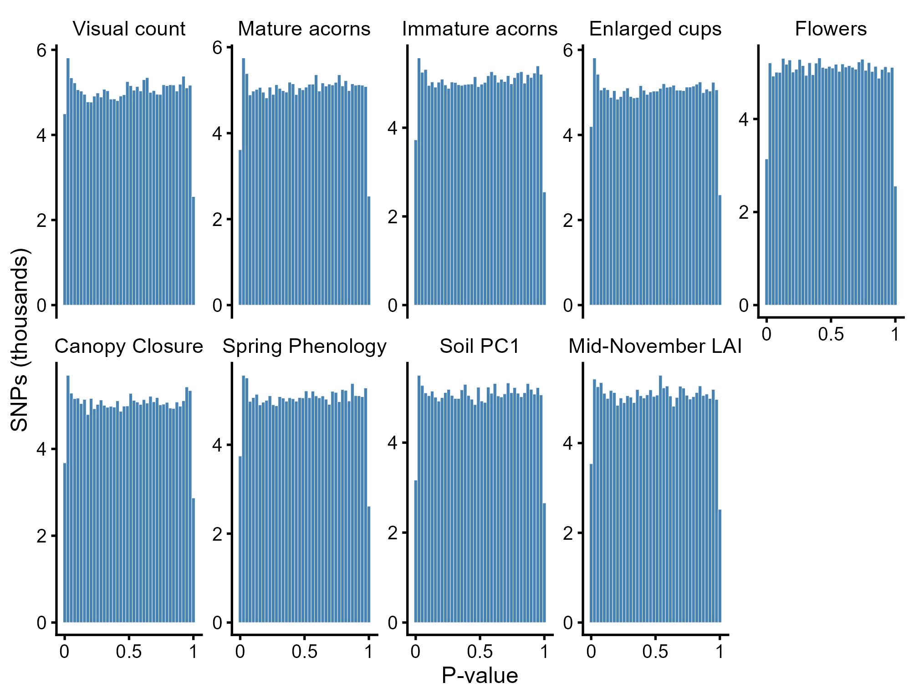

``` r
save_fig(hist_panel(res$q, "Q-value", "darkorange"), "SuppFig16b_Q_distributions",
         width = 170, height = 130)
```

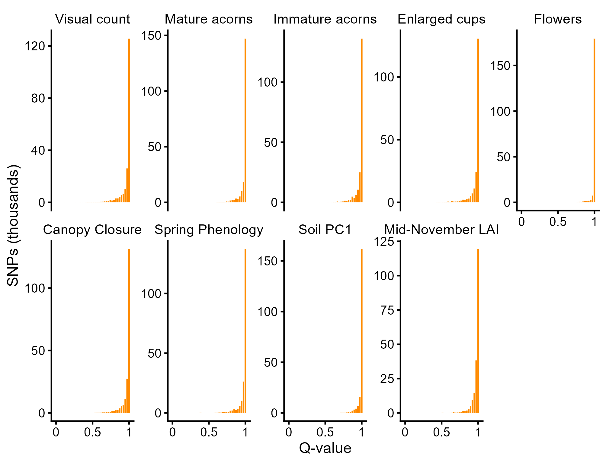

## Figure 5 and Supplementary Figure 17: Manhattan plots

Positions are plotted within chromosomes 1–12 (unplaced scaffolds
omitted); the red dashed line marks Q = 0.05. On each chromosome, the
most significant SNP within a coding sequence is labelled with the
symbol of the gene’s best *A. thaliana* hit.

``` r
chr_n <- suppressWarnings(as.integer(sub("Qrob_Chr0?", "", loci$CHROM)))
manhattan <- function(trait) {
  qv <- res$q[, trait]
  sig_i <- which(qv < 0.05 & !is.na(chr_n))
  set.seed(42)
  bg_i <- sample(setdiff(which(!is.na(chr_n)), sig_i), 1e5)
  d <- tibble(idx = c(bg_i, sig_i), chr = chr_n[idx], pos = loci$POS[idx] / 1e6,
              lq = -log10(qv[idx]), sig = idx %in% sig_i) |>
    left_join(select(snp_cds, idx, symbol), by = "idx")
  # label the most significant annotated SNP on each chromosome
  lab <- d |> filter(sig, !is.na(symbol)) |> group_by(chr) |>
    slice_max(lq, n = 1, with_ties = FALSE) |> ungroup()
  ggplot(d, aes(pos, lq)) +
    geom_point(data = filter(d, !sig), colour = "grey75", size = 0.2) +
    geom_point(data = filter(d, sig), colour = "steelblue", size = 0.7) +
    geom_hline(yintercept = -log10(0.05), linetype = "dashed", colour = "firebrick", linewidth = 0.4) +
    geom_text_repel(data = lab, aes(label = symbol), size = 2.2, min.segment.length = 0,
                    segment.size = 0.25, nudge_y = 0.6, max.overlaps = Inf, direction = "both",
                    fontface = "italic") +
    facet_grid(~ chr, scales = "free_x", space = "free_x", switch = "x") +
    scale_y_continuous(expand = expansion(mult = c(0, 0.15))) +
    coord_cartesian(clip = "off") +
    labs(x = "Chromosome", y = expression(-log[10](italic(Q))), title = trait) +
    theme(axis.text.x = element_blank(), axis.ticks.x = element_blank(),
          panel.spacing.x = unit(0.08, "lines"), strip.placement = "outside",
          strip.text.x = element_text(size = 7),
          panel.border = element_rect(colour = "grey85", fill = NA),
          plot.title = element_text(size = 9, face = "bold"),
          plot.margin = margin(4, 8, 2, 8))
}

# one file per variable
for (tr in PHENOTYPES)  save_fig(manhattan(tr), paste0("Figure5_", tr), width = 170, height = 55)
```

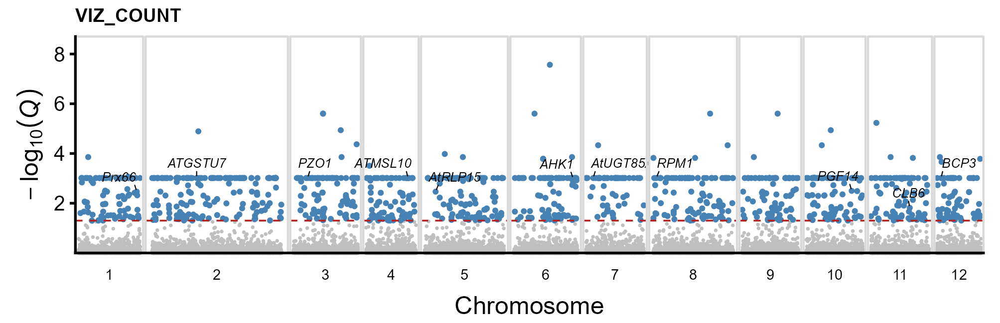

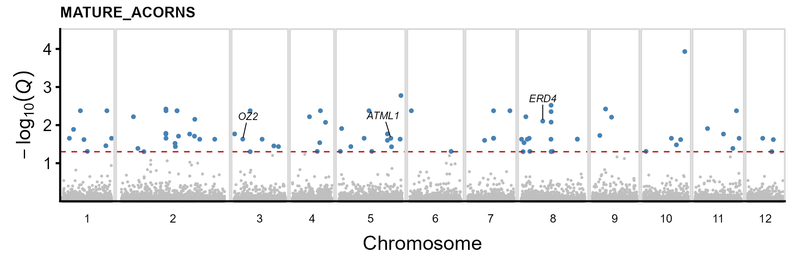

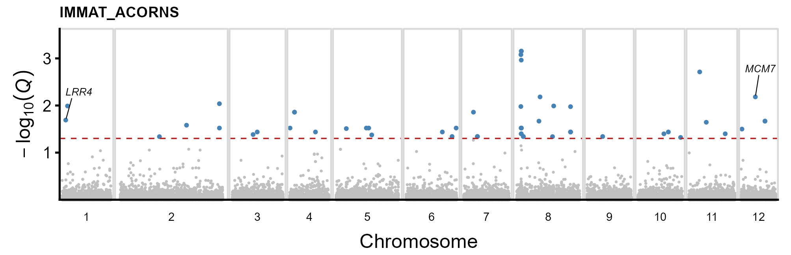

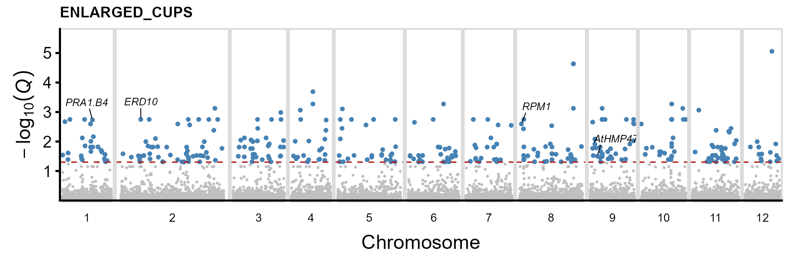

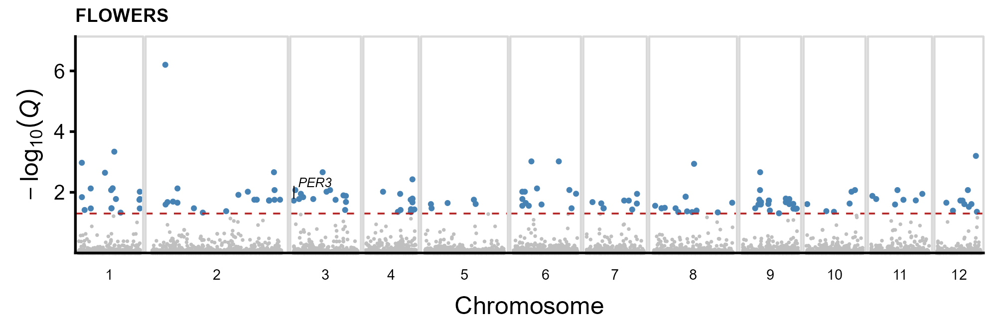

``` r
for (tr in ENVIRONMENT) save_fig(manhattan(tr), paste0("SuppFig17_", tr), width = 170, height = 55)
```

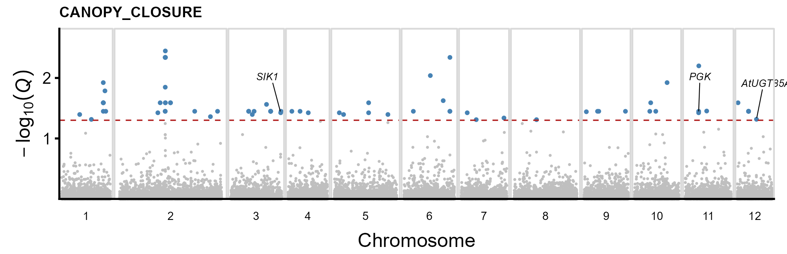

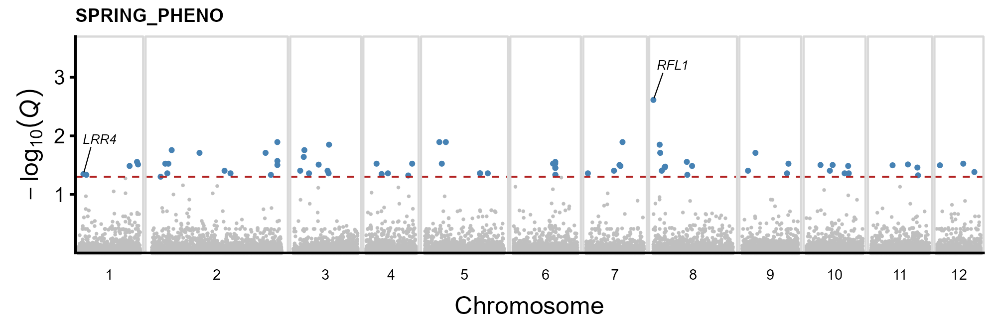

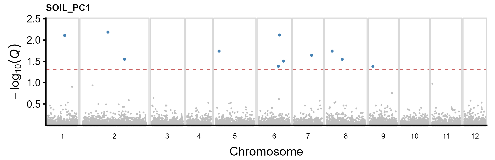

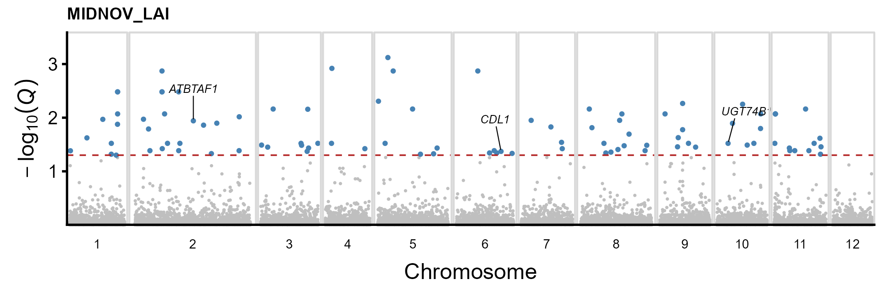

# Gene-set enrichment (Supplementary Table 16)

Genes on the 12 chromosomes are ranked by the GWAS score −log₁₀(P) of
the most significant SNP within their coding sequence. Because the sign
of an LFMM Z-score depends on which allele is coded, the score is
unsigned and the test one-sided (`scoreType = "pos"`). Gene sets are
tested with `gseGO` (all GO ontologies) and `gseKEGG`
(`clusterProfiler`); Benjamini–Hochberg adjusted P \< 0.05.

``` r
gsea_cache <- file.path(DIR_CACHE, "gwas", "gsea_results.rds")
vars_md5 <- unname(tools::md5sum(f_vars))
cached <- if (file.exists(gsea_cache)) readRDS(gsea_cache) else NULL
if (!is.null(cached) && identical(cached$vars_md5, vars_md5)) {
  gsea <- cached$gsea
} else {
  gene_scores <- snp_cds |> filter(!is.na(tair_locus), !is.na(chr_n[idx])) |>
    select(idx, tair_locus)
  gsea <- map(set_names(GWAS_VARS), function(tr) {
    s <- gene_scores |>
      mutate(score = -log10(res$p[idx, tr])) |>
      group_by(tair_locus) |> slice_max(score, n = 1, with_ties = FALSE) |> ungroup()
    ranked <- sort(setNames(s$score, s$tair_locus), decreasing = TRUE)
    go <- tryCatch(as_tibble(gseGO(ranked, OrgDb = org.At.tair.db, keyType = "TAIR", ont = "ALL",
                                   minGSSize = 5, maxGSSize = 500, pvalueCutoff = 0.05,
                                   eps = 0, scoreType = "pos", seed = TRUE, verbose = FALSE)),
                   error = function(e) NULL)
    # KEGG gene identifiers for A. thaliana are TAIR locus codes
    kegg <- tryCatch(as_tibble(gseKEGG(ranked, organism = "ath", keyType = "kegg",
                                       minGSSize = 5, maxGSSize = 500, pvalueCutoff = 0.05,
                                       eps = 0, scoreType = "pos", seed = TRUE, verbose = FALSE)),
                     error = function(e) tibble(error = conditionMessage(e)))
    list(go = go, kegg = kegg)
  })
  saveRDS(list(vars_md5 = vars_md5, gsea = gsea), gsea_cache)
}

go_all <- imap_dfr(gsea, ~ if (!is.null(.x$go) && nrow(.x$go)) mutate(.x$go, trait = .y)) |>
  bind_rows(tibble(trait = character(), ONTOLOGY = character(), ID = character(),
                   Description = character(), setSize = integer(), enrichmentScore = double(),
                   NES = double(), pvalue = double(), p.adjust = double(), core_enrichment = character()))
kegg_all <- imap_dfr(gsea, ~ if (!is.null(.x$kegg) && "ID" %in% names(.x$kegg) && nrow(.x$kegg))
                                mutate(.x$kegg, trait = .y)) |>
  bind_rows(tibble(trait = character()))
# gseKEGG downloads the KEGG annotation; stop if that failed for any variable
kegg_failed <- names(Filter(\(x) "error" %in% names(x$kegg), gsea))
if (length(kegg_failed))
  stop("KEGG enrichment failed for: ", paste(kegg_failed, collapse = ", "),
       ". Delete ", gsea_cache, " and render again with internet access.")

tibble(trait = GWAS_VARS,
       GO_terms = map_int(GWAS_VARS, ~ sum(go_all$trait == .x)),
       KEGG_pathways = map_int(GWAS_VARS, ~ sum(kegg_all$trait == .x))) |> knitr::kable()

st16 <- go_all |> filter(trait == "VIZ_COUNT") |>
  select(ONTOLOGY, ID, Description, setSize, enrichmentScore, NES, pvalue, p.adjust, core_enrichment) |>
  arrange(p.adjust)
save_tab(st16, "SuppTable16_GO_enrichment_visual_count")
knitr::kable(select(st16, -core_enrichment), digits = 5)
save_tab(select(go_all, trait, everything()), "GSEA_GO_all_variables")
if (nrow(kegg_all)) save_tab(select(kegg_all, trait, everything()), "GSEA_KEGG_all_variables")
```

| trait          | GO_terms | KEGG_pathways |
|:---------------|---------:|--------------:|
| VIZ_COUNT      |        6 |             0 |
| MATURE_ACORNS  |       11 |             1 |
| IMMAT_ACORNS   |       10 |             0 |
| ENLARGED_CUPS  |        1 |             0 |
| FLOWERS        |       28 |             0 |
| CANOPY_CLOSURE |       16 |             0 |
| SPRING_PHENO   |       33 |             0 |
| SOIL_PC1       |       27 |             0 |
| MIDNOV_LAI     |       18 |             0 |

| ONTOLOGY | ID | Description | setSize | enrichmentScore | NES | pvalue | p.adjust |
|:---|:---|:---|---:|---:|---:|---:|---:|
| BP | <GO:0006952> | defense response | 436 | 0.43999 | 1.27349 | 2e-05 | 0.01333 |
| BP | <GO:0043207> | response to external biotic stimulus | 464 | 0.43672 | 1.26678 | 2e-05 | 0.01333 |
| BP | <GO:0051707> | response to other organism | 464 | 0.43672 | 1.26678 | 2e-05 | 0.01333 |
| BP | <GO:0044419> | biological process involved in interspecies interaction between organisms | 468 | 0.43591 | 1.26460 | 2e-05 | 0.01333 |
| BP | <GO:0009607> | response to biotic stimulus | 466 | 0.43486 | 1.26152 | 2e-05 | 0.01333 |
| MF | <GO:0016301> | kinase activity | 463 | 0.43137 | 1.25105 | 5e-05 | 0.02312 |

# Key results

``` r
key04 <- tribble(
  ~Statistic, ~Value,
  "Sequenced trees", as.character(nrow(seq_stats)),
  "Raw bases, mean (SD) Gb", sprintf("%.2f (%.2f)", mean(seq_stats$Raw_bases_Gb), sd(seq_stats$Raw_bases_Gb)),
  "SNPs analysed", format(n_snps, big.mark = ","),
  "Leading PCs above broken stick", as.character(n_sig_pc),
  "Variance explained, PC1 (%)", sprintf("%.1f", pve$pve[1]),
  "sNMF minimum cross-entropy K", names(which.min(ce_mean)),
  "Kinship classes (>3° / 3° / 2° / 1°, %)", paste(sprintf("%.2f", 100 * prop.table(table(kin_pairs$Class))[c(">3°", "3°", "2°", "1°")]), collapse = " / "),
  "Soil PC1 variance (%)", sprintf("%.1f", soil_pve[1]),
  "Trait–SNP associations / unique SNPs", sprintf("%d / %d", nrow(sig), nrow(distinct(sig, CHROM, POS))),
  "Significant SNPs per variable", paste(sprintf("%s %d", st15$trait, st15$`Significant SNPs`), collapse = "; "),
  "Lambda range", sprintf("%.4f–%.4f", min(st14b$lambda), max(st14b$lambda)),
  "Shared VIZ_COUNT × CANOPY_CLOSURE SNPs", paste(with(filter(shared, Pair == "VIZ_COUNT × CANOPY_CLOSURE"),
                                                      paste0(CHROM, ":", POS, ifelse(in_CDS, " (CDS)", " (non-coding)"))), collapse = "; "),
  "GO terms for VIZ_COUNT (Q < 0.05)", as.character(nrow(st16)),
  "KEGG pathways (any variable, Q < 0.05)", as.character(nrow(kegg_all))
)
save_tab(key04, "key_results_04_genomic_associations")
knitr::kable(key04)
```

| Statistic | Value |
|:---|:---|
| Sequenced trees | 37 |
| Raw bases, mean (SD) Gb | 51.16 (6.35) |
| SNPs analysed | 1,013,644 |
| Leading PCs above broken stick | 0 |
| Variance explained, PC1 (%) | 3.0 |
| sNMF minimum cross-entropy K | 1 |
| Kinship classes (\>3° / 3° / 2° / 1°, %) | 67.87 / 26.28 / 5.56 / 0.30 |
| Soil PC1 variance (%) | 95.4 |
| Trait–SNP associations / unique SNPs | 2366 / 2306 |
| Significant SNPs per variable | VIZ_COUNT 1322; MATURE_ACORNS 102; IMMAT_ACORNS 61; ENLARGED_CUPS 399; FLOWERS 178; CANOPY_CLOSURE 83; SPRING_PHENO 100; SOIL_PC1 11; MIDNOV_LAI 110 |
| Lambda range | 1.0068–1.0616 |
| Shared VIZ_COUNT × CANOPY_CLOSURE SNPs | Qrob_Chr07:48460945 (non-coding); Qrob_H2.3_Sc0001141:9015 (non-coding) |
| GO terms for VIZ_COUNT (Q \< 0.05) | 6 |
| KEGG pathways (any variable, Q \< 0.05) | 1 |

``` r
sessionInfo()
```

    #> R version 4.5.2 (2025-10-31 ucrt)
    #> Platform: x86_64-w64-mingw32/x64
    #> Running under: Windows 11 x64 (build 26200)
    #> 
    #> Matrix products: default
    #>   LAPACK version 3.12.1
    #> 
    #> locale:
    #> [1] LC_COLLATE=English_United Kingdom.utf8 
    #> [2] LC_CTYPE=English_United Kingdom.utf8   
    #> [3] LC_MONETARY=English_United Kingdom.utf8
    #> [4] LC_NUMERIC=C                           
    #> [5] LC_TIME=English_United Kingdom.utf8    
    #> 
    #> time zone: Europe/London
    #> tzcode source: internal
    #> 
    #> attached base packages:
    #> [1] stats4    stats     graphics  grDevices utils     datasets  methods  
    #> [8] base     
    #> 
    #> other attached packages:
    #>  [1] org.At.tair.db_3.22.0  AnnotationDbi_1.72.0   Biobase_2.70.0        
    #>  [4] clusterProfiler_4.18.4 rtracklayer_1.70.1     GenomicRanges_1.62.1  
    #>  [7] Seqinfo_1.0.0          IRanges_2.44.0         S4Vectors_0.48.0      
    #> [10] BiocGenerics_0.56.0    generics_0.1.4         vegan_2.7-3           
    #> [13] permute_0.9-10         ggrepel_0.9.8          data.table_1.18.2.1   
    #> [16] ggcorrplot_0.1.4.1     DHARMa_0.5.0           emmeans_2.0.3         
    #> [19] multcomp_1.4-30        TH.data_1.1-5          MASS_7.3-65           
    #> [22] survival_3.8-3         mvtnorm_1.4-0          broom.mixed_0.2.9.7   
    #> [25] lme4_2.0-1             Matrix_1.7-4           car_3.1-5             
    #> [28] carData_3.0-6          iml_0.11.4             ranger_0.18.0         
    #> [31] VSURF_1.2.1            patchwork_1.3.2        readxl_1.4.5          
    #> [34] lubridate_1.9.4        forcats_1.0.1          stringr_1.6.0         
    #> [37] dplyr_1.1.4            purrr_1.2.2            readr_2.1.6           
    #> [40] tidyr_1.3.1            tibble_3.3.0           ggplot2_4.0.1         
    #> [43] tidyverse_2.0.0       
    #> 
    #> loaded via a namespace (and not attached):
    #>   [1] fs_1.6.7                    matrixStats_1.5.0          
    #>   [3] bitops_1.0-9                enrichplot_1.30.5          
    #>   [5] httr_1.4.8                  RColorBrewer_1.1-3         
    #>   [7] doParallel_1.0.17           ggsci_4.2.0                
    #>   [9] tools_4.5.2                 backports_1.5.0            
    #>  [11] R6_2.6.1                    lazyeval_0.2.2             
    #>  [13] mgcv_1.9-3                  withr_3.0.2                
    #>  [15] cli_3.6.5                   textshaping_1.0.5          
    #>  [17] scatterpie_0.2.6            sandwich_3.1-1             
    #>  [19] labeling_0.4.3              S7_0.2.1                   
    #>  [21] randomForest_4.7-1.2        Rsamtools_2.26.0           
    #>  [23] systemfonts_1.3.2           yulab.utils_0.2.4          
    #>  [25] gson_0.1.0                  DOSE_4.4.0                 
    #>  [27] R.utils_2.13.0              parallelly_1.47.0          
    #>  [29] RSQLite_2.4.6               gridGraphics_0.5-1         
    #>  [31] BiocIO_1.20.0               vroom_1.7.0                
    #>  [33] GO.db_3.22.0                abind_1.4-8                
    #>  [35] R.methodsS3_1.8.2           lifecycle_1.0.5            
    #>  [37] yaml_2.3.12                 SummarizedExperiment_1.40.0
    #>  [39] qvalue_2.42.0               SparseArray_1.10.9         
    #>  [41] grid_4.5.2                  blob_1.3.0                 
    #>  [43] qgam_2.0.0                  promises_1.5.0             
    #>  [45] crayon_1.5.3                ggtangle_0.1.2             
    #>  [47] lattice_0.22-7              cowplot_1.2.0              
    #>  [49] cigarillo_1.0.0             KEGGREST_1.50.0            
    #>  [51] pillar_1.11.1               knitr_1.51                 
    #>  [53] fgsea_1.36.2                rjson_0.2.23               
    #>  [55] boot_1.3-32                 estimability_1.5.1         
    #>  [57] codetools_0.2-20            fastmatch_1.1-8            
    #>  [59] glue_1.8.0                  ggiraph_0.9.6              
    #>  [61] ggfun_0.2.0                 fontLiberation_0.1.0       
    #>  [63] treeio_1.34.0               vctrs_0.7.3                
    #>  [65] png_0.1-9                   Rdpack_2.6.6               
    #>  [67] cellranger_1.1.0            gtable_0.3.6               
    #>  [69] cachem_1.1.0                xfun_0.57                  
    #>  [71] rbibutils_2.4.1             S4Arrays_1.10.1            
    #>  [73] mime_0.13                   coda_0.19-4.1              
    #>  [75] reformulas_0.4.4            iterators_1.0.14           
    #>  [77] gap_1.15.2                  nlme_3.1-168               
    #>  [79] ggtree_4.0.5                bit64_4.6.0-1              
    #>  [81] fontquiver_0.2.1            otel_0.2.0                 
    #>  [83] rpart_4.1.24                DBI_1.3.0                  
    #>  [85] tidyselect_1.2.1            bit_4.6.0                  
    #>  [87] compiler_4.5.2              curl_7.0.0                 
    #>  [89] fontBitstreamVera_0.1.1     DelayedArray_0.36.0        
    #>  [91] checkmate_2.3.4             scales_1.4.0               
    #>  [93] rappdirs_0.3.4              digest_0.6.39              
    #>  [95] minqa_1.2.8                 rmarkdown_2.30             
    #>  [97] XVector_0.50.0              htmltools_0.5.9            
    #>  [99] pkgconfig_2.0.3             MatrixGenerics_1.22.0      
    #> [101] fastmap_1.2.0               htmlwidgets_1.6.4          
    #> [103] rlang_1.2.0                 shiny_1.13.0               
    #> [105] farver_2.1.2                jsonlite_2.0.0             
    #> [107] zoo_1.8-15                  BiocParallel_1.44.0        
    #> [109] GOSemSim_2.36.0             R.oo_1.27.1                
    #> [111] RCurl_1.98-1.18             magrittr_2.0.4             
    #> [113] Formula_1.2-5               ggplotify_0.1.3            
    #> [115] Rcpp_1.1.1                  ape_5.8-1                  
    #> [117] ggnewscale_0.5.2            gdtools_0.5.0              
    #> [119] furrr_0.4.0                 stringi_1.8.7              
    #> [121] Metrics_0.1.4               plyr_1.8.9                 
    #> [123] parallel_4.5.2              listenv_0.10.1             
    #> [125] Biostrings_2.78.0           splines_4.5.2              
    #> [127] hms_1.1.4                   igraph_2.3.2               
    #> [129] reshape2_1.4.5              XML_3.99-0.23              
    #> [131] evaluate_1.0.5              tweenr_2.0.3               
    #> [133] nloptr_2.2.1                tzdb_0.5.0                 
    #> [135] foreach_1.5.2               httpuv_1.6.17              
    #> [137] polyclip_1.10-7             future_1.70.0              
    #> [139] ggforce_0.5.0               broom_1.0.12               
    #> [141] gap.datasets_0.0.6          xtable_1.8-8               
    #> [143] restfulr_0.0.16             tidytree_0.4.7             
    #> [145] tidydr_0.0.6                later_1.4.8                
    #> [147] viridisLite_0.4.2           ragg_1.5.1                 
    #> [149] aplot_0.3.0                 memoise_2.0.1              
    #> [151] GenomicAlignments_1.46.0    cluster_2.1.8.1            
    #> [153] timechange_0.3.0            globals_0.19.1
